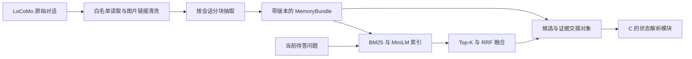

# 系统设计、编码与测试说明（B 供稿）

里程碑 4｜供稿：鲁瑞特｜2026-10-14。

本文是 B 的记忆与检索章节，供张崇洋合并进中期文档。组长最新安排为 10/21 前完成基础前后端、10/23 前补全本文；系统其他模块由对应负责人供稿。本文不表示整套系统已经端到端验收。

## B.1 设计目标与模块边界

对应 SRS FR-01–FR-07：将单段 LoCoMo 原始对话转换为可追溯的事实集合，再为推理模块提供候选和原始证据。B 保留历史状态；状态关系判定、有效记忆选择和答案生成属于 C。

不将 QA 标注区、标准答案、gold evidence 或标注摘要送入构建/索引。在线问题由调用方单独传入。

## B.2 数据结构和持久化

共享契约由 `src/common/models.py` 定义，禁止额外字段、非法数值和跨对话引用。完整字段见 [interfaces.md](interfaces.md)，本节只说明设计决策。

| 决策 | 原因与影响 |
| --- | --- |
| Memory 保留 content、实体/属性/值、事件时间、来源 | 不确定的信息留空，事实原文与结构化值可互相核对 |
| SourceTurn 与 Memory 分开 | 摘要不能替代原始证据；同一轮次可支持多个事实 |
| session_time 与 event_time 分开 | 发言时间不等于事件发生时间，避免虚假时间顺序 |
| build_id 绑定输入、配置与结果 | 换数据、模型或抽取结果后不能继续使用旧索引或旧引用 |
| JSON 原子替换并重新校验 | 导出失败保留原文件，不让半写入结果被下游读取 |
| embedding 只放索引缓存 | Memory JSON 保持轻量且独立于特定向量模型 |

## B.3 抽取与失败处理

读取器按会话编号、原始轮次顺序遍历，不读取标注派生内容。默认每块不跨会话，最多 20 轮、12000 文本字符；超限单轮报错，不截断证据。DeepSeek 返回事实列表后，先校验字段、时间精度、来源存在性及顺序，再写块缓存。

默认最多 3 次尝试，瞬时网络失败、429、5xx、非法 JSON 或截断输出在上限内重试；鉴权等永久 HTTP 错误直接失败。失败时不输出完整成功 bundle，已完成块可复用。日志不打印密钥或 HTTP 响应正文。实际远端抽取效果必须另做质量核对，Mock 只验证请求和失败行为。

## B.4 检索与交接

BM25 在内存构建；向量编码使用固定 revision 的 MiniLM 和 384 维归一化向量。查询和事实使用同一编码器。超出模型 256 token 上限报错，避免静默截断。向量缓存身份绑定构建、完整 bundle、模型/依赖/设备和记忆顺序，并校验维数及有限数值。

候选先按对话及显式实体/属性过滤，再各取 candidate_k；混合检索以 Memory ID 去重，按 `sum(1/(60+rank))` 合并。同分按 ID 稳定排序。模型失败不会自动降级为关键词检索。实体与属性为精确匹配，未知时不建议添加过滤。

`src/index/context.py` 将初始检索结果、构建信息、来源和可选关联历史打包。历史只在调用方显式要求时加入独立字段；来源从同一索引快照读取。输出对象的修改不影响原始存储。这样 C 可推理、D 可展示、E 可对齐初始 Top-K 证据，同时保留各自职责。

## B.5 需求、实现与测试追踪

| 需求 | 实现 | 自动化测试文件与代表用例 | 仍需的外部验收 |
| --- | --- | --- | --- |
| FR-01 清洗与隔离 | `memory/locomo.py` | `test_memory_pipeline.py`：input_whitelist_and_chronology、label_changes_do_not_change_build | 课程实际文件适配 |
| FR-02 抽取 | `memory/build.py`、`extract.py` | 同上：build_with_mocked_deepseek、bad_sources_retry_without_polluting_cache、transient_or_invalid_response_recovers | 真实 API、事实与时间质量核对 |
| FR-03 导出与版本 | `common/models.py`、`memory/store.py` | 同上：bundle_roundtrip_and_stable_build、failed_save_preserves_previous_file、filter_before_top_k_and_snapshot | 消费方按 build_id 对齐 |
| FR-04 关键词检索 | `index/bm25.py` | 同上：retrieval_ranking_filters_and_isolation、invalid_requests | 开发集召回评测 |
| FR-05 向量检索 | `index/embeddings.py` | `test_vector_retrieval.py`：向量排名、缓存、维度/长度/数值等用例 | 真实模型运行与开发集效果 |
| FR-06 混合检索 | `index/bm25.py` | `test_vector_retrieval.py`：RRF 去重、排名、通道信息等用例 | E 的正式对照实验 |
| FR-07 原文与历史 | `memory/store.py`、`index/context.py` | `test_reasoning_context.py`：history_preserves_top_k_and_has_all_original_evidence、opt_in_history_empty_candidates_and_truncation、saved_bundle_to_consumer_cli | C 的真实推理调用、D 的页面展示 |

运行 `python -m pytest -q`、`python -m ruff check .`、`python -m ruff format --check .`。模型单元测试使用显式 Mock/测试编码器，不产生真实调用费用。真实模型运行、设备、规模、结果及未完成项统一见 [本次交付记录](../process/2026-10-14-b-delivery.md)，不把历史测试次数当本次证据。

## B.6 局限与后续工作

抽取按块进行，跨块代词、实体别名归并和复杂时间区间尚未实现；未知字段保留 null。逐轮基线没有语义抽取能力。一个公开样例检索成功不能证明开发集指标达标。结构化交接入口经过消费契约测试，仍需要 C 的真实模块进行集成；目前不能声称已生成最终答案。

Python 3.11 和 macOS 的实际验收需要相应环境；本机其他 Python 版本的通过不替代双平台验收。正式课程接口、对话划分和评测口径由 A/E 对齐后记录。
