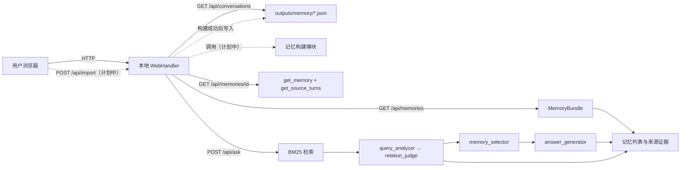

# 系统设计、编码与测试报告

> 6767 组｜里程碑 4｜主笔：张崇洋｜依据：[SRS](srs.md)、[接口](interfaces.md)

## 1 总体设计

（陈易）

### 1.1 设计目标与边界

系统把 LoCoMo 长对话转换为带原始证据和版本信息的结构化 Memory，并在回答问题时先检索相关历史、再判定记忆之间的状态关系，只把仍然有效的记忆交给模型生成答案。总体目标是把“记忆构建、候选检索、状态解析、答案生成、证据展示与评测”拆成接口清晰的独立模块，使各模块可以分别实现、测试和替换。

本期范围为单段对话内的文本记忆；不包含多模态、跨对话共享记忆、模型训练、面向公网的部署。Web 和评测入口属于同一问答流水线的消费端，不直接修改 Memory。

### 1.2 总体架构

```text
【离线构建】
locomo.json
  └─ memory.locomo：读取、清洗文本并保留 source turn
      └─ memory.build / extract：按会话分块，调用 DeepSeek 抽取事实
          └─ MemoryBundle：Memory + 来源 + build_id，校验后保存为 JSON
              └─ index：建立 BM25 与 MiniLM 向量索引

【在线问答】
question ─┬─ index.search：BM25 + 向量召回 → RRF 去重排序 → Top-K
          └─ reasoning.query_analyzer：识别人物、属性、时间范围
                  ↓
          reasoning.relation_judge：判定 RETAIN / UPDATE / SUPERSEDE / CONFLICT
                  ↓
          reasoning.memory_selector：选择当前有效 Memory
                  ↓
          reasoning.answer_generator：调用 DeepSeek → AnswerRecord

【消费端】
web：本地 HTTP 服务展示 Memory、原始证据、关系与答案
eval（规划中）：批量调用同一问答流水线，计算指标并运行基线
```

架构采用“离线构建 + 在线检索解析”的分层方式。离线阶段完成代价较高的事实抽取和索引建立；在线阶段只处理当前问题及其候选记忆。检索与状态解析分离，使 Recall@K 可以单独评价；状态解析与答案生成分离，使关系判断错误不会与生成错误混在一起。

### 1.3 模块划分与接口

| 模块 | 负责人 | 主要输入 | 主要输出 |
| --- | --- | --- | --- |
| `common/` | 陈易协调 | 各模块共享字段 | Pydantic 数据契约、JSON 读写、统一错误语义 |
| `memory/` | 鲁瑞特 | LoCoMo 对话、会话时间 | `MemoryBundle`、原始来源轮次 |
| `index/` | 鲁瑞特 | `MemoryBundle`、问题与 K | BM25/向量候选、`RetrievalResult` |
| `reasoning/` | 于国庆 | 问题、`RetrievalResult` | `QueryAnalysisResult`、`MemoryRelation`、`AnswerRecord` |
| `web/` | 许子萌 | MemoryBundle、用户问题 | 本地 HTTP 接口与记忆、证据、问答和状态关系页面 |
| `eval/` | 张崇洋 | 问题集、标准答案与证据 | 三指标结果、基线对照（规划中） |

模块之间以数据对象和函数接口协作，不直接依赖彼此内部实现。`MemoryBundle`、`SourceRef`、`RetrievalResult`、`MemoryRelation` 和 `AnswerRecord` 定义在 `common/models.py`；字段级契约以 [interfaces.md](interfaces.md) 为准，变更接口时须通知所有消费方。

### 1.4 端到端数据流与一致性

1. **构建**：只向抽取模型提供清洗后的原始轮次；QA、标准答案和 gold evidence 不进入构建、索引或模型输入。
2. **版本化**：每次构建记录 `build_id`、输入哈希、模型与 prompt 版本；索引、检索结果、状态判断和答案必须引用同一构建。
3. **保留历史**：构建阶段保留新旧事实，不提前删除旧状态；是否有效由在线阶段的 Query 分析结果和关系判定决定。
4. **证据回溯**：每条 Memory 保存 `(session_id, turn_id)` 来源；Web 和评测通过来源轮次定位原文或对齐 gold evidence。
5. **错误处理**：空结果返回空集合；非法输入、版本不匹配、来源缺失等按 `interfaces.md` 明确报错，不静默降级或伪造成功结果。

### 1.5 关键设计决策

| 决策 | 原因 |
| --- | --- |
| 离线构建与在线问答分离 | 避免每次提问重复抽取和建索引，并保证构建结果可复现 |
| 保留历史事实，查询时判定是否有效 | 过去的问题仍可能需要旧状态，不能在构建时永久覆盖历史 |
| BM25 + 向量检索并用 RRF 融合 | 同时覆盖名称、属性等字面匹配和不同表达的语义匹配 |
| 先判定候选记忆关系，再生成答案 | 避免把过期记忆直接交给生成模型，并在中间阶段定位错误 |
| JSON 作为首版存储与模块边界 | 降低数据库和部署复杂度，便于课程交付、调试与证据检查 |
| 本地 MiniLM、远端 DeepSeek | 向量计算可离线复用；语义抽取、关系判断和答案生成使用统一模型接口 |

## 2 详细设计

### 2.1 记忆与检索

（鲁瑞特；对应 FR-01 至 FR-07）

**构建流程与数据结构。** `memory.locomo` 按对话 ID 读取原始会话，保留轮次顺序、说话人、会话时间和来源 ID，过滤图片链接与空文本；仅将白名单字段交给抽取器，QA、标准答案及标注摘要不进入构建。`memory.build` 按会话分块，默认每块最多 20 轮、12000 字符；单轮超限直接报错，不截断证据。`deepseek` 模式调用官方接口抽取原子事实，`turns` 模式仅逐轮保存文本，并以 `turn_baseline` 明确标记，供离线验证使用。

Memory 保存 `content`、`entity/attribute/value`、`session_time`、`event_time`、`time_expression` 和 `sources`。会话时间与事件时间分别保存，未知字段为空；新旧状态均保留，由 C 在查询时判断有效性。仅字段及来源完全相同的事实去重，不进行实体别名归并或相似事实合并。`MemoryBundle` 汇总 Memory、原始轮次、schema 版本及 `build_info`；构建身份记录输入哈希、配置、模型与 prompt 版本，外部引用使用对话 ID、`build_id` 和 Memory ID。保存前校验唯一 ID、来源及时间一致性，通过后原子写入 UTF-8 JSON，读取时重新校验。

**检索与交接。** `build_index` 为单个 bundle 建立独立快照；`search_memories` 返回带构建身份的 `RetrievalResult`。BM25 使用内容、实体、属性和值建立词项统计；向量通道使用固定 revision 的本地 MiniLM 编码内容和问题，以余弦相似度排序。混合模式两路各取 `candidate_k`，按 Memory ID 去重，以 `sum(1 / (60 + rank))` 做等权 RRF，最终返回 `top_k`，并保留各通道分数和排名。实体/属性精确过滤先于候选截取；相同分数按 Memory ID 排序，保证结果稳定。

`get_source_turns` 按来源引用回溯原文；`retrieve_context` 将初始检索、证据与可选关联历史序列化给消费方。关联历史必须由调用方明确指定实体和属性，单列返回并标记 `truncated`，不混入初始 Top-K，便于 E 独立计算检索指标。B 提供候选与证据，状态关系和答案由 C 生成。字段及接入示例见 [interfaces.md](interfaces.md) 与 [b-handoff.md](b-handoff.md)。

**缓存与失败处理。** 抽取缓存绑定输入、配置、模型和 prompt；向量缓存绑定 bundle 与编码器身份。非法模型输出、越界来源、截断响应和瞬时网络错误有界重试，默认最多 3 次；认证失败立即报错。构建失败保留已验证块缓存，不导出完整成功结果；损坏缓存不触发隐式付费重试。非法查询、跨对话请求、版本不匹配、模型缺失、向量维度或数值非法均明确失败；混合检索任一路失败时不静默降级。MiniLM 输入超过模型 token 上限时拒绝编码，避免截断事实。合法空对话和无匹配结果返回空集合。

上述设计已实现并通过离线/Mock 测试；真实 DeepSeek 语义抽取质量、正式开发集召回效果与消费方完整联调仍待验收，不能用结构校验或逐轮基线代替。

### 2.2 状态解析与答案生成

### 2.2.1 模块定位

`reasoning/` 位于检索之后、答案生成之前，是本项目区别于 Vector RAG 的核心环节。它接收 `RetrievalResult`（候选 Memory 列表）和用户问题，输出 `AnswerRecord`（答案 + 有效记忆 ID + 冲突标记 + `build_id`）。

对外入口为 `src/reasoning/pipeline.py::answer(question, retrieval, question_id=None)`，内部依次调用四个模块：

| 文件                  | 职责                                                      |
| :-------------------- | :-------------------------------------------------------- |
| `query_analyzer.py`   | 调用 DeepSeek 抽取实体、时间视角、时间原文、属性与置信度  |
| `relation_judge.py`   | 对候选记忆按 `(entity, attribute)` 分组，两两判定四类关系 |
| `memory_selector.py`  | 按关系与 `time_scope` 选择当前有效记忆                    |
| `answer_generator.py` | 组装 prompt，调用 DeepSeek 生成一句话答案                 |

### 2.2.2 Query 分析

输出 `QueryAnalysisResult`，字段与 `common/models.py` 一致：`entity`、`time_scope`（`current` / `past` / `specific`）、`time_expression`、`attribute`、`confidence`，并携带 `conversation_id` 与 `build_id`。

设计要点：

- 使用 DeepSeek 官方接口，`response_format={"type": "json_object"}`，关闭 thinking。
- prompt 中给出 JSON 样例，避免返回空 content。
- 返回空 content 或 JSON 非法时重试 2 次；仍失败则抛出 `ValueError`。
- 401 / 402 错误直接抛出，不进入重试，避免浪费调用。

### 2.2.3 四类关系的判定

`relation_judge.judge_relations` 先按 `(entity, attribute)` 分组，**跳过 `entity` 或 `attribute` 为 null 的记忆**（turns 基线模式全部跳过，避免海量无意义调用）。仅在同组内两两比较，跨组记忆不产生关系记录，下游默认视为 RETAIN。

判定依据：时间顺序（`session_time` 与 `event_time`）、实体一致性、属性一致性、事件上下文。**不依赖语义相似度**。

四类关系的处理：

| 关系      | 判定含义                     | 后续处理                    |
| :-------- | :--------------------------- | :-------------------------- |
| RETAIN    | 两条可同时成立               | 均保留                      |
| UPDATE    | 后者补充或局部修改前者       | 交由 `memory_selector` 合并 |
| SUPERSEDE | 新记忆明确取代旧记忆         | 仅保留新值                  |
| CONFLICT  | 无法同时成立且无时间依据消解 | 双留并标记冲突              |

两条记忆的 `event_time` 与 `session_time` **均缺失**时，强制判为 CONFLICT，不调用模型，不推测时间先后。

输出 `MemoryRelation`，含 `memory_a`、`memory_b`、`relation_type`、`reason`、`sources`（按 `(session_id, turn_id)` 去重）。模型返回非法 JSON 时重试 2 次，仍失败则降级为 CONFLICT 并记录 `judge failed` 原因，不中断流水线。

### 2.2.4 有效记忆选择

`memory_selector.select_effective` 按关系过滤候选记忆：

- RETAIN、UPDATE、CONFLICT：保留
- SUPERSEDE：当 `time_scope != "past"` 时，丢弃 `memory_a`（旧值）
- `time_scope == "past"` 时，**不丢弃**被 SUPERSEDE 的旧记忆，保留给回溯性提问使用

这条规则对应 `memory-design.md` 中「询问过去状态时，旧事实仍可能是所需答案依据」。`has_conflict` 单独判断关系列表中是否存在 CONFLICT，供答案生成时决定是否附加冲突说明。

### 2.2.5 答案生成与异常处理

`answer_generator.generate_answer` 将有效记忆的内容逐条列出，冲突时附加 `[Note: conflicting information exists.]`，调用 DeepSeek 生成一句话答案。输出 `AnswerRecord`：

| 字段               | 含义                                          |
| :----------------- | :-------------------------------------------- |
| `answer`           | 一句话答案；空 content 时降级为 `(no answer)` |
| `valid_memory_ids` | 参与生成的有效记忆 ID                         |
| `conflict`         | 有效记忆集合是否存在冲突                      |
| `build_id`         | 与检索结果一致的构建版本                      |
| `question_id`      | 评测场景的题号，非评测为 null                 |

异常处理：模型返回空 content 时降级为 `(no answer)` 并记录，不中断批量评测。`build_id` 与当前 bundle 不一致时由上游检索模块抛 `RuntimeError`，本模块不重复校验。

### 2.3 Web 展示

（许子萌）

Web 采用 Python 标准库 `ThreadingHTTPServer` 提供本地 HTTP 服务，前端使用静态 HTML、CSS 与 JavaScript，不增加前端构建工具或运行时依赖。默认只绑定 `127.0.0.1:8000`。记忆文件从 `WEB_MEMORY_DIR` 指定目录读取，默认 `outputs/memory/`；每次请求按 `conversation_id` 加载并校验对应的 `MemoryBundle`，记忆 ID 只在该 bundle 内解析，避免将用户输入拼接为文件路径。



| 路由 | 输入 | 输出与行为 |
| --- | --- | --- |
| `GET /` | 无 | 返回单页应用；`/app.css`、`/app.js` 提供静态资源 |
| `GET /api/conversations` | 无 | 返回已校验的对话 ID、build_id 和 Memory 数量 |
| `GET /api/memories?conversation_id=...` | 对话 ID | 返回该 bundle 的 Memory 列表及 build_id |
| `GET /api/memories/{memory_id}?conversation_id=...` | 对话 ID、Memory ID | 使用 `get_memory` 和 `get_source_turns` 返回记忆与原始轮次 |
| `POST /api/ask` | 对话 ID、问题、可选 top_k | 使用 BM25 检索并调用现有 Query 分析、关系判定、有效记忆选择和答案生成，返回检索、关系与答案记录 |
| `POST /api/import`（计划中） | LoCoMo JSON 文件、可选 `sample_id` | 校验输入并调用记忆构建流程；成功后将 MemoryBundle 写入记忆目录并返回构建状态 |

页面由三部分组成：左栏按对话浏览并搜索记忆；选择记忆后显示来源轮次、说话人、会话时间和原文；问答区显示答案、引用的有效 Memory、记忆关系及关系判定理由。点选关系节点可跳转到其证据。空数据、无匹配项和错误请求均显示页面提示；后端不静默替换 bundle，也不在前端重新推断状态。

当前问答端使用 BM25，模型相关的查询分析、关系判断和答案生成需要本地 `.env` 中配置 DeepSeek API key；API 配置失败时向页面返回通用错误提示，不回传密钥或模型响应正文。当前实现为本地开发/课堂演示用途，不提供认证、跨域或公网部署能力。浏览记忆与证据不需要模型 API。

`examples/demo_dynamic_memory.json` 提供两条人工合成的状态变化记忆，可用于界面操作演示；其 `build_info.method` 标为 `manual_course_slide_example`，不得作为课程数据、自动抽取结果或评测证据。设 `WEB_MEMORY_DIR=examples` 后启动服务即可浏览。在线提问仍会调用 DeepSeek API。

**用户导入对话（FR-16，尚未实现）**：目标是在页面提供 JSON 文件选择与导入操作；服务端校验 LoCoMo 格式及 `sample_id`，调用 `src/memory/` 构建 MemoryBundle，成功后写入 `WEB_MEMORY_DIR` 指向的记忆目录并刷新对话列表。多 sample 文件需由用户指定要构建的 sample。抽取时只读取对话轮次，不能把 QA、gold evidence、observation 或摘要标注传给抽取器。当前页面没有上传控件，服务端没有导入路由，也没有把上传内容接到记忆构建流程；用户目前仍需在终端运行 `python -m src.memory.build`。FR-16 尚未实现、尚未测试和验收，不能将其描述为已完成。

**演示顺序**：启动 Web 服务并打开 `demo-state-change` → 选择“准备参加面试”记忆并展开 S1:1 原文 → 提问 `What is Alex's current adoption progress?` → 展示回答引用及两条记忆的状态关系 → 点击关系节点回看 S2:1 证据。该样例只演示交互与可解释性，关系标签和答案由运行时模型生成，不是预设评测结果。

### 2.4 评测接口

（张崇洋）

评测入口约定为：

```text
python -m src.eval.cli --conversation <conv_id> --questions <questions.json> --output answers.json
```

真实问答运行时另传 `--memory <memory.json>`，并在本地 `.env` 配置 `DEEPSEEK_API_KEY`；离线复核可用 `--answers-input` 读取已记录的答案、检索命中和关系标签，不调用模型。标准答案和 gold evidence 只用于评测，不传入记忆构建、索引或推理 prompt。

- M-1：对每题答案做英文词/数字和中文字符级 token F1，汇总宏平均。
- M-2：把初始 `retrieval.hits[:K]` 中每条 Memory 的 `sources.turn_id` 与 gold evidence 对齐；题目 Top-K 命中至少一条关键证据即记为 1，报告 Recall@1 和 Recall@5。关联历史不计入该指标。
- M-3：按题目或关系记录统计 RETAIN、UPDATE、SUPERSEDE、CONFLICT 的准确率，并输出四类混淆矩阵。
- 另记录每题 token 使用量，按 Full Text、Vector RAG、本组方法分别汇总平均值。


## 3 编码实现

（各负责人提供，陈易汇编）

- 环境与依赖：Python 3.11；依赖见 `requirements.txt`。Web 页面与 API 使用 Python 标准库，问答功能复用现有 `pydantic`、索引和推理依赖。
- B 模块实现：`src/memory/` 覆盖 FR-01 至 FR-03 的读取、抽取与持久化，`src/index/` 配合 `memory.store` 覆盖 FR-04 至 FR-07 的检索、融合与证据交接；共享契约位于 `src/common/`。基础依赖固定在 `requirements.txt`，向量可选依赖固定在 `requirements-vector.txt`，团队运行时基准由 `.python-version` 指定为 3.11。构建与交接命令见 [b-handoff.md](b-handoff.md)，当前离线验证环境及限制见第 4 节。
- 目录与需求映射：`src/web/server.py` 与 `src/web/static/` 当前实现 FR-12 至 FR-15（记忆浏览、证据回看、问题提交和关系展示）。FR-16（浏览器上传 LoCoMo JSON 并构建记忆）尚未实现；当前没有上传控件或导入 API。Memory 和证据读取复用 `src/memory/store.py`；检索复用 `src/index/bm25.py`；状态处理复用 `src/reasoning/`。
- 构建、配置和运行命令：先按项目命令构建 MemoryBundle，再执行 `python -m src.web.server`；默认打开 `http://127.0.0.1:8000`。默认加载 `outputs/memory/`，可用 `WEB_MEMORY_DIR`、`WEB_HOST`、`WEB_PORT` 覆盖。问答需配置 `DEEPSEEK_API_KEY`。
- 当前完成度及已知限制：Web 页面和本地 HTTP 路由已实现；本次交付记录中尚未执行 Web 手工验收或自动化测试。问答需本地 DeepSeek key；默认 BM25。逐轮 turns 基线缺少实体/属性，不能体现有意义的时态关系；课程真实数据上的端到端演示仍待实际运行确认。

## 4 现阶段测试结果

（张崇洋汇总）

本节只记录 M4 提交时实际完成并取得结果的测试，不作为最终验收结论。

**B 模块复核（2026-10-24）。** 在 Windows、Python 3.13.5 的本地 `.venv` 中，基于 `main` 提交 `92f12aa` 执行以下命令，54 项测试全部通过（0 失败），B 模块 Ruff 检查通过。团队基准 Python 3.11 与 macOS 尚未在本次复核中验证；其他模块的测试环境由对应负责人补充。

```powershell
.\.venv\Scripts\python.exe -m pytest -o addopts= tests/test_memory_pipeline.py tests/test_vector_retrieval.py tests/test_reasoning_context.py -q
.\.venv\Scripts\python.exe -m ruff check src/common src/memory src/index
```

上述 B 测试采用合成数据、Mock HTTP 响应与测试编码器，覆盖字段及来源校验、标签隔离、JSON 往返与失败写入保护、抽取重试与缓存、检索过滤与融合、向量缓存失效、历史截断、证据回溯及 CLI 消费链路，不调用真实 DeepSeek API。随后按 `requirements.txt` 补齐依赖，执行 `python -m pytest -o addopts= -q`，全量结果为 **74 passed、1 failed**：`test_judge_pair_deduplicates_sources` 进入实际关系判定 API，因本地占位密钥收到 HTTP 401；该测试未隔离真实请求，需由 C 补充 Mock 后复核。全仓 `ruff check .` 报 `src/web/server.py:102` 一处 E501；`ruff format --check .` 报 8 个既有文件待格式化。上述全仓问题与 B 的 54 项通过结果分别记录，不能声称全仓检查通过。

| 测试范围 | 已执行的测试 | 结果 | 证据位置 | 负责人 |
| --- | --- | --- | --- | --- |
| 数据结构与记忆构建 | 来源与时间校验、图片过滤、标注隔离、JSON 往返、稳定构建 ID、失败保护、Mock 抽取/重试/缓存、基础检索及离线 CLI | `test_memory_pipeline.py` 35 项通过；真实语义质量未验收 | `tests/test_memory_pipeline.py`；本节 2026-10-24 复核命令 | 鲁瑞特 |
| 检索与证据回溯 | 向量与 RRF 排序去重、过滤、缓存身份和损坏处理、非法向量、初始 Top-K 保持、关联历史、来源回溯与消费 CLI | `test_vector_retrieval.py` 12 项、`test_reasoning_context.py` 7 项通过；不代替 C 实际模块联调 | 对应两个测试文件；本节 2026-10-24 复核命令 | 鲁瑞特 |
| 状态解析与答案生成 | python -m pytest tests/test_reasoning.py -q;                        python -m pytest -q | 16 项通过；全量 63 项通过，无回归 | tests/test_reasoning.py`；`src/reasoning/ | 于国庆 |
| Web 与课程接口 | FR-12 至 FR-15 的 Web 代码已加入；FR-16 前端导入及记忆构建接线未实现；Web 手工验收和自动化测试尚未记录 | FR-16 未实现；其余 Web 功能未验收 | `src/web/` | 许子萌、张崇洋 |
| 集成链路 | 【待补】 | 【待补】 | 【待补】 | 陈易 |

**已有真实向量运行记录。** [2026-10-14 B 交付记录](../process/2026-10-14-b-delivery.md) 保存了公开 LoCoMo `conv-26` 的 419 轮逐轮基线验证：查询 `adoption interviews`，top_k=5、candidate_k=30，BM25/vector/hybrid 均返回 5 条可回溯原文的命中，各连续查询 30 次结果一致；使用 CPU 上的真实 MiniLM 模型和本地缓存。本次核对了本机 `outputs/oct16/verification.json`，未重跑该模型实验。它证明当时的检索与证据链路可运行，不证明真实语义抽取质量或正式 Recall@K；完整环境与性能口径见交付记录。

其余模块的通过/失败数量、环境和集成结果由对应负责人补齐。B 的真实抽取及人物、事件、状态、相对时间人工抽查，正式开发集检索质量，以及与 C/D/E 的完整联调尚未在本节取得验收结果。

## 5 阶段总结

本节总结当前阶段已经形成的成果和仍未完成的工作，不对最终效果作结论。

| 模块 | 当前成果 | 完成状态 | 负责人 |
| --- | --- | --- | --- |
| 记忆与检索 | 已实现 LoCoMo 清洗、带版本及来源的 Memory JSON、DeepSeek 抽取入口、BM25/MiniLM/RRF 检索和证据/历史交接；SRS FR-01 至 FR-07 与接口文档已供稿；本次 54 项离线/Mock 测试及 B 模块 Ruff 检查通过，已有真实 MiniLM 逐轮基线运行记录 | 实现与离线验证完成；真实语义抽取、正式检索质量、Python 3.11/macOS 验证及消费方完整联调待验收 | 鲁瑞特 |
| 状态解析与答案生成 | 五个模块文件与三个共享类型完成；16 项单元测试通过；turns 基线端到端跑通；`ruff check .` 通过 | 核心链路完成，真实数据验证待补 | 于国庆 |
| Web 展示 | FR-12 至 FR-15 已有本地页面和 HTTP 接口，覆盖记忆列表、来源轮次、BM25 问答接线和关系结果展示；FR-16 用户上传 LoCoMo JSON 并触发记忆构建尚未实现（无上传控件、导入 API 和构建接线）。现有 Web 功能尚无自动化测试，端到端效果待联调确认 | FR-12 至 FR-15 已实现，未验收；FR-16 未实现、未测试 | 许子萌 |
| 评测与基线 | 已加入离线 F1、Recall@K、关系准确率/混淆矩阵和课程 CLI 骨架；`src/eval` 尚无正式课程数据结果，Full Text/Vector RAG 对照未运行 | 骨架已实现；正式评测未测试 | 张崇洋 |
| 集成与交付 | 【待补】 | 【待补】 | 陈易 |
