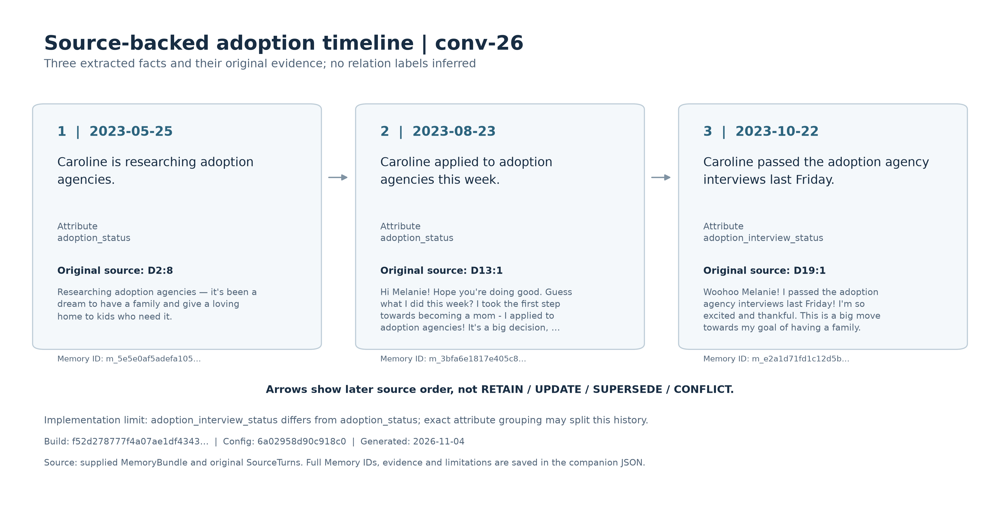

# 智能体动态记忆管理：最终报告

## 摘要


长程多会话对话中的历史事实可能被后续计划、偏好或状态更新。本项目实现结构化 Memory、混合检索、原文窗口兜底、显式状态关系判定、有效记忆选择和简洁答案生成，并通过本地 Web 与评测接口保存答案及来源。开发集共运行 586 题，其中 586 题有有效参考答案；完整流水线中 Full Text、Vector RAG 与本组方法的项目 token F1 分别为 0.2673、0.1932、0.2044。冻结后的独立测试共运行 301 题，三方法 F1 分别为 0.2790、0.1887、0.1966。后续检索与答案格式消融关闭状态解析，开发集和冻结测试的 QA F1 分别提升到 0.4325 和 0.4738；该结果单独列示，不与完整流水线混算。对当前参考标签的关系评测共 60 对，Accuracy=0.6833，Macro-F1=0.5852。

**记忆与检索补充数据：**

- 实现白名单输入、来源引用及构建版本贯通的结构化记忆链路，提供 BM25、固定版本 MiniLM 和 RRF 检索。
- 四个公开开发对话的2080轮文本生成951条记忆；145次抽取请求共293996 token，构建耗时合计862.41秒。
- 四个Bundle在隔离目录仅使用交付缓存重建一致；36组真实数据检索工程检查可回溯且重复一致。
- 47条定向辅助核查记录7条问题或限制，尚不能推断全量准确率；正式QA F1、Recall@K、冻结测试和状态关系统计已经完成，并分别保留完整流水线、优化消融与定向关系样本口径。

**关键词：** 长期对话记忆；LoCoMo；动态状态解析；混合检索；有效记忆；软件需求工程

## 1 引言


### 1.1 问题背景

长程多会话对话中，用户的状态会持续变化。以课件示例为例：Caroline 在第 1 次会话中说「我在研究领养机构」，在第 2 次会话中说「我上周五通过了领养面试」。这两条记忆都真实存在于对话中，但后者已经取代前者成为当前状态。普通向量 RAG 按语义相似度召回，会同时取出这两条，模型无法仅凭相似度判断哪条仍然有效，于是可能回答「Caroline 正在研究领养机构」——这是过期答案。

问题的本质不是「检索不到相关信息」，而是「检索到了新旧两条，却没有机制判断哪条当前有效」。本项目在检索与答案生成之间增加显式状态关系解析，并辅以原文窗口兜底与简短答案约束，分别处理状态失效、证据漏召回和答案表达问题。

### 1.2 项目目标

系统目标是把长期对话中的原始证据转换为可检索、可判断且可回溯的回答链路：

- 从 LoCoMo 对话中构建可追溯、带来源的结构化 Memory；
- 根据问题检索相关候选记忆；
- 判定 RETAIN、UPDATE、SUPERSEDE、CONFLICT 关系；
- 只使用当前仍然有效的记忆生成答案；
- 通过 Web 展示记忆、证据、答案与状态关系；
- 通过课程命令行接口输出答案并计算三项指标。

### 1.3 项目范围与边界

**范围内：** 单段 LoCoMo 对话内的文本记忆；记忆构建、混合检索、状态解析、答案生成、Web 展示和离线评测。

**范围外：** 多模态输入、跨对话记忆共享、模型训练或微调、面向公网的部署、物理设备控制，以及针对具体测试题写死规则。

### 1.4 主要贡献

本项目的主要贡献是把长期对话中的“记忆构建、候选检索、状态判断、答案输出与离线评分”连成可追溯闭环。具体包括：

1. **可追溯的结构化 Memory。** 原始轮次被转换为带 `build_id`、事件时间精度和 `(session_id, turn_id)` 来源的原子事实；构建时保留新旧状态，把有效性判断推迟到查询阶段。
2. **混合检索与证据兜底。** 在 BM25、MiniLM 和 RRF 之后增加五轮原文窗口兜底，处理事实漏抽和 Top-K 漏召回；开发集 Recall@5 由 0.6815 提升到 0.7825，且 Recall@1 不下降。
3. **显式状态关系与可解释输出。** 系统在生成前判定 RETAIN、UPDATE、SUPERSEDE、CONFLICT，并保留关系理由、有效 Memory ID 和原文入口；关系样本评测揭示了当前模型在兼容关系和冲突边界上的具体误判。
4. **可复现的评测与交付链路。** 提供三方法对照、逐题答案、F1/Recall/关系指标、冻结记录、Web 演示和需求追踪。检索与简洁答案优化在关闭状态解析的受控消融中把开发集和冻结测试 QA F1 分别提升到 0.4325 和 0.4738。

这些贡献以课程数据和可复现工程为主，不把规则阈值或单次评估包装成新的通用理论。

## 2 背景、数据与相关工作


### 2.1 LoCoMo 数据


本项目按 `sample_id` 读取 LoCoMo 的单段多会话对话。每段对话包含按编号排列的 `session_*`、会话时间和各轮的 `dia_id`、说话人与文本；同一人物的事实可能随会话推进而变化，因此来源顺序、会话时间与事实发生时间需要分别保留。数据中的 QA、标准答案、证据轮次标注和事件摘要可服务于离线评测，但不进入本模块的构建输入。

读取器采用字段白名单，仅从 `conversation` 的原始轮次构造 `SourceTurn`。清洗移除图片 Markdown、已知图片链接和空文本，保留普通文本链接；缺失轮次 ID、重复来源或非法结构明确报错。可识别的会话日期统一为 ISO 格式，无法识别时保留空值并告警。后续抽取使用的来源标识由会话编号与轮次 ID 组成，避免跨会话误引用。

| 项目 | 本项目口径 |
| --- | --- |
| 开发集 | `conv-26`、`conv-30`、`conv-41`、`conv-42`；用于调试 prompt、参数和错误修复 |
| 独立测试集 | `conv-43`、`conv-44`；按可任选两段的要求固定，正式运行须绑定冻结配置 |
| 文本范围 | 单段对话内的文本轮次；移除图片链接和无文本轮次 |
| 来源版本 | 当前开发集产物的 manifest 声明 `source_kind=public`；尚无课程文件逐字一致性证明 |
| 测试使用边界 | 不用测试标签调参；测试 Memory 只从原始对话构建 |

本报告历史结果使用 `outputs/locomo-public/runs/20261101T134604Z-5c326221/manifest.json` 对应的构建。该运行记录的源文件 SHA-256 为 `79fa87e90f04081343b8c8debecb80a9a6842b76a7aa537dc9fdf651ea698ff4`，抽取配置 ID 为 `6a02958d90c918c0`，prompt 为 `memory-facts-v1`，模型标识为 `deepseek-flash`，Python 为 3.12.16。API 返回的是模型名称，没有不可变权重版本。

| 对话 | 原文轮数 | Memory 数量 | 构建耗时/秒 | API 返回总 token | 缓存重建一致 |
| --- | ---: | ---: | ---: | ---: | --- |
| conv-26 | 419 | 204 | 75.75 | 61,049 | 是 |
| conv-30 | 369 | 164 | 60.83 | 51,343 | 是 |
| conv-41 | 663 | 291 | 113.95 | 93,138 | 是 |
| conv-42 | 629 | 299 | 115.72 | 88,958 | 是 |
| 合计 | 2,080 | 958 | 366.24 | 294,488 | 四段均一致 |

该表是一次离线 Memory 构建的耗时与 API 用量，不是每题问答成本。manifest 中质量审阅状态仍为 `pending`。`docs/final-report-b.md` 记载的 951 条 Memory、47 条抽查及 7 条问题属于此前另一轮构建；这些结论不直接迁移到本次 958 条构建。

### 2.2 相关工作


| 工作    | 核心思想                                                     | 本项目借鉴                                            | 本项目未复刻                             |
| :------ | :----------------------------------------------------------- | :---------------------------------------------------- | :--------------------------------------- |
| LoCoMo  | 提供长程多会话对话、QA、证据轮次与事件标注，用于评测长期记忆 | 使用其对话结构与证据轮次作为评测口径                  | 不使用其多模态部分，不针对具体题目写规则 |
| DimMem  | 结构化记忆 + 多维度检索，按人物、时间、属性组织，检索可按维度过滤 | 采用结构化 Memory，保留实体、属性、时间与来源         | 不构建完整维度索引，不做记忆合并压缩     |
| MRAgent | Cue–Tag–Content 图与主动检索，用 Cue 触发、Tag 限定范围      | 借鉴「先限定范围再检索」的思路，用 Query 分析收窄候选 | 不构建图记忆，不做多跳主动检索           |

本项目的重点不在记忆结构本身，而在检索之后、生成之前的显式状态关系判定。三项工作都没有把 RETAIN / UPDATE / SUPERSEDE / CONFLICT 作为独立环节处理，这是本组与它们的主要差异。

### 2.3 本文方法定位


本组采用轻量级结构化 Memory 与混合检索，不构建完整图记忆。核心差异是：在答案生成前显式执行状态关系判定与有效记忆选择。系统先按 `(entity, attribute)` 分组候选记忆，由模型判定四类关系，再根据问题的时间视角筛选当前有效记忆，最后只把有效记忆交给生成模型。这一层是本组方法与 Full Text、Vector RAG 两个基线在结构上的唯一区别，也是实验要验证的对象。

## 3 需求分析


### 3.1 用户与使用场景

| 用户 | 核心场景 | 主要需求 |
| --- | --- | --- |
| 项目开发成员 | 构建并检查 Memory、调试问答 | 数据可追溯、结果可复现 |
| 课堂演示者与听众 | 展示状态变化与系统依据 | Web 可视化、错误提示清楚 |
| 课程评测人员 | 批量提交问题并读取答案 | 参数化 CLI、固定输出格式 |
| 后续维护者 | 修改模块或复现实验 | 接口稳定、测试与文档完整 |

### 3.2 功能需求概览


| 功能 | 需求编号 | 实现模块 | 当前状态 | 证据范围 |
| --- | --- | --- | --- | --- |
| 记忆构建与存储 | FR-01–FR-03 | `src/memory/`、`src/common/` | 已测试 | 数据白名单、字段与来源校验、缓存、持久化；已有真实开发集构建 |
| 候选检索与证据回溯 | FR-04–FR-07 | `src/index/`、`src/memory/store.py` | 已测试 | 排序、过滤、融合、缓存与来源回溯；历史运行有 Recall 记录 |
| 状态解析与答案生成 | FR-08–FR-11 | `src/reasoning/` | 已测试 | 单元/Mock 验证、60 对人工关系评测和开发/测试问答均已完成；CONFLICT/SUPERSEDE 覆盖不足 |
| Web 记忆与关系可视化 | FR-12–FR-15 | `src/web/` | 已测试 | 局部浏览器检查及一次合成样例在线问答，完整验收未完成 |
| 评测与对照 | FR-16–FR-18 | `src/eval/`、`experiments/` | 已测试 | 指标、CLI、三方法开发集/测试集对照和优化消融已完成；课程官方评分器仍需外部确认 |

### 3.3 非功能需求

可复现性（NFR-01）通过输入哈希、依赖和 MiniLM revision、prompt 版本、构建身份与响应缓存实现。远端模型没有不可变版本，未缓存的两次调用不承诺逐字相同。跨平台性（NFR-02）以 Python 3.11、macOS 与 Windows 为验收目标，当前 3.12.16 的通过结果不能替代基准版本和双平台验收。

可追溯性（NFR-03）要求 Memory、候选和答案引用同一对话与 `build_id`，来源能够定位至原轮次。安全与数据隔离（NFR-04、NFR-06）要求密钥只来自本地配置、原始对话按数据处理，gold 标签只用于评分。性能与资源使用（NFR-05）需分别记录构建、问答各阶段的时间和 token；目前历史问答缺少这些字段，不能据此判定性能阈值已满足。

### 3.4 需求变更

| 变更 | 原因与影响 | 仓库证据 | 确认边界 |
| --- | --- | --- | --- |
| 取消 Web 上传原始 LoCoMo JSON | Web 直接消费预构建 MemoryBundle，避免页面同时承担构建与问答；离线构建入口保留 | `b82985e` / PR #34，2026-10-29 | 以已合入仓库记录为依据 |
| 固定开发集与测试隔离口径 | 使 prompt 和检索调试只使用四段开发对话 | `c5e9bcc` / PR #27，2026-10-24 | 测试使用仍须绑定冻结记录 |
| 补充参数化评测与结果聚合 | 支持在线答题、离线复算、按方法归并指标 | `84fa6d0` / PR #28；`f26987d` / PR #38 | 代码与测试存在不等于课程接口已验收 |


## 4 系统设计


### 4.1 总体架构


*图 1：系统总体架构。数据来源：现有代码、接口定义与项目设计；样本量和实验配置不适用；绘制日期：2026-11-03。图示区分索引模块支持的检索能力与 Web 当前使用的 BM25。本文采用该架构口径。可编辑源文件：[`fig-01-architecture.svg`](figures/fig-01-architecture.svg)。*

系统分为离线构建与在线问答两条链路：

```text
locomo.json
  → Memory 构建与校验
  → MemoryBundle（版本、来源、记忆）
  → BM25 / MiniLM / RRF / 五轮原文窗口兜底
  → Query 分析
  → 状态关系判定
  → 有效记忆选择
  → DeepSeek 简洁答案生成
  → Web 展示 / 课程 answers.json / 指标计算
```

离线阶段只读取原始对话，生成带 `build_id`、来源和时间的 MemoryBundle；QA、标准答案和 gold evidence 不参与构建。在线阶段以同一构建快照完成检索、状态判断和答案生成，所有候选、关系与答案都引用同一版本。构建阶段保留新旧事实，只有查询阶段依据问题时间视角决定有效性，因此历史问题仍可回溯旧状态。检索与答案实验可关闭状态解析做消融，但 Web 的批量实验与真实课程提交均使用可追溯来源，不返回脱离原文的答案。

### 4.2 数据模型与模块边界

| 数据模型 | 职责 | 模块边界 |
| --- | --- | --- |
| `SourceRef` / `SourceTurn` | 用 `(session_id, turn_id)` 定位原始轮次；保存说话人、时间和原文 | Memory 构建、证据回看和评测共用 |
| `MemoryBundle` | 聚合 `build_info`、Memory 列表与原始 SourceTurn，绑定同一对话与输入版本 | 写入 `src/memory/`；检索消费完整快照 |
| `RetrievalResult` / `RetrievalHit` | 返回有序命中、通道分数与 trace，hybrid 可含 `raw_window` 兜底命中 | `src/index/` 交给状态解析与评测 |
| `MemoryRelation` | 记录两条候选记忆的四类关系、理由与来源 | 只在查询期间产生，不写回持久化 Memory |
| `AnswerRecord` | 保存最短答案、有效 Memory ID、冲突标记与 `build_id` | 连接推理、Web、课程答案和离线评分 |

字段细节以 [接口文档](interfaces.md) 为准。索引对 MemoryBundle 建立独立快照，后续原文读取必须使用同一构建；跨对话、缺失来源和 build_id 不一致均明确失败。离线构建不写全局 active/superseded 状态，避免历史事实被提前丢弃。

### 4.3 关键设计决策

| 决策 | 选择 | 原因 | 代价或限制 |
| --- | --- | --- | --- |
| 存储方式 | UTF-8 JSON | 简单、透明、便于课程交付 | 大规模并发与查询能力有限 |
| 检索 | BM25 + 向量 + RRF + 原文窗口兜底 | 兼顾字面和语义，并恢复漏抽或未进 Top-K 的原文证据 | 增加 token 和延迟 |
| 答案格式 | `answer_v2` 最短答案短语 | 避免解释性文字稀释词级 F1；冲突结构化保存 | 过短答案可能缺少上下文 |
| 状态解析 | LLM 分组成对判定 | 能利用时间与上下文 | 有延迟、费用和稳定性风险 |
| 历史处理 | 构建时保留，查询时筛选 | 支持当前与历史问题 | 状态判断负担转移至在线阶段 |
| Web | 原生 HTML/CSS/JavaScript + Python 标准库 | 无前端构建步骤，便于复现 | 组件化和交互能力受限 |

### 4.4 错误处理与数据隔离

模型抽取或关系判定返回非法 JSON 时进行有界重试，认证/额度错误立即停止；缓存损坏、向量维度错误和超过编码长度时明确报错，不静默截断或降级。请求对话必须与索引一致，Memory、命中、关系和答案必须引用同一 `build_id`；来源缺失或排序不一致时拒绝继续。空问题、非法 K、空检索和未知 Web 对话返回可理解错误，不展示上一次答案。

输入读取采用字段白名单。QA、标准答案、gold evidence、事件摘要和问题类别不进入 Memory 构建、检索问题或答案 prompt；它们只在推理完成后由评测层读取。API key 只来自本地 `.env` 或环境变量，不进入源码、缓存、日志或提交产物。

## 5 详细实现


### 5.1 结构化记忆构建


`src/memory/locomo.py` 按原始会话和轮次顺序读取文本、解析会话时间，过滤图片链接并保留来源 ID。DeepSeek 抽取按会话边界分块，当前开发集构建最多 20 轮、12,000 字符一块，通过 JSON 输出返回事实。每条事实保存 content、entity、attribute、value、原始时间表达、事件日期与精度；未知日期留空，不把会话日期直接视为事件日期。

构建结果通过 Pydantic 验证后产生稳定的 Memory ID 与 `build_id`。缓存身份绑定输入、配置和 prompt 版本，JSON 以 UTF-8 原子保存。`turns` 模式将原文轮次映射为记忆，供无 API 的管线调试，不能替代语义抽取质量评测。当前四个开发集构建和缓存重建事实见 §2.1；未将此前 951 条构建的质量抽查当作本轮 958 条的抽查结果。

每条 Memory 保存事实描述、实体、属性、值、原始时间表达、事件时间及精度和来源。会话时间表示对话何时发生，事件时间表示所述事实何时发生，二者不能直接替换。无法确定的日期允许为 `null`，计划与已发生事件应通过事实描述区分。Pydantic 校验负责字段、时间结构及来源合法性，不能保证模型对人物、代词或相对时间的语义判断正确。

缓存身份包含白名单输入、请求模型、prompt、配置及输出长度上限等；缓存缺失或损坏时，`--cache-only` 明确失败，不自动请求 API。Memory ID 对事实及来源生成指纹，`build_id` 将输入、配置、prompt 与构建结果关联起来。保存采用 UTF-8 JSON 原子替换，加载时重新校验 Bundle；检索和证据读取绑定同一构建快照。构建阶段保留旧事实与新事实，查询阶段再由状态解析模块决定有效记忆，避免构建时删除历史后无法回答历史问题。

本轮构建使用 `deepseek-flash`、`memory-facts-v1`，配置 ID 为 `6a02958d90c918c0`；温度为 0、关闭 thinking、每次最多输出 8192 token。请求模型名与 API 返回模型名一致，但服务端未提供不可变权重版本，因此仅记录服务名称和响应缓存，不声称锁定了远端模型快照。

四个 Bundle 均通过保存/加载一致性及仅缓存重建验证。此前 951 条构建的 47 条定向抽查和 7 条问题记录仍见[质量记录](milestone5-b-quality.md)，但这些结论不直接迁移到本轮 958 条构建。

### 5.2 混合检索与证据回溯


索引模块提供 `bm25`、`vector` 和 `hybrid` 三种模式。BM25 将 Memory 的 `content`、`entity`、`attribute`、`value` 拼接后分词，英文按小写字母与数字词项处理，中文仅提供逐字回退；参数为 `k1=1.5`、`b=0.75`。字面匹配适合实体、属性和明确关键词查询，无共享词项时可以返回空命中，而不是强行补足 K 条。

向量检索使用本地 `sentence-transformers/all-MiniLM-L6-v2`，固定 revision 为 `1110a243fdf4706b3f48f1d95db1a4f5529b4d41`。仅对 Memory 的 `content` 编码，得到 384 维归一化向量，以点积计算余弦相似度；问题使用同一编码器。超过模型 256 token 长度上限时明确报错，不通过静默截断丢失事实。向量缓存记录构建身份、模型版本、编码设置和库版本；模型缺失、维度错误或缓存损坏均报错。BM25 基础安装无需加载向量模型，向量与混合模式需额外安装 `requirements-vector.txt`。

混合检索先对候选应用实体、属性的精确过滤，两路各保留 `candidate_k` 条，按 Memory ID 去重，再以等权倒数排名融合计算：`RRF(m) = Σ 1 / (60 + rank_channel(m))`。仅对该记忆出现的通道求和，排名从 1 开始。最终按融合分降序排列，同分按 Memory ID 排序，返回不超过 `top_k` 条；请求要求 `top_k ≤ candidate_k`。CLI 默认值分别为 10 和 30，正式实验仍须记录实际参数。返回结果保留各路原始分数、排名和 trace，不把不同量纲的 BM25 与余弦分数直接相加。

为处理“原文存在但事实没有进入 Memory”以及语义 Top-K 漏召回，`hybrid` 模式增加原始轮次窗口兜底。索引按会话边界构造连续五轮窗口，窗口保留全部来源 `(session_id, turn_id)`；在线查询保留原 RRF 前三名，再用 BM25 从五轮窗口中选择最多两条补足 Top-5。兜底只在不显式指定实体/属性过滤时启用，`fallback_window=0` 可完整关闭，便于消融。窗口命中的 `channel_scores` 标记为 `raw_window`，其 `score` 是该窗口的 BM25 分数，而不是 RRF 分；trace 记录窗口大小、请求槽位、候选数和实际选中数。

`retrieve_context` 将初始命中、所需原文与可选关联历史交给推理模块。关联历史必须显式提供实体、属性及正整数上限，且与初始 `retrieval.hits` 分开，供 E 按初始 Top-K 计算证据召回，避免扩展历史改变指标口径。原文从同一索引快照读取、按来源引用去重；跨对话或混用构建版本被拒绝。本模块提供候选与证据，不执行四类状态关系判定。当前 Web 使用 BM25，不能据此声称线上页面已采用混合检索。

已有真实数据工程检查覆盖四个开发对话，每段选首、中、末三条记忆内容作为查询，分别运行三种模式，共 36 组；全部命中均可回溯，重复结果一致，见[检索检查记录](evidence/member-b/retrieval-verification.json)。查询来自记忆内容本身，所以这里只验证接口、来源和确定性，不作为真实问题分布上的 Recall@K 或三种方法优劣证据。2026-11-04 在报告基线 `c830cb5` 上复跑四个相关测试文件，共 58 项通过；记录见[报告核对清单](evidence/member-b/report-check.json)。

可选实体、属性过滤在各通道截断前应用；最终 Top-K 与 `candidate_k` 分别控制返回量与单路候选量。初始 hits 用于 Recall@K；关联历史由单独接口读取并标记截断，不能悄悄并入初始检索指标。每条命中的 sources 可定位回 MemoryBundle 内的原始轮次。

### 5.3 动态状态解析


### 5.3.1 Query 分析

`query_analyzer` 接收用户问题、`conversation_id` 与 `build_id`，调用 DeepSeek 官方接口（关闭 thinking，`response_format=json_object`），输出 `QueryAnalysisResult`：

| 字段              | 含义                                                     |
| :---------------- | :------------------------------------------------------- |
| `entity`          | 问题涉及的核心实体，可为空                               |
| `time_scope`      | `current` / `past` / `specific`，决定 SUPERSEDE 是否生效 |
| `time_expression` | 问题中的时间原文                                         |
| `attribute`       | 问题询问的属性或事件类别                                 |
| `confidence`      | 抽取置信度，仅用于诊断                                   |

返回空 content 或 JSON 非法时重试 2 次；401 / 402 直接抛出，不进入重试。

### 5.3.2 候选记忆分组

`relation_judge` 先按 `(entity, attribute)` 分组。**`entity` 或 `attribute` 为 null 的记忆不进入比较流程**——这一规则在 `turn_baseline` 模式下避免了 419 条记忆产生约 8 万次无意义模型调用。跨组记忆不产生关系记录，下游默认视为 RETAIN。

### 5.3.3 四类关系的判定

判定综合时间顺序（`session_time` 与 `event_time`）、实体一致性、属性一致性与事件上下文，不依赖语义相似度。

| 关系      | 判定                   | 当前问题下的处理     | 历史问题下的处理     |
| :-------- | :--------------------- | :------------------- | :------------------- |
| RETAIN    | 可同时成立             | 保留                 | 保留                 |
| UPDATE    | 后续信息补充或局部修改 | 使用更新后的有效状态 | 按问题时间范围选择   |
| SUPERSEDE | 新状态明确替代旧状态   | 过滤旧状态           | 保留旧状态用于回溯   |
| CONFLICT  | 互斥且无法消解         | 两条均保留并提示冲突 | 两条均保留并提示冲突 |

两条记忆的 `event_time` 与 `session_time` **均缺失**时，强制判为 CONFLICT，不调用模型，不推测时间先后。模型返回非法 JSON 时重试 2 次，仍失败则降级为 CONFLICT 并记录原因，不中断流水线。输出 `MemoryRelation` 含 `memory_a`、`memory_b`、`relation_type`、`reason`、`sources`，来源按 `(session_id, turn_id)` 去重。

### 5.3.4 有效记忆选择

`memory_selector.select_effective` 按关系过滤：

- RETAIN、UPDATE、CONFLICT：保留
- SUPERSEDE：当 `time_scope != "past"` 时丢弃旧值；`time_scope == "past"` 时保留旧记忆供回溯性提问使用

这一规则对应 `memory-design.md` 中「询问过去状态时，旧事实仍可能是所需答案依据」。

UPDATE 当前没有实现独立的结构化合并操作，不能把“保留供生成”写成“已合并为新 Memory”。`specific` 视角尚无完整的日期截止筛选，需在时间问题上单独验证。

#### 图 2：真实状态时间线与关系案例

**真实事实时间线：** 下表来自本轮 `conv-26` 的原文与 Memory，不包含人工 gold 或系统关系预测。

| 来源 | 会话时间 | 已核对事实 | 当前抽取属性 |
| --- | --- | --- | --- |
| D2:8 | 2023-05-25 | 正在研究收养机构 | adoption_status |
| D13:1 | 2023-08-23 | 已申请收养机构 | adoption_status |
| D19:1 | 2023-10-22 | 已通过收养机构面试 | adoption_interview_status |



*图 2：从本轮 `conv-26` MemoryBundle 自动读取的真实事实与原文。样本量：3 条 Memory，0 个评测问题；抽取配置：`6a02958d90c918c0`，`build_id=f52d278777f4a07ae1df43430f48b08598ffa08a01fbbfb57e22fccc0f82a76a`；生成日期：2026-11-04。箭头仅表示来源先后，不是系统预测或人工 gold 的关系类型。生成脚本：`experiments/draw_state_example.py`；可编辑 SVG 与完整 Memory ID、原文、构建身份及局限见同名 `.svg`、`.json`。*

三条事实对应 Memory ID 前缀为 `m_5e5e0af5`、`m_3bfa6e18`、`m_e2a1d71f`。最后一条属性不同，当前分组规则可能漏掉跨属性关联。补充图展示 `conv-30` 的真实 UPDATE 关系；它用于解释状态演化机制，不替代关系准确率的总体统计。


*图 2 补充：该图来自 `conv-30` 的真实 Memory 与关系判定输出，箭头表示系统运行时判定的 UPDATE 关系，不是人工 gold。该案例用于展示状态解析机制；最终效果仍以独立测试集上的冻结版指标为准。*

### 5.4 答案生成


答案 prompt 接收问题、有效 Memory 的事实内容、说出该事实的时间、事件时间和必要冲突提示，不读取标准答案。`answer_v2` 要求输出最短且精确的答案短语：日期、姓名、值或数量不再包装成完整句子；Yes/No 题只输出 Yes 或 No；冲突和解释不塞入 `answer` 文本，而由 `conflict` 等结构化字段承载。这样既方便课程接口按词级 F1 评分，也避免解释性内容稀释答案。历史版本的空模型内容写为 `(no answer)`；这类结果应作为失败或拒答披露，不是正确答案。模型服务状态、远端版本与上下文长度都会影响输出，正式实验记录请求配置及输入、输出 token。

`answer_generator.generate_answer` 的输入仅包含：问题、有效 Memory 列表、冲突标记。有效记忆逐条列入 prompt；存在 CONFLICT 时仍附加冲突提示供模型内部消歧，但最终答案只返回直接答案。存在时间冲突时优先最新 `event_time`，其次最新 `session_time`。调用 DeepSeek 官方接口并关闭 thinking。

输出 `AnswerRecord`：

| 字段               | 含义                                          |
| :----------------- | :-------------------------------------------- |
| `answer`           | 最短答案短语；空 content 时降级为 `(no answer)` |
| `valid_memory_ids` | 参与生成的有效记忆 ID                         |
| `conflict`         | 有效记忆集合是否存在冲突                      |
| `build_id`         | 与检索结果一致的构建版本                      |
| `question_id`      | 评测题号，非评测为 null                       |

异常处理：模型返回空 content 时降级并记录，不中断批量评测；`build_id` 与当前 bundle 不一致由上游检索模块抛 `RuntimeError`，本模块不重复校验。生成结果只读使用记忆，不写回 MemoryBundle。

### 5.5 Web 应用


Web 模块由 `src/web/server.py` 和 `src/web/static/` 组成。服务使用 Python 标准库 `ThreadingHTTPServer` 提供静态页面和 JSON 接口，默认监听 `127.0.0.1:8000`；页面使用原生 HTML、CSS 和 JavaScript，无需前端构建。服务从 `WEB_MEMORY_DIR` 指定的目录读取预构建的 `MemoryBundle`。页面分为“记忆库”和“智能问答”：前者选择对话、检索并浏览记忆，点击记忆可回看对应原始轮次；后者提交问题，展示回答、有效记忆数量、构建版本、状态关系、判定理由和证据入口。图中被选作答案依据的关系节点会被突出显示。

| 接口 | 作用 |
| --- | --- |
| `GET /api/conversations` | 列出可用对话与构建信息 |
| `GET /api/memories?conversation_id=…` | 读取所选对话的记忆列表 |
| `GET /api/memories/{memory_id}?conversation_id=…` | 读取记忆详情与来源轮次 |
| `POST /api/ask` | 对指定对话和问题执行检索、状态解析、有效记忆选择与答案生成，返回答案及关系等信息 |

当前 Web 问答使用 BM25 检索，并调用已有推理与答案生成模块；Web 不重新判定记忆关系。页面会在切换对话时清除旧回答，在请求失败或版本不一致时显示错误。浏览记忆和来源不需要模型 API；在线问答需要配置可用的 DeepSeek 服务。当前页面不提供原始 LoCoMo 上传或 Memory 构建功能，应先在页面外准备好 MemoryBundle。


*图 3：新版 Web 演示截图。数据来源：仓库中的合成样例 `examples/demo_dynamic_memory.json`；样本量：1 次提问、2 条记忆；配置：BM25、DeepSeek 在线问答，`build_id=manual-demo-state-change-v1`，基于提交 `83636d6` 和本地未提交的前端修改；生成日期：2026-11-03。相关运行记录见 [`fig-03-web-demo-evidence.json`](figures/fig-03-web-demo-evidence.json)。该演示不作为 LoCoMo 实验结果或模型效果指标。*

演示时先选择 `demo-state-change`，在记忆库中查看记忆和来源，再进入智能问答页询问 “What is Alex's current adoption status?”。本次实际返回 Alex 已通过收养机构面试，并展示一条 `UPDATE` 关系；点击关系节点后可回看相应来源轮次。此记录只证明该样例当次运行及界面展示，不证明其他问题、全部关系类型或课程数据均已通过验收。

### 5.6 课程评测接口


`src.eval` 接受对话编号、问题文件、MemoryBundle 和输出路径。在线模式读取预构建 Memory；`--answers-input` 用于离线评分，不再次调用模型。

```bash
python -m src.eval \
  --conversation conv-26 \
  --questions locomo.json \
  --memory outputs/locomo-public/memory/conv-26.json \
  --mode hybrid --top-k 5 --candidate-k 30 \
  --output outputs/eval/conv-26-answers.json \
  --metrics-output outputs/eval/conv-26-metrics.json
```

答案记录包含题号、对话号、问题、最短有效答案、有效记忆、冲突标志、构建信息与检索记录；`answer_v2` 的解释和冲突信息分别留在结构化字段，不混入评分答案。本轮补充query_analysis、relations数组、token_usage、elapsed_seconds和模型身份。

## 6 测试与实验方法


### 6.1 测试策略


**表 2 测试层次、工具与最终结果。**

| 层次 | 验证内容 | 工具或证据 | 最终结果 |
| --- | --- | --- | --- |
| 单元与集成测试 | 数据契约、检索、推理、指标、Memory→答案链路 | pytest | 2026-11-09，Python 3.11.18：除 `test_relation_workflow.py` 外全部可收集测试通过；该文件因缺少 `experiments/prepare_relation_labels.py` 在收集阶段失败。此缺口已列入 §9.4 与 §8.2。 |
| 静态检查 | 格式、未使用导入、行宽等 | Ruff | 2026-11-09：`python -m ruff check .` 与改动文件格式检查均通过。 |
| 开发集与测试集评测 | Memory→检索→推理→答案→指标 | CLI 与记录文件 | 三方法开发集各 586 题、测试集各 301 题；优化消融开发集 586 题、冻结测试 301 题。记录见 `outputs/eval/`、`outputs/quality-final/test/` 与 `experiments/retrieval-improvement.md`。 |
| 真实数据测试 | DeepSeek 抽取、四段开发集 Memory | 实际命令与产物 | 2026-11-04：四段开发集 Memory 来源预检查通过，共 958 条（204/164/291/299）；`./.venv/bin/python -m experiments.final_workflow dev --execute` 完成三方法各 586 题、共 1,758 条，0 失败；见 `outputs/final/dev/manifest.json` 和表 3、表 4；两段测试 Memory 已构建（conv-43：317 条，conv-44：305 条）并冻结；`./.venv/bin/python -m experiments.final_workflow test --execute` 已完成三方法各 301 题、共 903 条，最终无缺失答案；曾有 4 次 API 连接失败及 2 次人工中断并已断点续跑，见 `outputs/final/test/attempts.jsonl`、`manifest.json` 和表 6。 |
| Web 验收 | 浏览、证据、问答、关系图 | HTTP 集成测试、图 3、页面审计 | 已完成六段数据列表/详情、build_id、来源读取与空问题错误检查，截图见 `docs/figures/fig-03-web-demo.png`；真实课程的完整在线问答和所有异常交互仍需浏览器验收。 |
| 跨平台验收 | Python 3.11、macOS、Windows | 两平台测试记录 | 2026-11-04：已有 macOS 15.5 arm64、Python 3.12.16 的全仓 147 项通过记录；Python 3.11 与 Windows 实机验收尚未完成，不能以当前记录代替两平台验收。 |

**记忆与检索测试补充：** 2026-11-04在报告基线`c830cb5`上，使用Windows/Python 3.13.5复跑`test_memory_devbuild.py`、`test_memory_pipeline.py`、`test_reasoning_context.py`、`test_vector_retrieval.py`，58项通过，覆盖白名单、分块、缓存、存储、索引、融合与上下文交接。这是选定测试集，不代表全仓库或Python 3.11/macOS验收。真实构建、145次缓存重建和36组检索记录见§5及[证据索引](evidence/member-b/report-check.json)。

### 6.2 实验问题与假设


| 编号 | 研究问题 | 可检验假设 |
| --- | --- | --- |
| RQ1 | 结构化 Memory 能否保留回答问题所需的证据？ | 本组方法的 Recall@K 不低于 Vector RAG，或能说明差异来源 |
| RQ2 | 状态关系解析能否减少过期记忆造成的错误？ | 本组方法的 QA F1 优于不做状态判断的 Vector RAG |
| RQ3 | 显式状态解析的收益是否值得额外 token 与延迟？ | 以 F1、平均 token 和耗时的联合结果判断 |
| RQ4 | 系统在未见测试对话上是否仍成立？ | 冻结配置后独立测试集结果与开发集结论方向一致 |

### 6.3 数据划分与防泄漏


开发集固定为 `conv-26/30/41/42`；测试集固定为 `conv-43/44`。测试方案、代码、prompt、模型、K、Memory 身份与原始数据哈希应写入冻结 manifest，再启动正式测试。测试原文可以作为系统输入，但人工标准答案、gold evidence 与关系标签只由评分步骤读取，不进入检索请求或模型消息。测试中出现失败时保留记录；若不得不修改代码，应记录原因和新版本，不能把修复前后结果当作同一次冻结实验。
### 6.4 对照方法


| 方法 | 输入范围 | 是否检索 | 是否状态解析 | 用途 |
| --- | --- | --- | --- | --- |
| Full Text | 对话全文 | 否 | 否 | 检验直接长上下文回答 |
| Vector RAG | 向量 Top-K Memory | 是 | 否 | 隔离普通语义检索效果 |
| 本组方法 | BM25 + 向量 + RRF 候选 | 是 | 是 | 验证完整方案 |

三个方法必须使用相同数据、问题、生成模型和评分口径；Full Text 与 Vector RAG 的「状态更新准确率」标记为不适用，因为它们不含状态解析环节。本组方法内部另做消融：关闭状态解析（等价于 Vector RAG 走同一候选集）与开启状态解析对比，用于隔离状态解析单独的贡献。

### 6.5 指标定义


| 指标 | 定义 | 汇总方式 | 备注 |
| --- | --- | --- | --- |
| QA F1 | 生成答案与标准答案的词级 F1 | 宏平均 | 按课程指定口径 |
| Recall@K | 前 K 条 Memory 的来源是否覆盖至少一条关键证据 | Recall@1、Recall@5 | gold evidence 只用于评分 |
| 状态更新准确率 | 四类关系判定正确比例 | 总体准确率 + 混淆矩阵 | 同时报告各类样本量 |
| 平均 token | 每方法每题输入与输出 token 总和 | 算术平均 | 记录模型与计费口径 |
| 平均耗时 | 每题问答耗时 | 算术平均；另报中位数 | 标明设备和网络条件 |

## 7 实验结果与分析


### 7.1 开发集主结果
本轮正式开发实验在相同问题、模型、生成约束和固定参数下完成三种方法对照。表 3 由完整运行产物自动汇总，三方法各运行 586 题，共 1,758 条答案，失败数为 0。

**表 3 开发集主结果。**

| 方法 | QA F1 | Recall@1 | Recall@5 | 状态更新准确率 | 平均 token | 平均耗时（秒） |
| --- | ---: | ---: | ---: | --- | ---: | ---: |
| Full Text | 0.2673 | 不适用 | 不适用 | 不适用 | 29449.2 | 1.317 |
| Vector RAG | 0.1932 | 0.4281 | 0.6473 | 不适用 | 280.8 | 1.075 |
| 本组方法 | 0.2044 | 0.4589 | 0.6712 | 见独立关系评测 | 642.6 | 2.686 |

配置编号：`533a5a031527cef0b127c801abcbd0577054cb1d224ce90195e6b89587f31101`；模型：`deepseek-flash`；数据划分：conv-26, conv-30, conv-41, conv-42；检索参数：Top-K=5，candidate-K=30。

三个方法均为本仓库实现；QA F1 使用项目评分器，尚不代表课程官方评分。状态准确率以单独的记忆对评测报告，不能从 QA 题数推算。

| 方法 | 运行题数 | QA F1 分母 | Recall 分母 | token 有记录题数 | 耗时有记录题数 | 中位耗时（秒） |
| --- | ---: | ---: | ---: | ---: | ---: | ---: |
| Full Text | 586 | 586 | 不适用 | 586 | 586 | 1.283 |
| Vector RAG | 586 | 586 | 584 | 586 | 586 | 1.030 |
| 本组方法 | 586 | 586 | 584 | 586 | 586 | 2.273 |

平均 token/耗时按成功完成且有记录的问题统计；失败尝试单列，不作为完整费用账单。

| 方法 | 记录的失败尝试数 | 失败尝试已知 token | token 未知的失败尝试数 |
| --- | ---: | ---: | ---: |
| Full Text | 0 | 0 | 0 |
| Vector RAG | 0 | 0 | 0 |
| 本组方法 | 0 | 0 | 0 |


*图 4：来源为本次完整开发集逐题结果；样本量、配置编号和分母见表 3。生成时间：2026-11-04T14:51:21.969230+00:00。*

**历史开发运行（不并入上述正式对照）：** `outputs/eval/dev-hybrid/dev-answers.json` 保存 757 条本组 `hybrid+state` 结果，对应 §2.1 的 958 条 Memory。检索为 Top-K 5、candidate-K 30、MiniLM 固定 revision 与 RRF-k60。按旧项目评分器复算，586 条含 gold answer 的题得到 token F1 0.1611，755 条含 gold evidence 的题得到 Recall@1 0.4053、Recall@5 0.6093。171 题没有 gold answer，2 题没有 gold evidence。没有逐题问答 token、耗时或关系真值，不能补算这些字段，也不能用本轮构建 token 代替问答成本。

历史结果提示证据存在性与回答质量之间仍有差距，但仅凭汇总数不能判断来源是抽取、检索、状态筛选还是生成。历史运行未包含同口径基线，不能据其单独声称提升；本轮同题结果见表 3，两次配置和题集应分开存档。

### 7.2 分对话结果


**表 4 开发集分对话结果。** 下表为本组方法；原始结果另保存三方法各对话指标。

| 对话 | 问题数 | QA F1 | Recall@5 | 状态准确率 | 主要失败类型 |
| --- | ---: | ---: | ---: | --- | --- |
| `conv-26` | 154 | 0.2051 | 0.6316 | 关系对样本另见 §7.3 | 未作全量逐题归因 |
| `conv-30` | 81 | 0.1979 | 0.6173 | 关系对样本另见 §7.3 | 未作全量逐题归因 |
| `conv-41` | 152 | 0.2254 | 0.7237 | 关系对样本另见 §7.3 | 未作全量逐题归因 |
| `conv-42` | 199 | 0.1905 | 0.6834 | 关系对样本另见 §7.3 | 未作全量逐题归因 |

问题数依照该次运行的样本选择策略；QA/Recall 分母见主结果说明。失败归因需要核对原文，脚本不根据低分自动判断原因。

本轮正式开发结果中，conv-41 的 Recall@5 最高，conv-30 最低。不同对话的问题和证据分布不同，不能将分数差异直接归因为某个模块。已核验案例覆盖构建缺口、召回缺口与生成/词面评分差异，见 §8.1；尚未对全部题目逐项人工归因。关系对是另一组定向样本，不与表 4 的 QA 题数混用。
### 7.3 状态关系错误分析


参考标签关系样本共 **60** 对；成功判定 60 对，失败或缺失 0 对。Accuracy=0.6833，Macro-F1=0.5852。Accuracy 的分母包含失败与缺失。

**表 5 状态关系混淆矩阵。** 行为参考标签，列为系统预测；失败另列。

| 真实类别 \ 预测类别 | RETAIN | UPDATE | SUPERSEDE | CONFLICT | 失败/缺失 | 样本量 |
| --- | ---: | ---: | ---: | ---: | ---: | ---: |
| RETAIN | 30 | 7 | 0 | 4 | 0 | 41 |
| UPDATE | 7 | 10 | 0 | 1 | 0 | 18 |
| SUPERSEDE | 0 | 0 | 1 | 0 | 0 | 1 |
| CONFLICT | 0 | 0 | 0 | 0 | 0 | 0 |

模型：`deepseek-flash`；prompt：`relation_v2`；gold SHA256：`62d7b0fc736fe13d91c912d2fa80135fe0296af01580cb48038c22ab3c8e6210`。
样本来自相同实体与属性的定向记忆对抽样，不能推断全部记忆对的总体准确率。CSV 的标注人字段为张崇洋，复核人字段为空。


*图 5：来源为所填参考标签与逐对预测，样本量和配置见表 5；生成时间：2026-11-04T14:51:21.969230+00:00。*

当前参考标签分布为 RETAIN 41 对、UPDATE 18 对、SUPERSEDE 1 对、CONFLICT 0 对。固定四类的 F1 分别为 0.7692、0.5714、1.0000、0.0000；其中 CONFLICT 没有参考样本，评分实现将该类 F1 记为 0，这不表示已经测得真实冲突的召回能力。SUPERSEDE 仅 1 对，不能据其 100% 结果作泛化判断。41/60=68.33%，低于 SRS 中 FR-09 的 70% 目标 1.67 个百分点，当前评测未达到该目标。

19 对预测分歧中，RETAIN→UPDATE 与 UPDATE→RETAIN 各 7 对，另有 5 对参考标签为兼容关系的样本被预测为 CONFLICT。原文核验揭示了三种具体机制：

- `conv-26/p_21eac39dccd0d1f1c4cf`：Caroline 的艺术表达“包容与多样性”和“个人跨性别经历”，原文内容可以兼容，当前参考标签为 UPDATE，系统因主题措辞不同且缺少事件时间预测 CONFLICT。应先判断语义互斥，再考虑时间如何消解冲突。
- `conv-26/p_5b9a4570e79abe8e27c6`：两条记忆分别描述 LGBTQ 中心和海滩落日启发的画作，来源为 `D9:16` 与 `D14:7`。没有同一画作的证据，参考标签为 RETAIN；系统自行假定是同一作品而预测 CONFLICT，说明仅按人物与属性分组还不足以识别具体事件。
- `conv-30/p_24974e467bb496044d75`：A 说 Jon 正在筹建舞蹈工作室，B 由 Gina 关于创业动力的提问抽取成“经营工作室”。当前参考为 RETAIN，系统根据抽取措辞预测 UPDATE；这同时涉及抽取证据强度与关系边界，不能只归因于关系模型。

完整候选 Memory、原文和来源引用保存在 `experiments/final-relation-labels/candidate-evidence.json`。上述检查没有修改本轮标签、预测或冻结配置；后续补充样本、复核边界或修改 prompt，应另建评测版本并保留本轮结果。

**主要混淆方向**：

1. **UPDATE 与 SUPERSEDE 边界**：模型可能把「换工作」判为 UPDATE 而非 SUPERSEDE，区别在于旧职位是否整条失效。
2. **时间缺失导致 CONFLICT 偏多**：若抽取阶段 `event_time` 大量为空，强制 CONFLICT 规则会把本可判定新旧的样本推入 CONFLICT，压低准确率。
3. **实体或属性抽取错误传导**：`entity` 为 null 的记忆被跳过，不产生关系；若抽取质量不足，状态解析实际退化为「不过滤」，此时错误不会出现在混淆矩阵里，而是体现在 QA F1 无提升

### 7.4 独立测试集结果


选定的独立测试为 `conv-43` 与 `conv-44`，不与开发集重叠。冻结记录绑定了数据哈希、代码版本、模型、参数及两段测试 Memory；表 6 从冻结后的完整运行自动汇总。

**表 6 独立测试集主结果。**

| 方法 | QA F1 | Recall@1 | Recall@5 | 状态更新准确率 | 平均 token | 平均耗时（秒） |
| --- | ---: | ---: | ---: | --- | ---: | ---: |
| Full Text | 0.2790 | 不适用 | 不适用 | 不适用 | 36243.2 | 1.489 |
| Vector RAG | 0.1887 | 0.3987 | 0.6777 | 不适用 | 278.3 | 1.150 |
| 本组方法 | 0.1966 | 0.4485 | 0.6744 | 见独立关系评测 | 619.1 | 2.969 |

配置编号：`b93710a76b824411de9fd985a10383ad68417cf30c1b36101035ff457a0cb9e9`；模型：`deepseek-flash`；数据划分：conv-43, conv-44；检索参数：Top-K=5，candidate-K=30。

三个方法均为本仓库实现；QA F1 使用项目评分器，尚不代表课程官方评分。状态准确率以单独的记忆对评测报告，不能从 QA 题数推算。

| 方法 | 运行题数 | QA F1 分母 | Recall 分母 | token 有记录题数 | 耗时有记录题数 | 中位耗时（秒） |
| --- | ---: | ---: | ---: | ---: | ---: | ---: |
| Full Text | 301 | 301 | 不适用 | 301 | 301 | 1.159 |
| Vector RAG | 301 | 301 | 301 | 301 | 301 | 0.974 |
| 本组方法 | 301 | 301 | 301 | 300 | 301 | 2.051 |

平均 token/耗时按成功完成且有记录的问题统计；失败尝试单列，不作为完整费用账单。

| 方法 | 记录的失败尝试数 | 失败尝试已知 token | token 未知的失败尝试数 |
| --- | ---: | ---: | ---: |
| Full Text | 0 | 0 | 0 |
| Vector RAG | 1 | 0 | 1 |
| 本组方法 | 5 | 1210 | 3 |

独立测试中，本组方法的 QA F1 比 Vector RAG 高 0.0079（约 0.79 个百分点），比 Full Text 低 0.0824；没有进行显著性检验，不能将该差值解释为稳定的总体优势。本组方法 Recall@1 高于 Vector RAG，而 Recall@5 为 0.6744，略低于向量基线的 0.6777；检索覆盖与最终问答分数并非一一对应，需要通过原文和逐题结果定位差异。

资源方面，本组方法在用量完整的 300 道成功题上平均在线 token 为 619.1，Full Text 与 Vector RAG 分别为 36,243.2 和 278.3；相较全文输入节省了上下文用量，同时比向量基线增加了调用开销。本组方法平均耗时 2.969 秒，高于 Full Text 的 1.489 秒和 Vector RAG 的 1.150 秒，远端响应与网络重试也会影响观测值。6 次失败尝试已单列，另有 1 道完成题的用量不完整，因此成功题均值不能作为整次费用账单。关系评测已完成，表 5 和图 5 见 §7.3；其类别覆盖、标签复核状态和未达阈值情况单独解释。

### 7.5 检索与答案格式优化消融

本次优化针对两个可复现损失：第一，部分 gold evidence 虽在原始对话中，却没有进入抽取后的 Memory；第二，答案平均约 20 token，而标准答案平均约 5 token，解释性文本被词级 F1 惩罚。

优化组合为：

1. 原 hybrid RRF 保留前三名；
2. 使用不跨 session 的连续五轮原文窗口 BM25，补足剩余两个 Top-5 槽位；
3. 使用 `answer_v2` 只输出最短答案短语，结构化字段继续保存冲突标记和有效 Memory ID。

为保证只测量该组合，开发集与冻结测试均关闭 Query 分析和状态关系判定，使用相同问题、`deepseek-flash`、生成温度 0、Top-K=5 和项目评分器。

**表 8 开发集优化消融（586 题）。**

| 配置 | QA F1 | Recall@1 | Recall@5 | 平均 token | 平均耗时（秒） |
| --- | ---: | ---: | ---: | ---: | ---: |
| 原混合检索 + `answer_v1` | 0.1983 | 0.4658 | 0.6815 | 284.0 | 1.19 |
| 五轮窗口兜底 + `answer_v1` | 0.2346 | 0.4658 | 0.7825 | 576.6 | 1.19 |
| 五轮窗口兜底 + `answer_v2` | 0.4325 | 0.4658 | 0.7825 | 659.9 | 1.21 |

窗口兜底在 Recall@1 不变的前提下，将 Recall@5 提高 `0.1010`，相当于多找回 59 道开发题。`answer_v2` 在此基础上将 QA F1 再提高 `0.1979`；配对 bootstrap 95% 区间为 `[0.1693, 0.2257]`。相对最初开发配置，QA F1 总计提高 `0.2342`，平均答案长度从约 20 token 降至 3.6 token，F1=1 的题由 0 道增至 131 道。

方案在开发集完成后冻结，冻结快照为 `aeef703f6714b53e3ae4837d5dec80d3be415cb71d87aad8f75cf01bb8faeb9c`。测试 Memory 仅由 `conv-43/44` 原始对话构建，未读取 QA 或 gold evidence。

**表 9 冻结独立测试结果（301 题）。**

| 对话 | 题数 | QA F1 | Recall@1 | Recall@5 |
| --- | ---: | ---: | ---: | ---: |
| `conv-43` | 178 | 0.4783 | 0.4719 | 0.8258 |
| `conv-44` | 123 | 0.4673 | 0.3984 | 0.7480 |
| **总计** | **301** | **0.4738** | **0.4419** | **0.7940** |

冻结测试零失败，平均 672.3 token、1.13 秒/题，84 题 F1=1。该测试集 F1 高于开发集，但本次消融关闭状态解析，因此表 8、表 9 与表 3、表 6 的完整流水线结果不能直接混为同一种配置。完整逐题结果与复现实验记录见 `experiments/retrieval-improvement.md`。

## 8 讨论


### 8.1 主要发现


dev 同题比较：Full Text QA F1=0.2673，Vector RAG=0.1932，本组方法=0.2044。上述是实测分数，原因分析需结合检索和状态错误记录。

test 同题比较：Full Text QA F1=0.2790，Vector RAG=0.1887，本组方法=0.1966。上述是实测分数，原因分析需结合检索和状态错误记录。

对当前参考标签的关系评测共 60 对，Accuracy=0.6833，Macro-F1=0.5852，失败/缺失 0 对。

逐题检查显示，低分至少有三种可区分路径：`conv-41/q-68` 的原文证据在 `D1:12`，但当前 Memory Bundle 没有覆盖该轮次，属于构建覆盖缺口；`conv-43/q-85` 的 Memory 已有 `D4:7`，但未进入本题 Top-5，属于检索召回缺口；`conv-30/q-1` 已命中 gold evidence，却在答案中混入冲突背景，Recall@5 为 1 而 token F1 仅 0.1176，属于词面评分与生成内容不一致。`conv-44/q-89` 还出现具体建议未被抽取或召回、同名实体干扰的边界情况。这些问题说明低 F1 不能统一归因于状态关系；可复核的来源、命中与答案记录保存在 `docs/source-trace-audit.json`、`outputs/quality-final/test/` 与 `experiments/retrieval-improvement.md`。
### 8.2 局限与未来工作


当前系统限定在单段 LoCoMo 文本对话、预构建 MemoryBundle 和本地演示场景，尚未覆盖大规模并发、公网部署、跨对话共享、多模态、多跳图记忆或模型训练。Web 端当前使用 BM25；完整混合检索、窗口兜底和状态解析主要通过实验 CLI 验证，不能把批量实验结果直接等同于页面验收。

Memory 抽取仍存在实体别名、属性口径和相对日期不一致。窗口兜底提高了 Recall，但增加上下文 token；答案 `answer_v2` 降低了解释性文字对词级 F1 的干扰，也可能让原本包含正确片段的冗长回答变为更短但不匹配的答案。检索召回、生成质量和评分格式必须一起分析，不能只看单一 F1。

完整状态解析流水线相对 Vector RAG 只提高约 1 个百分点，关系判定准确率为 68.33%，低于 70% 目标；60 对关系样本中没有 CONFLICT，仅有 1 对 SUPERSEDE，类别覆盖不足。检索与答案优化实验关闭了状态解析，因此 0.4325/0.4738 不能替代完整状态流水线成绩。

后续工作应优先：统一实体和属性规范并重新构建 Memory；在状态解析开启时复测窗口兜底与 `answer_v2`；补充 CONFLICT/SUPERSEDE 人工标签；用交叉编码器或原始轮次重排进一步提高 Top-5；增加跨平台、公网安全和并发测试。任何扩展仍需在固定开发集上设计，并在冻结后只运行一次独立测试。

## 9 项目管理与团队协作


### 9.1 里程碑完成情况

| 里程碑 | 计划交付 | 实际完成时间 | 证据 | 偏差与原因 |
| --- | --- | --- | --- | --- |
| 团队工作流 | 文档、process、slides | 2026-10-09 | tag `v0.1-milestone1`；`docs/team_workflow.md`；`process/minutes/` | 按期完成；早期会议截图未全部归档，后续以文字纪要为主 |
| Proposal | 范围、路线图与展示 slides | 2026-10-09 | tag `v0.2-proposal`；`docs/proposal.md`；Milestone 2 PDF | 按期完成；路线图在提交前从通用阶段改为 MVP/V1/V2/V3 |
| SRS | IEEE 830 改编需求文档 | 2026-10-24 | tag `v0.3-srs`；`docs/srs.md`；Milestone 3 PDF | 按期完成；数据划分和接口在编写期间变化，进行了章节重排 |
| 中期设计与测试 | 设计/测试文档、代码、slides | 2026-10-24 | tag `v0.4-midterm`；`docs/design-and-test.md`；Milestone 4 PDF | 按期提交，但当时真实开发集实验尚未开始 |
| 最终交付 | 报告、代码、演示、process | 2026-11-09（实验与报告主体） | `docs/final-report.md`、`outputs/quality-final/test/`、`experiments/retrieval-improvement.md` | 初版实验结果在 11 月 4 日后才完整；最终优化、冻结测试和文档收口集中在 11 月 9 日；`v1.0-final` 应在材料封包后创建 |

### 9.2 团队分工

团队保持五人分工：陈易负责项目管理、集成、仓库与课程接口，并负责最终实验协调；鲁瑞特负责数据、Memory、索引与检索；于国庆负责 Query 分析、状态关系与答案生成；许子萌负责 Web 与可视化；张崇洋负责评测、实验记录和文档统稿。

实际执行中，鲁瑞特较早完成 Memory/检索交付，使后续模块能并行接入；于国庆完成状态解析，但跨模块集成集中在提交前；许子萌的 Web 主体已完成，真实课程页面验收仍不完整；张崇洋承担三方法跑批、指标、冻结和报告整合；陈易处理数据口径、GitHub 流程、冲突解决和最终文档完整性。相比最初按周平均推进，后期工作更集中于实验、结果核验与交付收口。

### 9.3 过程管理

项目按周维护会议与行动项，10 月 4、11、18、24 日的过程记录位于 `process/minutes/`。仓库采用 GitHub Flow：工作分支、约定式提交、Pull Request、非作者审核和 Squash merge；主分支只通过 PR 更新，里程碑使用 `v0.1-milestone1` 至 `v0.4-midterm` tag。

项目没有 CI，提交质量由本地 pre-commit、Ruff、pytest、空白检查和 PR 描述承担。最终测试使用独立冻结记录 `outputs/quality-final/freeze.json`，绑定代码、公开数据、六段 Memory、模型和参数；测试 Memory 只从原始对话构建，未读取 QA 或 gold evidence。

### 9.4 复盘

有效的做法包括：先冻结 Memory/检索接口再并行实现；在所有阶段区分实现、测试和验收；只在开发集上调整 prompt 与检索参数；在测试前保存数据与代码哈希。鲁瑞特与于国庆的接口化交付使状态解析、Web 和评测可以独立推进，最终优化也能够在同一开发集上做可控消融。

实际发生的主要偏差是：真实 Memory 构建和正式实验比初期计划更晚；完整状态解析实验的结果接近 Vector RAG，没有支持最初的强假设；两段测试 Memory 和最终优化在 11 月 9 日才完成；`final-report.md` 在多人供稿后出现文本和图片冲突，通过独立 worktree 解决并继续采用 Squash merge。另一个遗留问题是 `tests/test_relation_workflow.py` 依赖尚未提交的 `experiments/prepare_relation_labels.py`，导致全仓 `pytest` 在收集阶段停止；其余可收集测试和 Ruff 检查通过。

团队据此调整了结论口径：保留完整流水线、检索/答案消融和关系定向样本三组结果，不把关闭状态解析的高分直接写成完整系统效果；测试集只运行冻结后的最终配置。

## 10 结论


系统已经完成课程要求的端到端链路：可从 LoCoMo 原始对话构建带来源和版本的 Memory，执行 BM25、MiniLM 和 RRF 混合检索，解析四类状态关系，选择有效记忆并生成答案；Web 可展示 Memory、证据和关系，实验入口可输出答案及 QA F1、Recall@K、状态准确率和 token/耗时。

状态关系解析的可验证收益有限。完整流水线在开发集上的 QA F1 为 0.2044，仅比 Vector RAG 的 0.1932 高约 1.12 个百分点；冻结测试集为 0.1966，比 Vector RAG 高约 0.79 个百分点，且均低于 Full Text。关系判定准确率为 68.33%，未达到 70% 目标，CONFLICT 与 SUPERSEDE 样本覆盖不足。因此当前结果不能支持“状态解析显著优于两个基线”的强结论。

更明显的改进来自原始轮次兜底与简洁答案：在关闭状态解析的受控消融中，开发集 QA F1 从 0.1983 提升到 0.4325，冻结的 conv-43/44 测试集达到 0.4738，开发集和测试集 Recall@5 分别为 0.7825 和 0.7940。该结果说明本项目的主要瓶颈首先是证据覆盖、Top-K 召回和答案表达，而不是继续增加状态判断调用。

结论的适用范围是公开 LoCoMo 数据中的四段开发对话和两段固定测试对话，使用项目词级 F1 评分器与 `deepseek-flash`。课程官方评分器、完整状态解析与本次优化组合的共同运行、Web 全量验收及跨平台复测仍需完成。后续应冻结联合配置，在开发集验证后只运行一次最终测试，避免把调参过程混入泛化结论。

## 附录

### 附录 A 需求追踪与验收


**表 7 需求追踪与验收。** “已测试”表示存在可核对测试或真实运行，不表示所有边界均已验收。

| 需求 | 状态 | 实现位置 | 测试与实验证据 |
| --- | --- | --- | --- |
| FR-01 读取与清洗 | 已测试 | `src/memory/locomo.py` | 四段开发集 2,080 轮及两段测试对话构建成功；图片链接与标签隔离测试通过 |
| FR-02 事实抽取 | 已测试 | `src/memory/build.py`、`extract.py` | 开发集真实构建 951 条；测试集 conv-43/44 分别 317/318 条；7 条定向质量问题已记录 |
| FR-03 持久化与版本 | 已测试 | `src/common/models.py`、`src/memory/store.py` | 保存/加载、重复 ID、跨对话来源、缓存重建和 build_id 测试通过 |
| FR-04 BM25 检索 | 已测试 | `src/index/bm25.py` | 排序、过滤、空结果、稳定性与五轮窗口 BM25 测试通过 |
| FR-05 向量检索 | 已测试 | `src/index/embeddings.py` | 固定 MiniLM revision、缓存命中/失效、非法向量与超长输入测试通过；开发/测试实验运行成功 |
| FR-06 混合检索与兜底 | 已测试 | `src/index/bm25.py` | RRF、去重、窗口兜底、显式过滤测试通过；开发集 Recall@5 0.6815→0.7825，测试集 0.7940 |
| FR-07 证据与关联历史 | 已测试 | `src/memory/store.py`、`src/index/context.py` | 来源回溯、源轮次去重、初始 Top-K 保持、历史截断和消费 CLI 测试通过 |
| FR-08 Query 分析 | 已测试 | `src/reasoning/query_analyzer.py` | 正常 JSON、空 content 重试、非法字段和 API 错误测试通过；真实语义字段准确率尚未全量统计 |
| FR-09 状态关系判定 | 已测试 | `src/reasoning/relation_judge.py` | 60 对定向样本 Accuracy 0.6833、Macro-F1 0.5852；CONFLICT 为 0、SUPERSEDE 仅 1，完整关系测试收集仍缺 `prepare_relation_labels.py` |
| FR-10 有效记忆与答案 | 已测试 | `src/reasoning/memory_selector.py`、`answer_generator.py` | current/past、冲突、空结果测试通过；开发集 answer_v2 F1 0.4325，测试集 0.4738（关闭状态解析） |
| FR-11 可追溯性 | 已测试 | `src/reasoning/`、`src/common/models.py` | AnswerRecord 保留 build_id、valid_memory_ids；来源审计和跨版本拒绝测试通过 |
| FR-12 记忆浏览 | 已测试 | `src/web/` | 六段 Memory 的列表、build_id、详情与异常 HTTP 测试通过；完整浏览器验收仍不充分 |
| FR-13 来源回看 | 已测试 | `src/web/`、`src/memory/store.py` | 来源轮次读取、去重和详情接口测试通过；错误引用的 UI 场景未全部覆盖 |
| FR-14 Web 问答 | 已测试 | `src/web/`、`src/reasoning/pipeline.py` | mock HTTP、一次真实合成样例和六段数据接口检查；真实课程页面全流程验收未完成 |
| FR-15 状态关系视图 | 已测试 | `src/web/static/` | UPDATE 合成案例可显示关系、理由和证据；四类关系与空状态 UI 未全部验收 |
| FR-16 参数化评测入口 | 已测试 | `src/eval/` | 单段、批量、离线复算和课程格式输出测试通过；四段开发集与两段冻结测试已运行 |
| FR-17 三项指标 | 已测试 | `src/eval/metrics.py`、`aggregate.py` | F1、Recall@1/5、关系准确率/混淆矩阵、token 和耗时汇总测试通过 |
| FR-18 基线与平均 token | 已测试 | `experiments/`、`src/eval/` | Full Text、Vector RAG、本组方法同题对照完成；优化消融的 token 和耗时已记录 |
| NFR-01 可复现性 | 已测试 | 构建、缓存、freeze | 固定数据/代码/Memory/模型哈希；冻结快照复核一致；远端模型未承诺不可变权重 |
| NFR-02 跨平台性 | 已测试 | Python 3.11、pathlib、UTF-8 | macOS/Python 3.11 全量可收集测试通过；此前 Windows 记录存在，但尚未用同一最终版本双平台复跑 |
| NFR-03 可追溯性 | 已测试 | Memory、检索 trace、AnswerRecord | 每条 Memory、命中和答案均保留来源及 build_id；抽样来源审计通过 |
| NFR-04 安全与标签隔离 | 已测试 | `.env`、白名单读取、评测脚本 | 密钥不入库、构建白名单排除 QA/evidence；注入式对抗测试仍可加强 |
| NFR-05 性能与资源 | 已测试 | telemetry、实验 manifest | 记录每题 token、耗时与中位数；最终优化测试平均 672.3 token、1.13 秒/题 |
| NFR-06 失败与数据保护 | 已测试 | 模型校验、原子写入、Web 错误处理 | 非法 JSON、来源缺失、版本不一致、损坏缓存和写入路径测试通过；公网滥用场景未覆盖 |

### 附录 B 运行与复现


环境以 Python 3.11 为基准。在全新目录中执行：

```bash
python3.11 -m venv .venv
source .venv/bin/activate
python -m pip install -r requirements.txt
python -m pip install -r requirements-vector.txt
cp .env.example .env
```

本机 `.env` 需填写 `DEEPSEEK_API_KEY`；不要把 `.env`、模型缓存、原始数据或大型输出提交到 Git。公开 LoCoMo 数据可放在 `cache/public_locomo10.json`。课程交付时应按助教要求把正式数据放在根目录 `locomo.json`。

开发集检索消融可完全离线复现：

```bash
python -m experiments.measure_retrieval_improvement \
  --data cache/public_locomo10.json \
  --memory-dir outputs/milestone5-b/memory \
  --splits experiments/splits.json \
  --output outputs/eval/retrieval-improvement.json
```

开发集和独立测试的 DeepSeek 运行必须使用不同输出目录。开发集调参命令示例：

```bash
python -m experiments.run_final_eval \
  --data cache/public_locomo10.json \
  --memory-dir outputs/milestone5-b/memory \
  --dataset dev --splits experiments/splits.json \
  --output-dir outputs/eval/quality-dev \
  --methods ours --top-k 5 --candidate-k 30 \
  --fallback-window 5 --fallback-slots 2 \
  --execute
```

测试集必须先冻结，再使用 `--dataset test --freeze-record ...` 运行。冻结记录应包含数据、代码、Memory、模型和参数哈希；测试运行后不得据此继续调参。

启动 Web：

```bash
WEB_MEMORY_DIR=outputs/milestone5-b/memory python -m src.web.server
```

浏览器访问 `http://127.0.0.1:8000/`。课程 CLI、HTTP 接口和输出字段分别见 §5.6 与 `docs/interfaces.md`。

**Web 运行补充：** Windows PowerShell 下，在项目根目录安装项目依赖、创建 `.env` 并配置本机模型密钥后，可用合成样例启动：

```powershell
$env:WEB_MEMORY_DIR = 'examples'
.\.venv\Scripts\python.exe -m src.web.server
```

在浏览器打开 `http://127.0.0.1:8000/`。以上假定已存在项目虚拟环境 `.venv`；默认端口可由 `WEB_PORT` 覆盖。使用四段开发对话时，将 `WEB_MEMORY_DIR` 改为实际 MemoryBundle 所在目录，如 `outputs/milestone5-b/memory`，并先确认目录中已有可用 JSON 文件。在线问答需要可用的 DeepSeek 配置；密钥仅保存在本机，不写入报告或仓库。该命令已用于当前本地工作树的演示，最终冻结版本仍需复核。

**记忆与检索复现补充（bash，仓库根目录）：** 安装`requirements.txt`，向量/混合模式另安装`requirements-vector.txt`。取得交付包后，仅恢复产物与抽取缓存，避免包中旧源码覆盖当前代码：

```bash
unzip milestone5-b-delivery.zip 'cache/extractions/*' 'outputs/milestone5-b/*' -d .
python -m src.index.context \
  --memory outputs/milestone5-b/memory/conv-26.json \
  --query "What did Caroline do yesterday?" \
  --mode bm25 --top-k 5 --candidate-k 30 \
  --output outputs/report-b-context.json
python -m pytest tests/test_memory_devbuild.py tests/test_memory_pipeline.py \
  tests/test_reasoning_context.py tests/test_vector_retrieval.py -q
```

BM25读取已有记忆与来源，不请求抽取或问答API。已准备本地MiniLM模型时，可将模式改为`hybrid`并添加`--local-files-only`；交付包不含模型权重。若另持有与§2.1哈希一致的公开数据，可以预检查并仅用缓存重建：

```bash
python -m src.memory.devbuild --data cache/public_locomo10.json --source-kind public --preflight
python -m src.memory.devbuild --data cache/public_locomo10.json --source-kind public --cache-only
```

`outputs/`和`cache/`被Git忽略，完整Bundle和缓存由`milestone5-b-delivery.zip`单独交付；克隆仓库不会自动获得这些文件。本次将构建配置、质量记录与验证结果归档至`docs/evidence/member-b/`，方便在GitHub核对。公开数据不能仅通过更改文件名就视为课程数据。

### 附录 C 接口与输出示例


以下为字段结构示例，不是课程实验数据。完整 Pydantic 契约见 `src/common/models.py`，字段语义见 `docs/interfaces.md`。

**MemoryBundle：**

```json
{
  "schema_version": "0.1",
  "conversation_id": "conv-26",
  "build_info": {
    "build_id": "example-build-v1",
    "method": "llm_extraction",
    "input_sha256": "64-hex-input-hash",
    "extractor_config_id": "6a02958d90c918c0",
    "model": "deepseek-flash",
    "prompt_version": "memory-facts-v1",
    "note": null
  },
  "source_turns": [
    {
      "conversation_id": "conv-26",
      "session_id": 1,
      "turn_id": "D1:3",
      "speaker": "Caroline",
      "session_time": "2023-05-08T13:56:00",
      "text": "原文轮次"
    }
  ],
  "memories": [
    {
      "memory_id": "m_example",
      "conversation_id": "conv-26",
      "content": "Caroline went to a support group yesterday.",
      "entity": "Caroline",
      "attribute": "event_attendance",
      "value": "attended a support group",
      "time_expression": "yesterday",
      "event_time": "2023-05-07",
      "event_time_precision": "day",
      "session_time": "2023-05-08T13:56:00",
      "sources": [{"session_id": 1, "turn_id": "D1:3"}]
    }
  ]
}
```

**MemoryRelation：**

```json
{
  "memory_a": "m_old",
  "memory_b": "m_new",
  "relation_type": "SUPERSEDE",
  "reason": "The later memory states that the earlier status no longer holds.",
  "sources": [
    {"session_id": 1, "turn_id": "D1:3"},
    {"session_id": 2, "turn_id": "D2:4"}
  ]
}
```

**AnswerRecord：**

```json
{
  "question_id": "q-1",
  "answer": "7 May 2023",
  "valid_memory_ids": ["m_example"],
  "conflict": false,
  "build_id": "example-build-v1"
}
```

**answers.json（逐题运行记录的精简字段）：**

```json
{
  "question_id": "q-1",
  "conversation_id": "conv-26",
  "question": "When did Caroline go to the support group?",
  "answer": "7 May 2023",
  "gold_answer": "7 May 2023",
  "gold_evidence": ["D1:3"],
  "valid_memory_ids": ["m_example"],
  "conflict": false,
  "build_id": "example-build-v1",
  "retrieval": {"mode": "hybrid", "hits": []},
  "token_usage": {"input_tokens": 0, "output_tokens": 0, "total_tokens": 0},
  "elapsed_seconds": 0.0,
  "status": "success"
}
```

标准答案与 gold evidence 只存在于评分记录，不传入 Memory 构建、检索或答案 prompt。

**metrics.json：**

```json
{
  "scorer_version": "project-token-f1-v1",
  "rows": 1,
  "qa_rows": 1,
  "qa_f1": 1.0,
  "recall@1": 1.0,
  "recall@5": 1.0,
  "relation_accuracy": null,
  "average_tokens": 0.0,
  "average_elapsed_seconds": 0.0,
  "failed_rows": 0
}
```

检索上下文在 MemoryBundle 之外另含 `context_version`、`build_info`、`retrieval`、`related_history` 与 `source_turns`。未请求关联历史时 `related_history=null`；Recall@K 只使用初始 `retrieval.hits`。

### 附录 D 团队贡献


**陈易（项目负责人 / 集成与评测协调）：**

- **项目与仓库**：建立团队仓库、目录结构、团队工作流、Git 约定、README、目录说明和本地质量检查；维护 `main` 保护、分支/PR、里程碑 tag 与最终提交完整性。
- **集成**：负责模块接口口径、数据划分落地、Memory/检索/推理/Web/评测的端到端接线；处理最终报告文本与图片合并冲突，并保持 Squash merge 流程。
- **代码与实验**：完成最终评测运行器配置扩展、五轮原文窗口兜底和 `answer_v2` 简洁答案改进；实现开发集前后对照、冻结测试协议与 reproducible result records。
- **文档**：主笔最终报告 §1、§4、§8.2、§9、§10 与附录 A/B/C；汇总附录 D，并同步 README、设计文档、SRS、接口和 Memory 设计。
- **验证**：执行全量 DeepSeek 开发集与冻结测试，记录零失败运行、QA F1、Recall@K、token 和耗时；组织全仓 Ruff 与 pytest 复核。当前 `feat/quality-improvement` 分支改动尚未形成最终提交。
- **交叉复核**：核对课程接口、数据/测试隔离、报告数字与代码版本，避免把关闭状态解析的消融分数写成完整流水线成绩。

**许子萌（Web 与可视化）：** 实现本地 Web 页面和 HTTP 接口，包括对话/Memory 浏览、原始来源回看、问答和状态关系视图；提供总体架构图中的前端部分、Web 章节、演示截图与 HTTP 测试。当前版本已完成核心页面和数据接口，真实课程问答与全部异常交互仍未做完整浏览器验收。

**于国庆：**负责动态状态解析模块

- **代码**：`src/reasoning/` 下 `query_analyzer`、`relation_judge`、`memory_selector`、`answer_generator`、`pipeline` 五个文件；`src/common/models.py` 新增 `QueryAnalysisResult`、`MemoryRelation`、`AnswerRecord`。
- **测试**：`tests/test_reasoning.py` 16 项单元测试，模型调用全部 mock；全量回归 75 passed。
- **文档**：SRS 3.3–3.5 节、Proposal 技术方案、M4 报告 2.2 节、最终报告 2.2 / 2.3 / 5.3 / 5.4 / 6.2 / 6.4 / 7.3。
- **实验**：`experiments/relation-samples.json` 32 条人工标注关系样例。

**鲁瑞特（数据、Memory 与检索）：** 负责 LoCoMo 白名单读取与清洗、DeepSeek 结构化记忆构建、来源与版本契约、缓存与 JSON 存储，以及 BM25、MiniLM、RRF 检索和证据交接；完成真实 Memory 构建、缓存复验、7 条质量问题记录和 36 组检索工程检查。主笔 §2.1、§5.1、§5.2 和相应设计/测试材料。

**张崇洋（评测、实验与文档）：** 负责 SRS、设计测试文档和最终报告统稿；实现并运行 QA F1、Recall@K、关系准确率、token/耗时评测，完成三方法开发集与测试集对照、冻结记录、混淆矩阵和报告图表。负责 §3、§6、§7 以及表 3–6 的数据口径与结果核验。
