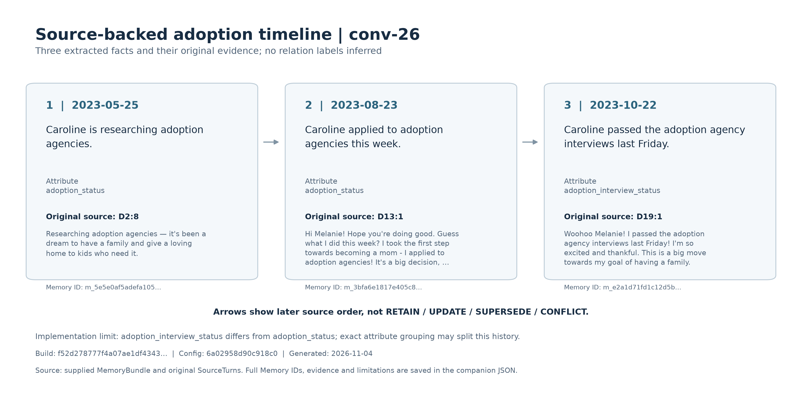
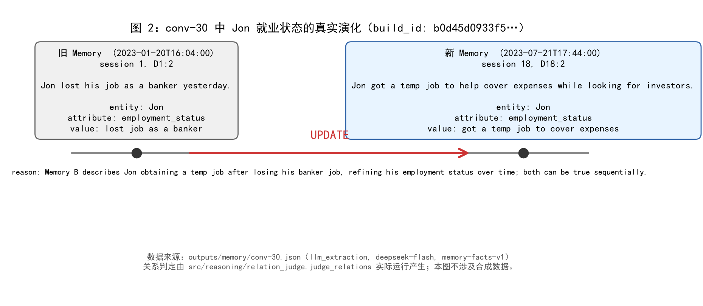
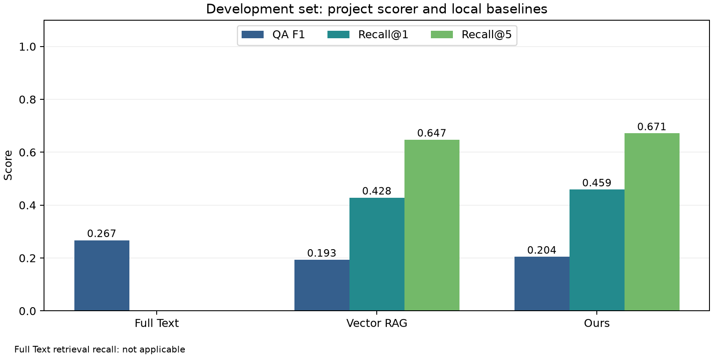
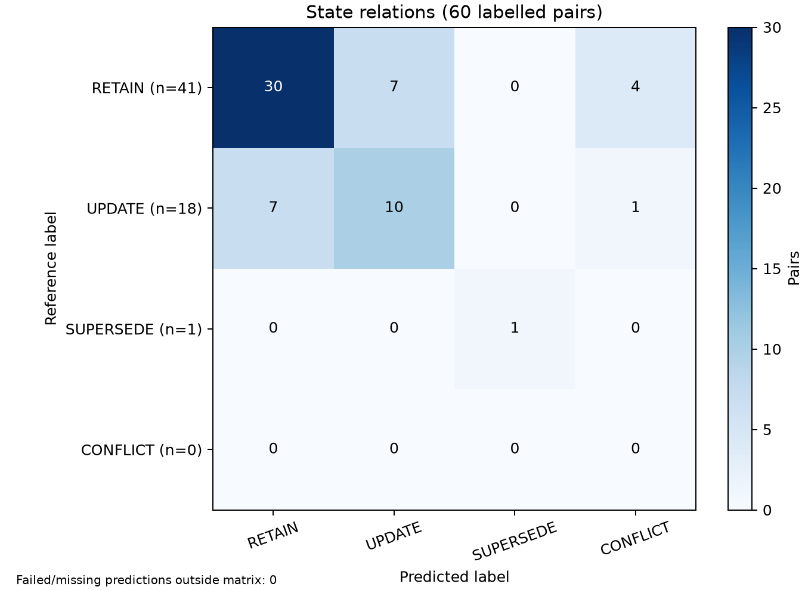

# 智能体动态记忆管理：最终报告

> 课程：软件需求工程  
> 团队：6767 组（队伍 ID：2）  
> 版本：v1.0-final-draft  
> 日期：2026 年 11 月  

<!--
写作说明：
1. 本文件是最终报告框架，不是最终交付稿。定稿时删除全部写作提示。
2. 统一区分“已实现”“已测试”“已验收”“待完成”，不得用设计目标代替实测结果。
3. 所有指标必须写明数据划分、方法版本、配置和样本量；未经真实实验不得填写估计值。
4. 标准答案、gold evidence 和状态关系标签只用于离线评测，不得进入记忆构建、检索或模型输入。
-->

## 填报责任总表

下面指定的是每个部分的**实际填写负责人**。主笔负责把内容写成可提交的正文；供稿人负责提供事实、配置、数据、图表或实现依据；复核人负责检查技术口径、数据真实性和前后一致性。没有明确交给个人的内容不得默认由文档主笔代写。

| 章节 | 主笔 / 实际填写人 | 供稿或数据提供 | 复核 |
| --- | --- | --- | --- |
| 摘要 | 张崇洋 | 全员各提供 3～5 条“结果、限制、贡献” | 陈易 |
| 1 引言 | 陈易 | 于国庆提供问题动机与技术定位 | 张崇洋 |
| 2.1 LoCoMo 数据 | 鲁瑞特 | 张崇洋补充评测口径 | 陈易 |
| 2.2 相关工作、2.3 方法定位 | 于国庆 | 鲁瑞特、张崇洋核对方法差异 | 陈易 |
| 3 需求分析 | 张崇洋 | 各模块负责人确认功能状态；陈易提供约束与变更 | 陈易 |
| 4 系统设计 | 陈易 | 鲁瑞特、于国庆、许子萌提供模块设计；许子萌负责架构图 | 张崇洋 |
| 5.1 记忆构建、5.2 混合检索 | 鲁瑞特 | 张崇洋提供对应测试与指标证据 | 于国庆 |
| 5.3 状态解析、5.4 答案生成 | 于国庆 | 张崇洋提供状态标签与测试结果 | 鲁瑞特 |
| 5.5 Web 应用 | 许子萌 | 陈易提供部署和接口信息 | 张崇洋 |
| 5.6 课程评测接口 | 张崇洋 | 陈易确认最终课程接口 | 于国庆 |
| 6.1 测试策略 | 张崇洋 | 各模块负责人提交测试记录 | 陈易 |
| 6.2 实验问题与假设、6.4 对照方法 | 于国庆 | 张崇洋确认指标可计算性 | 陈易 |
| 6.3 数据划分、6.5 指标定义 | 张崇洋 | 陈易确认课程要求 | 于国庆 |
| 7.1 开发集主结果、7.2 分对话结果 | 张崇洋 | 实际跑批数据，不允许他人估算或代填 | 于国庆 |
| 7.3 状态关系错误分析 | 于国庆 | 张崇洋提供混淆矩阵与错误记录 | 鲁瑞特 |
| 7.4 独立测试集结果 | 张崇洋 | 陈易负责确认冻结记录和数据隔离过程 | 于国庆 |
| 8.1 主要发现 | 张崇洋 | 于国庆、鲁瑞特核对技术结论 | 陈易 |
| 8.2 局限与未来工作 | 陈易 | 全员补充各自模块限制 | 张崇洋 |
| 9 项目管理与团队协作 | 陈易 | 全员确认个人贡献与行动计划偏差 | 张崇洋 |
| 10 结论 | 陈易 | 张崇洋提供最终实验结果 | 全员确认 |
| 附录 A 需求追踪与验收 | 陈易 | FR/NFR 对应负责人填写状态和证据 | 张崇洋 |
| 附录 B 运行与复现 | 陈易 | 鲁瑞特、于国庆、许子萌、张崇洋分别复核本模块命令 | 张崇洋 |
| 附录 C 接口与输出示例 | 陈易 | 于国庆、张崇洋核对推理和评测字段 | 鲁瑞特 |
| 附录 D 团队贡献 | 陈易汇总 | 每名成员先填写自己的贡献，不得由他人代写 | 张崇洋 |

### 图表占位清单

图表不是越多越好。正文保留下面这些必要图表；实际数据产生前只保留占位符，禁止使用示意数字代替实验结果。

| 编号 | 类型 | 内容 | 正文位置 | 生成与填写负责人 | 当前状态 |
| --- | --- | --- | --- | --- | --- |
| 图 1 | 架构图 | 系统总体架构与端到端数据流 | 4.1 | 陈易设计，许子萌绘制 | 已绘制，待架构复核 |
| 图 2 | 流程图 | 一个真实状态变化案例的 Memory 关系演化 | 5.3 | 于国庆 | 【待真实案例确认】 |
| 图 3 | 截图 | Web 问答、有效 Memory、证据与关系视图 | 5.5 | 许子萌 | 已截图（合成样例），待最终界面验收 |
| 图 4 | 分组柱状图 | 三种方法在开发集上的 QA F1 与 Recall 对比 | 7.1 | 张崇洋 | 【待真实实验结果】 |
| 图 5 | 混淆矩阵热力图 | 四类状态关系的判定结果 | 7.3 | 张崇洋生成，于国庆解释 | 【待人工关系标签】 |
| 表 1 | 数据表 | 功能需求与最终实现状态 | 3.2 | 张崇洋 | 【占位表已建立】 |
| 表 2 | 数据表 | 测试层次、工具与结果 | 6.1 | 张崇洋 | 【占位表已建立】 |
| 表 3 | 数据表 | 开发集主结果 | 7.1 | 张崇洋 | 【待真实实验结果】 |
| 表 4 | 数据表 | 开发集分对话结果 | 7.2 | 张崇洋 | 【待真实实验结果】 |
| 表 5 | 数据表 | 状态关系混淆矩阵 | 7.3 | 张崇洋 | 【待人工关系标签】 |
| 表 6 | 数据表 | 独立测试集主结果 | 7.4 | 张崇洋 | 【冻结后运行】 |
| 表 7 | 数据表 | 需求追踪与验收 | 附录 A | 陈易 | 【待最终验收填写】 |

图表文件约定：最终图片放入 `docs/figures/`，文件名使用 `fig-01-architecture.png`、`fig-04-dev-comparison.png` 这类小写短横线格式；原始数据或绘图脚本放入 `experiments/`，确保负责人能够从真实结果重新生成图表。每张图下方必须写明数据来源、样本量、实验配置编号和生成日期。

协作方式：各负责人通过独立分支提交自己负责的章节或 Markdown 片段，并附数据、截图或测试证据；张崇洋负责统一措辞与排版，陈易负责技术口径和最终交付完整性。不要多人同时直接修改同一份 `final-report.md`。

## 摘要

**填报责任：** 张崇洋主笔；全员提供结果、限制和贡献；陈易复核。


<!-- BEGIN AUTO:abstract -->
长程多会话对话中的历史事实可能被后续计划、偏好或状态更新。本项目实现结构化 Memory、混合检索、显式状态关系判定、有效记忆选择和答案生成，并通过本地 Web 与评测接口保存答案及来源。开发集共运行 586 题，其中 586 题有有效参考答案；Full Text、Vector RAG 与本组方法的项目 token F1 分别为 0.2673、0.1932、0.2044。冻结后的独立测试共运行 301 题，三方法 F1 分别为 0.2790、0.1887、0.1966。本组方法在用量记录完整的成功题上平均在线 token 为开发集 642.6、测试集 619.1，分别有 586 与 300 题完整记录用量；失败尝试和未知用量另行披露。对当前参考标签的关系评测共 60 对，Accuracy=0.6833，Macro-F1=0.5852。

**B 模块摘要供稿（待主笔整合，2026-11-04）：**

- 实现白名单输入、来源引用及构建版本贯通的结构化记忆链路，提供 BM25、固定版本 MiniLM 和 RRF 检索。
- 四个公开开发对话的2080轮文本生成951条记忆；145次抽取请求共293996 token，构建耗时合计862.41秒。
- 四个Bundle在隔离目录仅使用交付缓存重建一致；36组真实数据检索工程检查可回溯且重复一致。
- 47条定向辅助核查记录7条问题或限制，尚不能推断全量准确率；正式QA F1、Recall@K和状态准确率由E/C提供。

**关键词：** 长期对话记忆；LoCoMo；动态状态解析；混合检索；有效记忆；软件需求工程

## 1 引言

**填报责任：** 陈易主笔；于国庆提供问题动机与技术定位；张崇洋复核。

### 1.1 问题背景

说明长程、多会话对话中的状态变化，以及普通向量 RAG 同时召回旧状态和新状态所造成的错误回答。应给出一个具体、脱敏的 LoCoMo 状态变化示例，但不得把示例结果冒充实验结论。

长程多会话对话中，用户的状态会持续变化。以课件示例为例：Caroline 在第 1 次会话中说「我在研究领养机构」，在第 2 次会话中说「我上周五通过了领养面试」。这两条记忆都真实存在于对话中，但后者已经取代前者成为当前状态。普通向量 RAG 按语义相似度召回，会同时取出这两条，模型无法仅凭相似度判断哪条仍然有效，于是可能回答「Caroline 正在研究领养机构」——这是过期答案。

问题的本质不是「检索不到相关信息」，而是「检索到了新旧两条，却没有机制判断哪条当前有效」。本项目在检索与答案生成之间增加显式状态关系解析，正是针对这一点

### 1.2 项目目标

明确系统目标：

- 从 LoCoMo 对话中构建可追溯、带来源的结构化 Memory；
- 根据问题检索相关候选记忆；
- 判定 RETAIN、UPDATE、SUPERSEDE、CONFLICT 关系；
- 只使用当前仍然有效的记忆生成答案；
- 通过 Web 展示记忆、证据、答案与状态关系；
- 通过课程命令行接口输出答案并计算三项指标。

### 1.3 项目范围与边界

**范围内：** 单段 LoCoMo 对话内的文本记忆；记忆构建、混合检索、状态解析、答案生成、Web 展示和离线评测。

**范围外：** 多模态输入、跨对话记忆共享、模型训练或微调、面向公网的部署、物理设备控制，以及针对具体测试题写死规则。

### 1.4 主要贡献

从以下四个方面提炼，避免把普通工程实现包装成研究贡献：

1. 面向长对话状态变化的可追溯结构化 Memory；
2. 在检索与生成之间加入显式状态关系解析层；
3. 同时评价问答质量、证据召回和状态判断的课程评测链路；
4. 可复现的 Web 演示、实验记录与需求追踪材料。

【待根据最终实验结论调整措辞】

## 2 背景、数据与相关工作

**填报责任：** 各小节负责人不同，见下。

### 2.1 LoCoMo 数据

**填报责任：** 鲁瑞特主笔；张崇洋补充评测口径；陈易复核。

本项目按 `sample_id` 读取 LoCoMo 的单段多会话对话。每段对话包含按编号排列的 `session_*`、会话时间和各轮的 `dia_id`、说话人与文本；同一人物的事实可能随会话推进而变化，因此来源顺序、会话时间与事实发生时间需要分别保留。数据中的 QA、标准答案、证据轮次标注和事件摘要可服务于离线评测，但不进入本模块的构建输入。

读取器采用字段白名单，仅从 `conversation` 的原始轮次构造 `SourceTurn`。清洗移除图片 Markdown、已知图片链接和空文本，保留普通文本链接；缺失轮次 ID、重复来源或非法结构明确报错。可识别的会话日期统一为 ISO 格式，无法识别时保留空值并告警。后续抽取使用的来源标识由会话编号与轮次 ID 组成，避免跨会话误引用。

| 项目 | 本项目口径 |
| --- | --- |
| 开发集 | `conv-26`、`conv-30`、`conv-41`、`conv-42`；用于调试 prompt、参数和错误修复 |
| 独立测试集 | `conv-43`、`conv-44`；按可任选两段的要求固定，正式运行须绑定冻结配置 |
| 文本范围 | 单段对话内的文本轮次；移除图片链接和无文本轮次 |
| 来源版本 | 当前开发集产物的 manifest 声明 `source_kind=public`；尚无课程文件逐字一致性证明 |
| 测试使用边界 | 不用测试标签调参；测试 Memory 只从原始对话构建 |

本报告历史结果使用 `outputs/locomo-public/runs/20261101T134604Z-5c326221/manifest.json` 对应的构建。该运行记录的源文件 SHA-256 为 `79fa87e90f04081343b8c8debecb80a9a6842b76a7aa537dc9fdf651ea698ff4`，抽取配置 ID 为 `6a02958d90c918c0`，prompt 为 `memory-facts-v1`，模型标识为 `deepseek-flash`，Python 为 3.12.16。API 返回的是模型名称，没有不可变权重版本。

| 对话 | 原文轮数 | Memory 数量 | 构建耗时/秒 | API 返回总 token | 缓存重建一致 |
| --- | ---: | ---: | ---: | ---: | --- |
| conv-26 | 419 | 204 | 75.75 | 61,049 | 是 |
| conv-30 | 369 | 164 | 60.83 | 51,343 | 是 |
| conv-41 | 663 | 291 | 113.95 | 93,138 | 是 |
| conv-42 | 629 | 299 | 115.72 | 88,958 | 是 |
| 合计 | 2,080 | 958 | 366.24 | 294,488 | 四段均一致 |

该表是一次离线 Memory 构建的耗时与 API 用量，不是每题问答成本。manifest 中质量审阅状态仍为 `pending`。`docs/final-report-b.md` 记载的 951 条 Memory、47 条抽查及 7 条问题属于此前另一轮构建；这些结论不直接迁移到本次 958 条构建。

### 2.2 相关工作

**填报责任：** 于国庆主笔；鲁瑞特、张崇洋核对方法差异；陈易复核。

| 工作    | 核心思想                                                     | 本项目借鉴                                            | 本项目未复刻                             |
| :------ | :----------------------------------------------------------- | :---------------------------------------------------- | :--------------------------------------- |
| LoCoMo  | 提供长程多会话对话、QA、证据轮次与事件标注，用于评测长期记忆 | 使用其对话结构与证据轮次作为评测口径                  | 不使用其多模态部分，不针对具体题目写规则 |
| DimMem  | 结构化记忆 + 多维度检索，按人物、时间、属性组织，检索可按维度过滤 | 采用结构化 Memory，保留实体、属性、时间与来源         | 不构建完整维度索引，不做记忆合并压缩     |
| MRAgent | Cue–Tag–Content 图与主动检索，用 Cue 触发、Tag 限定范围      | 借鉴「先限定范围再检索」的思路，用 Query 分析收窄候选 | 不构建图记忆，不做多跳主动检索           |

本项目的重点不在记忆结构本身，而在检索之后、生成之前的显式状态关系判定。三项工作都没有把 RETAIN / UPDATE / SUPERSEDE / CONFLICT 作为独立环节处理，这是本组与它们的主要差异。

### 2.3 本文方法定位

**填报责任：** 于国庆主笔；陈易复核。

本组采用轻量级结构化 Memory 与混合检索，不构建完整图记忆。核心差异是：在答案生成前显式执行状态关系判定与有效记忆选择。系统先按 `(entity, attribute)` 分组候选记忆，由模型判定四类关系，再根据问题的时间视角筛选当前有效记忆，最后只把有效记忆交给生成模型。这一层是本组方法与 Full Text、Vector RAG 两个基线在结构上的唯一区别，也是实验要验证的对象。

## 3 需求分析

**填报责任：** 张崇洋主笔；各模块负责人确认功能状态，陈易提供约束与变更；陈易复核。

### 3.1 用户与使用场景

| 用户 | 核心场景 | 主要需求 |
| --- | --- | --- |
| 项目开发成员 | 构建并检查 Memory、调试问答 | 数据可追溯、结果可复现 |
| 课堂演示者与听众 | 展示状态变化与系统依据 | Web 可视化、错误提示清楚 |
| 课程评测人员 | 批量提交问题并读取答案 | 参数化 CLI、固定输出格式 |
| 后续维护者 | 修改模块或复现实验 | 接口稳定、测试与文档完整 |

### 3.2 功能需求概览


| 功能 | 需求编号 | 实现模块 | 当前状态 | 证据范围 |
| --- | --- | --- | --- | --- |
| 记忆构建与存储 | FR-01–FR-03 | `src/memory/`、`src/common/` | 已测试 | 数据白名单、字段与来源校验、缓存、持久化；已有真实开发集构建 |
| 候选检索与证据回溯 | FR-04–FR-07 | `src/index/`、`src/memory/store.py` | 已测试 | 排序、过滤、融合、缓存与来源回溯；历史运行有 Recall 记录 |
| 状态解析与答案生成 | FR-08–FR-11 | `src/reasoning/` | 已测试 | 合成输入与 Mock 验证；正式人工关系准确率和追溯抽样未完成 |
| Web 记忆与关系可视化 | FR-12–FR-15 | `src/web/` | 已测试 | 局部浏览器检查及一次合成样例在线问答，完整验收未完成 |
| 评测与对照 | FR-16–FR-18 | `src/eval/`、`experiments/` | 已测试 | 指标、CLI、聚合有离线测试；正式三方法对照与课程接口确认未完成 |

### 3.3 非功能需求

可复现性（NFR-01）通过输入哈希、依赖和 MiniLM revision、prompt 版本、构建身份与响应缓存实现。远端模型没有不可变版本，未缓存的两次调用不承诺逐字相同。跨平台性（NFR-02）以 Python 3.11、macOS 与 Windows 为验收目标，当前 3.12.16 的通过结果不能替代基准版本和双平台验收。

可追溯性（NFR-03）要求 Memory、候选和答案引用同一对话与 `build_id`，来源能够定位至原轮次。安全与数据隔离（NFR-04、NFR-06）要求密钥只来自本地配置、原始对话按数据处理，gold 标签只用于评分。性能与资源使用（NFR-05）需分别记录构建、问答各阶段的时间和 token；目前历史问答缺少这些字段，不能据此判定性能阈值已满足。

### 3.4 需求变更

| 变更 | 原因与影响 | 仓库证据 | 确认边界 |
| --- | --- | --- | --- |
| 取消 Web 上传原始 LoCoMo JSON | Web 直接消费预构建 MemoryBundle，避免页面同时承担构建与问答；离线构建入口保留 | `b82985e` / PR #34，2026-10-29 | 以已合入仓库记录为依据 |
| 固定开发集与测试隔离口径 | 使 prompt 和检索调试只使用四段开发对话 | `c5e9bcc` / PR #27，2026-10-24 | 测试使用仍须绑定冻结记录 |
| 补充参数化评测与结果聚合 | 支持在线答题、离线复算、按方法归并指标 | `84fa6d0` / PR #28；`f26987d` / PR #38 | 代码与测试存在不等于课程接口已验收 |


## 4 系统设计

**填报责任：** 陈易主笔；鲁瑞特、于国庆、许子萌提供模块设计，许子萌负责架构图；张崇洋复核。

### 4.1 总体架构


*图 1：系统总体架构。数据来源：现有代码、接口定义与项目设计；样本量和实验配置不适用；绘制日期：2026-11-03。图示区分索引模块支持的检索能力与 Web 当前使用的 BM25，最终架构口径待组长及相关模块负责人复核。可编辑源文件：[`fig-01-architecture.svg`](figures/fig-01-architecture.svg)。*

给出一张最终架构图，至少包含：

```text
locomo.json
  → Memory 构建与校验
  → MemoryBundle（版本、来源、记忆）
  → BM25 / MiniLM / RRF
  → Query 分析
  → 状态关系判定
  → 有效记忆选择
  → DeepSeek 答案生成
  → Web 展示 / 课程 answers.json / 指标计算
```

强调离线构建与在线问答分离、历史事实保留、构建版本一致性和证据回溯。

### 4.2 数据模型与模块边界

用表格说明 `MemoryBundle`、`SourceRef`、`RetrievalResult`、`MemoryRelation`、`AnswerRecord` 的职责，以及它们如何连接各模块。字段细节引用 `docs/interfaces.md`，正文只解释关键契约与版本约束。

**B 模块设计供稿：** `MemoryBundle` 聚合构建身份、Memory和原始`SourceTurn`，`SourceRef`定位同一对话中的会话与轮次；`RetrievalResult`携带对话ID、`build_id`、命中列表及通道trace。索引对Bundle建立独立快照，后续来源读取沿用该快照。离线构建保留历史，在线阶段由C判断有效性；数据模型和错误边界见§5.1、§5.2及[接口文档](interfaces.md)。

### 4.3 关键设计决策

| 决策 | 选择 | 原因 | 代价或限制 |
| --- | --- | --- | --- |
| 存储方式 | UTF-8 JSON | 简单、透明、便于课程交付 | 大规模并发与查询能力有限 |
| 检索 | BM25 + 向量 + RRF | 兼顾字面与语义匹配 | 增加索引和模型依赖 |
| 状态解析 | LLM 分组成对判定 | 能利用时间与上下文 | 有延迟、费用和稳定性风险 |
| 历史处理 | 构建时保留，查询时筛选 | 支持当前与历史问题 | 状态判断负担转移至在线阶段 |
| Web | 原生 HTML/CSS/JavaScript + Python 标准库 | 无前端构建步骤，便于复现 | 组件化和交互能力受限 |

### 4.4 错误处理与数据隔离

说明非法模型输出、API 重试、版本不匹配、来源缺失、空检索和 Web 请求错误的处理方式；再次明确评测标签不得进入构建与推理。

## 5 详细实现

**填报责任：** 各小节负责人不同，见下。

### 5.1 结构化记忆构建

**填报责任：** 鲁瑞特主笔；张崇洋提供测试证据；于国庆复核接口衔接。

`src/memory/locomo.py` 按原始会话和轮次顺序读取文本、解析会话时间，过滤图片链接并保留来源 ID。DeepSeek 抽取按会话边界分块，当前开发集构建最多 20 轮、12,000 字符一块，通过 JSON 输出返回事实。每条事实保存 content、entity、attribute、value、原始时间表达、事件日期与精度；未知日期留空，不把会话日期直接视为事件日期。

构建结果通过 Pydantic 验证后产生稳定的 Memory ID 与 `build_id`。缓存身份绑定输入、配置和 prompt 版本，JSON 以 UTF-8 原子保存。`turns` 模式将原文轮次映射为记忆，供无 API 的管线调试，不能替代语义抽取质量评测。当前四个开发集构建和缓存重建事实见 §2.1；未将此前 951 条构建的质量抽查当作本轮 958 条的抽查结果。

每条 Memory 保存事实描述、实体、属性、值、原始时间表达、事件时间及精度和来源。会话时间表示对话何时发生，事件时间表示所述事实何时发生，二者不能直接替换。无法确定的日期允许为 `null`，计划与已发生事件应通过事实描述区分。Pydantic 校验负责字段、时间结构及来源合法性，不能保证模型对人物、代词或相对时间的语义判断正确。

缓存身份包含白名单输入、请求模型、prompt、配置及输出长度上限等；缓存缺失或损坏时，`--cache-only` 明确失败，不自动请求 API。Memory ID 对事实及来源生成指纹，`build_id` 将输入、配置、prompt 与构建结果关联起来。保存采用 UTF-8 JSON 原子替换，加载时重新校验 Bundle；检索和证据读取绑定同一构建快照。构建阶段保留旧事实与新事实，查询阶段再由状态解析模块决定有效记忆，避免构建时删除历史后无法回答历史问题。

本轮构建使用 `deepseek-flash`、`memory-facts-v1`，配置 ID 为 `6a02958d90c918c0`；温度为 0、关闭 thinking、每次最多输出 8192 token。请求模型名与 API 返回模型名一致，但服务端未提供不可变权重版本，因此仅记录服务名称和响应缓存，不声称锁定了远端模型快照。

四个 Bundle 均通过保存/加载一致性及仅缓存重建验证。此前 951 条构建的 47 条定向抽查和 7 条问题记录仍见[质量记录](milestone5-b-quality.md)，但这些结论不直接迁移到本轮 958 条构建。

### 5.2 混合检索与证据回溯

**填报责任：** 鲁瑞特主笔；张崇洋提供检索测试与指标证据；于国庆复核检索到推理的交接。

索引模块提供 `bm25`、`vector` 和 `hybrid` 三种模式。BM25 将 Memory 的 `content`、`entity`、`attribute`、`value` 拼接后分词，英文按小写字母与数字词项处理，中文仅提供逐字回退；参数为 `k1=1.5`、`b=0.75`。字面匹配适合实体、属性和明确关键词查询，无共享词项时可以返回空命中，而不是强行补足 K 条。

向量检索使用本地 `sentence-transformers/all-MiniLM-L6-v2`，固定 revision 为 `1110a243fdf4706b3f48f1d95db1a4f5529b4d41`。仅对 Memory 的 `content` 编码，得到 384 维归一化向量，以点积计算余弦相似度；问题使用同一编码器。超过模型 256 token 长度上限时明确报错，不通过静默截断丢失事实。向量缓存记录构建身份、模型版本、编码设置和库版本；模型缺失、维度错误或缓存损坏均报错。BM25 基础安装无需加载向量模型，向量与混合模式需额外安装 `requirements-vector.txt`。

混合检索先对候选应用实体、属性的精确过滤，两路各保留 `candidate_k` 条，按 Memory ID 去重，再以等权倒数排名融合计算：`RRF(m) = Σ 1 / (60 + rank_channel(m))`。仅对该记忆出现的通道求和，排名从 1 开始。最终按融合分降序排列，同分按 Memory ID 排序，返回不超过 `top_k` 条；请求要求 `top_k ≤ candidate_k`。CLI 默认值分别为 10 和 30，正式实验仍须记录实际参数。返回结果保留各路原始分数、排名和 trace，不把不同量纲的 BM25 与余弦分数直接相加。

`retrieve_context` 将初始命中、所需原文与可选关联历史交给推理模块。关联历史必须显式提供实体、属性及正整数上限，且与初始 `retrieval.hits` 分开，供 E 按初始 Top-K 计算证据召回，避免扩展历史改变指标口径。原文从同一索引快照读取、按来源引用去重；跨对话或混用构建版本被拒绝。本模块提供候选与证据，不执行四类状态关系判定。当前 Web 使用 BM25，不能据此声称线上页面已采用混合检索。

已有真实数据工程检查覆盖四个开发对话，每段选首、中、末三条记忆内容作为查询，分别运行三种模式，共 36 组；全部命中均可回溯，重复结果一致，见[检索检查记录](evidence/member-b/retrieval-verification.json)。查询来自记忆内容本身，所以这里只验证接口、来源和确定性，不作为真实问题分布上的 Recall@K 或三种方法优劣证据。2026-11-04 在报告基线 `c830cb5` 上复跑四个相关测试文件，共 58 项通过；记录见[报告核对清单](evidence/member-b/report-check.json)。

可选实体、属性过滤在各通道截断前应用；最终 Top-K 与 `candidate_k` 分别控制返回量与单路候选量。初始 hits 用于 Recall@K；关联历史由单独接口读取并标记截断，不能悄悄并入初始检索指标。每条命中的 sources 可定位回 MemoryBundle 内的原始轮次。

### 5.3 动态状态解析

**填报责任：** 于国庆主笔；张崇洋提供状态标签和测试结果；鲁瑞特复核数据输入。

### 5.3.1 Query 分析

`query_analyzer` 接收用户问题、`conversation_id` 与 `build_id`，调用 DeepSeek 官方接口（关闭 thinking，`response_format=json_object`），输出 `QueryAnalysisResult`：

| 字段              | 含义                                                     |
| :---------------- | :------------------------------------------------------- |
| `entity`          | 问题涉及的核心实体，可为空                               |
| `time_scope`      | `current` / `past` / `specific`，决定 SUPERSEDE 是否生效 |
| `time_expression` | 问题中的时间原文                                         |
| `attribute`       | 问题询问的属性或事件类别                                 |
| `confidence`      | 抽取置信度，仅用于诊断                                   |

返回空 content 或 JSON 非法时重试 2 次；401 / 402 直接抛出，不进入重试。

### 5.3.2 候选记忆分组

`relation_judge` 先按 `(entity, attribute)` 分组。**`entity` 或 `attribute` 为 null 的记忆不进入比较流程**——这一规则在 `turn_baseline` 模式下避免了 419 条记忆产生约 8 万次无意义模型调用。跨组记忆不产生关系记录，下游默认视为 RETAIN。

### 5.3.3 四类关系的判定

判定综合时间顺序（`session_time` 与 `event_time`）、实体一致性、属性一致性与事件上下文，不依赖语义相似度。

| 关系      | 判定                   | 当前问题下的处理     | 历史问题下的处理     |
| :-------- | :--------------------- | :------------------- | :------------------- |
| RETAIN    | 可同时成立             | 保留                 | 保留                 |
| UPDATE    | 后续信息补充或局部修改 | 使用更新后的有效状态 | 按问题时间范围选择   |
| SUPERSEDE | 新状态明确替代旧状态   | 过滤旧状态           | 保留旧状态用于回溯   |
| CONFLICT  | 互斥且无法消解         | 两条均保留并提示冲突 | 两条均保留并提示冲突 |

两条记忆的 `event_time` 与 `session_time` **均缺失**时，强制判为 CONFLICT，不调用模型，不推测时间先后。模型返回非法 JSON 时重试 2 次，仍失败则降级为 CONFLICT 并记录原因，不中断流水线。输出 `MemoryRelation` 含 `memory_a`、`memory_b`、`relation_type`、`reason`、`sources`，来源按 `(session_id, turn_id)` 去重。

### 5.3.4 有效记忆选择

`memory_selector.select_effective` 按关系过滤：

- RETAIN、UPDATE、CONFLICT：保留
- SUPERSEDE：当 `time_scope != "past"` 时丢弃旧值；`time_scope == "past"` 时保留旧记忆供回溯性提问使用

这一规则对应 `memory-design.md` 中「询问过去状态时，旧事实仍可能是所需答案依据」。

UPDATE 当前没有实现独立的结构化合并操作，不能把“保留供生成”写成“已合并为新 Memory”。`specific` 视角尚无完整的日期截止筛选，需在时间问题上单独验证。

#### 图 2：真实状态时间线与关系案例

**真实事实时间线：** 下表来自本轮 `conv-26` 的原文与 Memory，不包含人工 gold 或系统关系预测。

| 来源 | 会话时间 | 已核对事实 | 当前抽取属性 |
| --- | --- | --- | --- |
| D2:8 | 2023-05-25 | 正在研究收养机构 | adoption_status |
| D13:1 | 2023-08-23 | 已申请收养机构 | adoption_status |
| D19:1 | 2023-10-22 | 已通过收养机构面试 | adoption_interview_status |



*图 2：从本轮 `conv-26` MemoryBundle 自动读取的真实事实与原文。样本量：3 条 Memory，0 个评测问题；抽取配置：`6a02958d90c918c0`，`build_id=f52d278777f4a07ae1df43430f48b08598ffa08a01fbbfb57e22fccc0f82a76a`；生成日期：2026-11-04。箭头仅表示来源先后，不是系统预测或人工 gold 的关系类型。生成脚本：`experiments/draw_state_example.py`；可编辑 SVG 与完整 Memory ID、原文、构建身份及局限见同名 `.svg`、`.json`。*

三条事实对应 Memory ID 前缀为 `m_5e5e0af5`、`m_3bfa6e18`、`m_e2a1d71f`。最后一条属性不同，当前分组规则可能漏掉跨属性关联。图 2 没有填写未经运行的 UPDATE 等关系标签；完整状态关系演化解释需以人工复核标签与冻结版运行补充。



*图 2 补充：该图来自 `conv-30` 的真实 Memory 与关系判定输出，箭头表示系统运行时判定的 UPDATE 关系，不是人工 gold。该案例用于展示状态解析机制；最终效果仍以独立测试集上的冻结版指标为准。*

### 5.4 答案生成

**填报责任：** 于国庆主笔；张崇洋提供问答结果；陈易复核课程输出要求。

答案 prompt 接收问题、有效 Memory 的事实内容、说出该事实的时间、事件时间和必要冲突提示，不读取标准答案。输出为一句话及 `valid_memory_ids`、`conflict`、`build_id`。历史版本的空模型内容写为 `(no answer)`；这类结果应作为失败或拒答披露，不是正确答案。模型服务状态、远端版本与上下文长度都会影响输出，正式实验应记录请求配置及输入、输出 token。

`answer_generator.generate_answer` 的输入仅包含：问题、有效 Memory 列表、冲突标记。有效记忆逐条列入 prompt；存在 CONFLICT 时附加 `[Note: conflicting information exists.]`。调用 DeepSeek 官方接口，关闭 thinking，生成一句话答案。

输出 `AnswerRecord`：

| 字段               | 含义                                          |
| :----------------- | :-------------------------------------------- |
| `answer`           | 一句话答案；空 content 时降级为 `(no answer)` |
| `valid_memory_ids` | 参与生成的有效记忆 ID                         |
| `conflict`         | 有效记忆集合是否存在冲突                      |
| `build_id`         | 与检索结果一致的构建版本                      |
| `question_id`      | 评测题号，非评测为 null                       |

异常处理：模型返回空 content 时降级并记录，不中断批量评测；`build_id` 与当前 bundle 不一致由上游检索模块抛 `RuntimeError`，本模块不重复校验。生成结果只读使用记忆，不写回 MemoryBundle。

### 5.5 Web 应用

**填报责任：** 许子萌主笔；陈易提供部署与接口信息；张崇洋复核截图和演示步骤。

Web 模块由 `src/web/server.py` 和 `src/web/static/` 组成。服务使用 Python 标准库 `ThreadingHTTPServer` 提供静态页面和 JSON 接口，默认监听 `127.0.0.1:8000`；页面使用原生 HTML、CSS 和 JavaScript，无需前端构建。服务从 `WEB_MEMORY_DIR` 指定的目录读取预构建的 `MemoryBundle`。页面分为“记忆库”和“智能问答”：前者选择对话、检索并浏览记忆，点击记忆可回看对应原始轮次；后者提交问题，展示回答、有效记忆数量、构建版本、状态关系、判定理由和证据入口。图中被选作答案依据的关系节点会被突出显示。

| 接口 | 作用 |
| --- | --- |
| `GET /api/conversations` | 列出可用对话与构建信息 |
| `GET /api/memories?conversation_id=…` | 读取所选对话的记忆列表 |
| `GET /api/memories/{memory_id}?conversation_id=…` | 读取记忆详情与来源轮次 |
| `POST /api/ask` | 对指定对话和问题执行检索、状态解析、有效记忆选择与答案生成，返回答案及关系等信息 |

当前 Web 问答使用 BM25 检索，并调用已有推理与答案生成模块；Web 不重新判定记忆关系。页面会在切换对话时清除旧回答，在请求失败或版本不一致时显示错误。浏览记忆和来源不需要模型 API；在线问答需要配置可用的 DeepSeek 服务。当前页面不提供原始 LoCoMo 上传或 Memory 构建功能，应先在页面外准备好 MemoryBundle。


*图 3：新版 Web 演示截图。数据来源：仓库中的合成样例 `examples/demo_dynamic_memory.json`；样本量：1 次提问、2 条记忆；配置：BM25、DeepSeek 在线问答，`build_id=manual-demo-state-change-v1`，基于提交 `83636d6` 和本地未提交的前端修改；生成日期：2026-11-03。相关运行记录见 [`fig-03-web-demo-evidence.json`](figures/fig-03-web-demo-evidence.json)。该演示不作为 LoCoMo 实验结果或模型效果指标。*

演示时先选择 `demo-state-change`，在记忆库中查看记忆和来源，再进入智能问答页询问 “What is Alex's current adoption status?”。本次实际返回 Alex 已通过收养机构面试，并展示一条 `UPDATE` 关系；点击关系节点后可回看相应来源轮次。此记录只证明该样例当次运行及界面展示，不证明其他问题、全部关系类型或课程数据均已通过验收。

### 5.6 课程评测接口

**填报责任：** 张崇洋主笔；陈易确认最终课程接口；于国庆复核完整调用链。

`src.eval` 接受对话编号、问题文件、MemoryBundle 和输出路径。在线模式读取预构建 Memory；`--answers-input` 用于离线评分，不再次调用模型。

```bash
python -m src.eval \
  --conversation conv-26 \
  --questions locomo.json \
  --memory outputs/locomo-public/memory/conv-26.json \
  --mode hybrid --top-k 5 --candidate-k 30 \
  --output outputs/eval/conv-26-answers.json \
  --metrics-output outputs/eval/conv-26-metrics.json
```

答案记录包含题号、对话号、问题、一句话答案、有效记忆、冲突标志、构建信息与检索记录；本轮补充query_analysis、relations数组、token_usage、elapsed_seconds和模型身份。

## 6 测试与实验方法

**填报责任：** 以张崇洋为主，于国庆负责实验设计与对照方法；各模块负责人提供测试证据。

### 6.1 测试策略

**填报责任：** 张崇洋主笔；各模块负责人提交测试记录；陈易复核。

**表 2 占位：测试层次、工具与最终结果。** 各模块负责人提供测试记录，张崇洋汇总；不能只写“测试通过”，必须写清命令、数量和日期。

| 层次 | 验证内容 | 工具或证据 | 最终结果 |
| --- | --- | --- | --- |
| 单元测试 | 数据契约、检索、关系选择、指标计算 | pytest | 2026-11-04，系统与 Python 版本见 `outputs/final/verification.json`；`python -m pytest -o addopts= -q`：147 passed in 1.25s（全仓总数，包含集成测试，未单独统计纯单元测试数）；记录：`outputs/final/check-1.txt`。 |
| 静态检查 | 格式、未使用导入、行宽等 | Ruff | 2026-11-04：`python -m ruff check .`：All checks passed!；`python -m ruff format --check .`：51 files already formatted；记录：`outputs/final/check-2.txt`、`outputs/final/check-3.txt`。 |
| 集成测试 | Memory→检索→推理→答案→指标 | pytest + CLI | 2026-11-04：Memory 保存/加载、检索、推理与指标交接随全仓 pytest 验证，通过数计入单元测试行的总数；`python -m experiments.run_final_eval --dataset dev ...` 开发集来源预检查通过，完整参数见 `outputs/final/verification.json`，记录：`outputs/final/check-4.txt`。 |
| 真实数据测试 | DeepSeek 抽取、四段开发集 Memory | 实际命令与产物 | 2026-11-04：四段开发集 Memory 来源预检查通过，共 958 条（204/164/291/299）；`./.venv/bin/python -m experiments.final_workflow dev --execute` 完成三方法各 586 题、共 1,758 条，0 失败；见 `outputs/final/dev/manifest.json` 和表 3、表 4；两段测试 Memory 已构建（conv-43：317 条，conv-44：305 条）并冻结；`./.venv/bin/python -m experiments.final_workflow test --execute` 已完成三方法各 301 题、共 903 条，最终无缺失答案；曾有 4 次 API 连接失败及 2 次人工中断并已断点续跑，见 `outputs/final/test/attempts.jsonl`、`manifest.json` 和表 6。 |
| Web 验收 | 浏览、证据、问答、关系图 | Chrome 浏览器自动操作与图 3；见 §5.5 和附录 A | 2026-11-02：四个对话选项、记忆与证据、视图切换、对话切换及窄屏布局检查；问答交互使用模拟响应。2026-11-03：1 次两条合成记忆的真实在线问答；仅为局部测试，最终验收待完成；2026-11-04：26 项 HTTP 集成测试通过（模型为 mock），见 `outputs/final/check-1.txt`；完整浏览器/真实模型页面验收仍待完成。 2026-11-04 23:10（UTC+8）补充 19 项不调用模型的真实 HTTP 请求：六段对话的 Memory 数量为 204/164/291/299/317/305，列表/详情 build_id 一致，来源可读取，空问题返回 400；明细见 `docs/web-browser-audit.md`。浏览器工具通道不可用，未取得本轮 UI 截图，完整页面验收仍待完成。 |
| 跨平台验收 | Python 3.11、macOS、Windows | 两平台测试记录 | 2026-11-04：已有 macOS 15.5 arm64、Python 3.12.16 的全仓 147 项通过记录；Python 3.11 与 Windows 实机验收尚未完成，不能以当前记录代替两平台验收。 |

**B 模块测试供稿：** 2026-11-04在报告基线`c830cb5`上，使用Windows/Python 3.13.5复跑`test_memory_devbuild.py`、`test_memory_pipeline.py`、`test_reasoning_context.py`、`test_vector_retrieval.py`，58项通过，覆盖白名单、分块、缓存、存储、索引、融合与上下文交接。这是选定测试集，不代表全仓库或Python 3.11/macOS验收。真实构建、145次缓存重建和36组检索记录见§5及[证据索引](evidence/member-b/report-check.json)。

### 6.2 实验问题与假设

**填报责任：** 于国庆主笔；张崇洋确认每个研究问题都能由实际指标回答。

| 编号 | 研究问题 | 可检验假设 |
| --- | --- | --- |
| RQ1 | 结构化 Memory 能否保留回答问题所需的证据？ | 本组方法的 Recall@K 不低于 Vector RAG，或能说明差异来源 |
| RQ2 | 状态关系解析能否减少过期记忆造成的错误？ | 本组方法的 QA F1 优于不做状态判断的 Vector RAG |
| RQ3 | 显式状态解析的收益是否值得额外 token 与延迟？ | 以 F1、平均 token 和耗时的联合结果判断 |
| RQ4 | 系统在未见测试对话上是否仍成立？ | 冻结配置后独立测试集结果与开发集结论方向一致 |

### 6.3 数据划分与防泄漏

**填报责任：** 张崇洋主笔；陈易确认课程要求；于国庆复核训练、调试和测试边界。

开发集固定为 `conv-26/30/41/42`；测试集固定为 `conv-43/44`。测试方案、代码、prompt、模型、K、Memory 身份与原始数据哈希应写入冻结 manifest，再启动正式测试。测试原文可以作为系统输入，但人工标准答案、gold evidence 与关系标签只由评分步骤读取，不进入检索请求或模型消息。测试中出现失败时保留记录；若不得不修改代码，应记录原因和新版本，不能把修复前后结果当作同一次冻结实验。
### 6.4 对照方法

**填报责任：** 于国庆主笔；张崇洋确认基线可运行和可比较；陈易复核。

| 方法 | 输入范围 | 是否检索 | 是否状态解析 | 用途 |
| --- | --- | --- | --- | --- |
| Full Text | 对话全文 | 否 | 否 | 检验直接长上下文回答 |
| Vector RAG | 向量 Top-K Memory | 是 | 否 | 隔离普通语义检索效果 |
| 本组方法 | BM25 + 向量 + RRF 候选 | 是 | 是 | 验证完整方案 |

三个方法必须使用相同数据、问题、生成模型和评分口径；Full Text 与 Vector RAG 的「状态更新准确率」标记为不适用，因为它们不含状态解析环节。本组方法内部另做消融：关闭状态解析（等价于 Vector RAG 走同一候选集）与开启状态解析对比，用于隔离状态解析单独的贡献。

### 6.5 指标定义

**填报责任：** 张崇洋主笔；陈易确认课程口径；于国庆复核状态指标定义。

| 指标 | 定义 | 汇总方式 | 备注 |
| --- | --- | --- | --- |
| QA F1 | 生成答案与标准答案的词级 F1 | 宏平均 | 按课程指定口径 |
| Recall@K | 前 K 条 Memory 的来源是否覆盖至少一条关键证据 | Recall@1、Recall@5 | gold evidence 只用于评分 |
| 状态更新准确率 | 四类关系判定正确比例 | 总体准确率 + 混淆矩阵 | 同时报告各类样本量 |
| 平均 token | 每方法每题输入与输出 token 总和 | 算术平均 | 记录模型与计费口径 |
| 平均耗时 | 每题问答耗时 | 算术平均；另报中位数 | 标明设备和网络条件 |

## 7 实验结果与分析

**填报责任：** 张崇洋负责真实跑批、数据和主结果；于国庆负责状态错误分析。

> 本节只能填写真实运行结果。未运行的实验保留“待完成”，不得生成示意分数。

### 7.1 开发集主结果
本轮正式开发实验在相同问题、模型、生成约束和固定参数下完成三种方法对照。表 3 由完整运行产物自动汇总，三方法各运行 586 题，共 1,758 条答案，失败数为 0。

<!-- BEGIN AUTO:table-dev -->
**表 3 开发集主结果。**

| 方法 | QA F1 | Recall@1 | Recall@5 | 状态更新准确率 | 平均 token | 平均耗时（秒） |
| --- | ---: | ---: | ---: | --- | ---: | ---: |
| Full Text | 0.2673 | 不适用 | 不适用 | 不适用 | 29449.2 | 1.317 |
| Vector RAG | 0.1932 | 0.4281 | 0.6473 | 不适用 | 280.8 | 1.075 |
| 本组方法 | 0.2044 | 0.4589 | 0.6712 | 见独立关系评测 | 642.6 | 2.686 |

配置编号：`533a5a031527cef0b127c801abcbd0577054cb1d224ce90195e6b89587f31101`；模型：`deepseek-flash`；数据划分：conv-26, conv-30, conv-41, conv-42；检索参数：Top-K=5，candidate-K=30。

三个方法均为本仓库实现；QA F1 使用项目评分器，尚不代表课程官方评分。状态准确率以单独的记忆对评测报告，不能从 QA 题数推算。

| 方法 | 运行题数 | QA F1 分母 | Recall 分母 | token 有记录题数 | 耗时有记录题数 | 中位耗时（秒） |
| --- | ---: | ---: | ---: | ---: | ---: | ---: |
| Full Text | 586 | 586 | 不适用 | 586 | 586 | 1.283 |
| Vector RAG | 586 | 586 | 584 | 586 | 586 | 1.030 |
| 本组方法 | 586 | 586 | 584 | 586 | 586 | 2.273 |

平均 token/耗时按成功完成且有记录的问题统计；失败尝试单列，不作为完整费用账单。

| 方法 | 记录的失败尝试数 | 失败尝试已知 token | token 未知的失败尝试数 |
| --- | ---: | ---: | ---: |
| Full Text | 0 | 0 | 0 |
| Vector RAG | 0 | 0 | 0 |
| 本组方法 | 0 | 0 | 0 |



*图 4：来源为本次完整开发集逐题结果；样本量、配置编号和分母见表 3。生成时间：2026-11-04T14:51:21.969230+00:00。*
<!-- END AUTO:table-dev -->

**历史开发运行（不并入上述正式对照）：** `outputs/eval/dev-hybrid/dev-answers.json` 保存 757 条本组 `hybrid+state` 结果，对应 §2.1 的 958 条 Memory。检索为 Top-K 5、candidate-K 30、MiniLM 固定 revision 与 RRF-k60。按旧项目评分器复算，586 条含 gold answer 的题得到 token F1 0.1611，755 条含 gold evidence 的题得到 Recall@1 0.4053、Recall@5 0.6093。171 题没有 gold answer，2 题没有 gold evidence。没有逐题问答 token、耗时或关系真值，不能补算这些字段，也不能用本轮构建 token 代替问答成本。

历史结果提示证据存在性与回答质量之间仍有差距，但仅凭汇总数不能判断来源是抽取、检索、状态筛选还是生成。历史运行未包含同口径基线，不能据其单独声称提升；本轮同题结果见表 3，两次配置和题集应分开存档。

### 7.2 分对话结果

**填报责任：** 张崇洋根据实际运行结果填写；鲁瑞特复核检索相关失败；于国庆复核状态相关失败。

<!-- BEGIN AUTO:table-dev-conversations -->
**表 4 开发集分对话结果。** 下表为本组方法；原始结果另保存三方法各对话指标。

| 对话 | 问题数 | QA F1 | Recall@5 | 状态准确率 | 主要失败类型 |
| --- | ---: | ---: | ---: | --- | --- |
| `conv-26` | 154 | 0.2051 | 0.6316 | 关系对样本另见 §7.3 | 未作全量逐题归因 |
| `conv-30` | 81 | 0.1979 | 0.6173 | 关系对样本另见 §7.3 | 未作全量逐题归因 |
| `conv-41` | 152 | 0.2254 | 0.7237 | 关系对样本另见 §7.3 | 未作全量逐题归因 |
| `conv-42` | 199 | 0.1905 | 0.6834 | 关系对样本另见 §7.3 | 未作全量逐题归因 |

问题数依照该次运行的样本选择策略；QA/Recall 分母见主结果说明。失败归因需要核对原文，脚本不根据低分自动判断原因。
<!-- END AUTO:table-dev-conversations -->

本轮正式开发结果中，conv-41 的 Recall@5 最高，conv-30 最低。不同对话的问题和证据分布不同，不能将分数差异直接归因为某个模块。已核验案例覆盖构建缺口、召回缺口与生成/词面评分差异，见 §8.1 和 `docs/final-error-cases.md`；尚未对全部题目逐项人工归因。关系对是另一组定向样本，不与表 4 的 QA 题数混用。
### 7.3 状态关系错误分析

**填报责任：** 于国庆主笔；张崇洋提供混淆矩阵和逐题记录；鲁瑞特复核实体、属性和时间来源。

<!-- BEGIN AUTO:relation-results -->
参考标签关系样本共 **60** 对；成功判定 60 对，失败或缺失 0 对。Accuracy=0.6833，Macro-F1=0.5852。Accuracy 的分母包含失败与缺失。

**表 5 状态关系混淆矩阵。** 行为参考标签，列为系统预测；失败另列。

| 真实类别 \ 预测类别 | RETAIN | UPDATE | SUPERSEDE | CONFLICT | 失败/缺失 | 样本量 |
| --- | ---: | ---: | ---: | ---: | ---: | ---: |
| RETAIN | 30 | 7 | 0 | 4 | 0 | 41 |
| UPDATE | 7 | 10 | 0 | 1 | 0 | 18 |
| SUPERSEDE | 0 | 0 | 1 | 0 | 0 | 1 |
| CONFLICT | 0 | 0 | 0 | 0 | 0 | 0 |

模型：`deepseek-flash`；prompt：`relation_v2`；gold SHA256：`62d7b0fc736fe13d91c912d2fa80135fe0296af01580cb48038c22ab3c8e6210`。
样本来自相同实体与属性的定向记忆对抽样，不能推断全部记忆对的总体准确率。CSV 的标注人字段为张崇洋，复核人字段为空。



*图 5：来源为所填参考标签与逐对预测，样本量和配置见表 5；生成时间：2026-11-04T14:51:21.969230+00:00。*
<!-- END AUTO:relation-results -->

当前参考标签分布为 RETAIN 41 对、UPDATE 18 对、SUPERSEDE 1 对、CONFLICT 0 对。固定四类的 F1 分别为 0.7692、0.5714、1.0000、0.0000；其中 CONFLICT 没有参考样本，评分实现将该类 F1 记为 0，这不表示已经测得真实冲突的召回能力。SUPERSEDE 仅 1 对，不能据其 100% 结果作泛化判断。41/60=68.33%，低于 SRS 中 FR-09 的 70% 目标 1.67 个百分点，当前评测未达到该目标。

19 对预测分歧中，RETAIN→UPDATE 与 UPDATE→RETAIN 各 7 对，另有 5 对参考标签为兼容关系的样本被预测为 CONFLICT。原文核验揭示了三种具体机制：

- `conv-26/p_21eac39dccd0d1f1c4cf`：Caroline 的艺术表达“包容与多样性”和“个人跨性别经历”，原文内容可以兼容，当前参考标签为 UPDATE，系统因主题措辞不同且缺少事件时间预测 CONFLICT。应先判断语义互斥，再考虑时间如何消解冲突。
- `conv-26/p_5b9a4570e79abe8e27c6`：两条记忆分别描述 LGBTQ 中心和海滩落日启发的画作，来源为 `D9:16` 与 `D14:7`。没有同一画作的证据，参考标签为 RETAIN；系统自行假定是同一作品而预测 CONFLICT，说明仅按人物与属性分组还不足以识别具体事件。
- `conv-30/p_24974e467bb496044d75`：A 说 Jon 正在筹建舞蹈工作室，B 由 Gina 关于创业动力的提问抽取成“经营工作室”。当前参考为 RETAIN，系统根据抽取措辞预测 UPDATE；这同时涉及抽取证据强度与关系边界，不能只归因于关系模型。

完整原文、系统理由和核验路径保存在 `docs/final-relation-error-cases.md`。上述检查没有修改本轮标签、预测或冻结配置；后续补充样本、复核边界或修改 prompt，应另建评测版本并保留本轮结果。

**主要混淆方向**：

1. **UPDATE 与 SUPERSEDE 边界**：模型可能把「换工作」判为 UPDATE 而非 SUPERSEDE，区别在于旧职位是否整条失效。
2. **时间缺失导致 CONFLICT 偏多**：若抽取阶段 `event_time` 大量为空，强制 CONFLICT 规则会把本可判定新旧的样本推入 CONFLICT，压低准确率。
3. **实体或属性抽取错误传导**：`entity` 为 null 的记忆被跳过，不产生关系；若抽取质量不足，状态解析实际退化为「不过滤」，此时错误不会出现在混淆矩阵里，而是体现在 QA F1 无提升

### 7.4 独立测试集结果

**填报责任：** 张崇洋在冻结后实际运行并填写；陈易记录冻结过程和数据隔离，于国庆复核结论。

选定的独立测试为 `conv-43` 与 `conv-44`，不与开发集重叠。冻结记录绑定了数据哈希、代码版本、模型、参数及两段测试 Memory；表 6 从冻结后的完整运行自动汇总。

<!-- BEGIN AUTO:table-test -->
**表 6 独立测试集主结果。**

| 方法 | QA F1 | Recall@1 | Recall@5 | 状态更新准确率 | 平均 token | 平均耗时（秒） |
| --- | ---: | ---: | ---: | --- | ---: | ---: |
| Full Text | 0.2790 | 不适用 | 不适用 | 不适用 | 36243.2 | 1.489 |
| Vector RAG | 0.1887 | 0.3987 | 0.6777 | 不适用 | 278.3 | 1.150 |
| 本组方法 | 0.1966 | 0.4485 | 0.6744 | 见独立关系评测 | 619.1 | 2.969 |

配置编号：`b93710a76b824411de9fd985a10383ad68417cf30c1b36101035ff457a0cb9e9`；模型：`deepseek-flash`；数据划分：conv-43, conv-44；检索参数：Top-K=5，candidate-K=30。

三个方法均为本仓库实现；QA F1 使用项目评分器，尚不代表课程官方评分。状态准确率以单独的记忆对评测报告，不能从 QA 题数推算。

| 方法 | 运行题数 | QA F1 分母 | Recall 分母 | token 有记录题数 | 耗时有记录题数 | 中位耗时（秒） |
| --- | ---: | ---: | ---: | ---: | ---: | ---: |
| Full Text | 301 | 301 | 不适用 | 301 | 301 | 1.159 |
| Vector RAG | 301 | 301 | 301 | 301 | 301 | 0.974 |
| 本组方法 | 301 | 301 | 301 | 300 | 301 | 2.051 |

平均 token/耗时按成功完成且有记录的问题统计；失败尝试单列，不作为完整费用账单。

| 方法 | 记录的失败尝试数 | 失败尝试已知 token | token 未知的失败尝试数 |
| --- | ---: | ---: | ---: |
| Full Text | 0 | 0 | 0 |
| Vector RAG | 1 | 0 | 1 |
| 本组方法 | 5 | 1210 | 3 |
<!-- END AUTO:table-test -->

独立测试中，本组方法的 QA F1 比 Vector RAG 高 0.0079（约 0.79 个百分点），比 Full Text 低 0.0824；没有进行显著性检验，不能将该差值解释为稳定的总体优势。本组方法 Recall@1 高于 Vector RAG，而 Recall@5 为 0.6744，略低于向量基线的 0.6777；检索覆盖与最终问答分数并非一一对应，需要通过原文和逐题结果定位差异。

资源方面，本组方法在用量完整的 300 道成功题上平均在线 token 为 619.1，Full Text 与 Vector RAG 分别为 36,243.2 和 278.3；相较全文输入节省了上下文用量，同时比向量基线增加了调用开销。本组方法平均耗时 2.969 秒，高于 Full Text 的 1.489 秒和 Vector RAG 的 1.150 秒，远端响应与网络重试也会影响观测值。6 次失败尝试已单列，另有 1 道完成题的用量不完整，因此成功题均值不能作为整次费用账单。关系评测已完成，表 5 和图 5 见 §7.3；其类别覆盖、标签复核状态和未达阈值情况单独解释。

## 8 讨论

**填报责任：** 各小节负责人不同，见下。

### 8.1 主要发现

**填报责任：** 张崇洋主笔；于国庆和鲁瑞特核对技术解释；陈易复核结论边界。

<!-- BEGIN AUTO:main-findings -->
dev 同题比较：Full Text QA F1=0.2673，Vector RAG=0.1932，本组方法=0.2044。上述是实测分数，原因分析需结合检索和状态错误记录。

test 同题比较：Full Text QA F1=0.2790，Vector RAG=0.1887，本组方法=0.1966。上述是实测分数，原因分析需结合检索和状态错误记录。

对当前参考标签的关系评测共 60 对，Accuracy=0.6833，Macro-F1=0.5852，失败/缺失 0 对。
<!-- END AUTO:main-findings -->

逐题检查显示，低分至少有三种可区分路径：`conv-41/q-68` 的原文证据在 `D1:12`，但当前 Memory Bundle 没有覆盖该轮次，属于构建覆盖缺口；`conv-43/q-85` 的 Memory 已有 `D4:7`，但未进入本题 Top-5，属于检索召回缺口；`conv-30/q-1` 已命中 gold evidence，却在答案中混入冲突背景，Recall@5 为 1 而 token F1 仅 0.1176，属于词面评分与生成内容不一致。`conv-44/q-89` 还出现具体建议未被抽取或召回、同名实体干扰的边界情况。因而不能把所有低 F1 统一归因于状态关系；本轮记忆对评测结果及其边界见 §7.3。可核验的问题、答案、来源轮次和 Top-5 路径见 `docs/final-error-cases.md`，正式归档时应把对应 JSON 和 Memory 产物一并保存。
### 8.2 局限与未来工作

**填报责任：** 陈易主笔；全员补充各自模块限制；张崇洋复核。

明确当前不包含大规模并发、图记忆、多跳主动检索、完整多模态和跨对话共享；若未来扩展，说明预计收益、额外成本和验证方式。

**Web 模块供稿：** 当前服务主要面向本机演示，未验证公网部署与大规模并发；页面依赖预构建 MemoryBundle，不能直接上传原始对话完成构建；问答依赖模型 API，输出与响应时间受服务状态影响。图 3 的单次合成样例不能替代四段开发数据的批量评测，也不能证明四类关系均已完成验收。

**B 模块局限供稿：** 实体别名与属性尚缺统一归一化，精确过滤可能割裂历史；相对日期抽取在分块之间不稳定，模糊指代可能被过度补全。向量编码上限为256 token，超限需重新分割。后续可增加通用属性规范、日期精度约束和证据一致性检查，并通过版本化重建与同配置评测验证效果。已记录的7条问题或限制尚未宣称修复，现有工程检查也不能支持“混合检索提升QA F1”的结论。

## 9 项目管理与团队协作

**填报责任：** 陈易主笔；全员确认个人贡献、实际进度和计划偏差；张崇洋复核。

### 9.1 里程碑完成情况

| 里程碑 | 计划交付 | 实际完成时间 | 证据 | 偏差与原因 |
| --- | --- | --- | --- | --- |
| 团队工作流 | 文档、process、slides | 【待填】 | tag / 邮件记录 | 【待填】 |
| Proposal | 范围和路线图 slides | 【待填】 | tag / PR | 【待填】 |
| SRS | IEEE 830 改编需求文档 | 【待填】 | tag / PR | 【待填】 |
| 中期设计与测试 | 文档、代码、slides | 【待填】 | tag / PR | 【待填】 |
| 最终交付 | 报告、代码、演示、process | 【待填】 | `v1.0-final` | 【待填】 |

### 9.2 团队分工

概述五名成员的主责和交叉备份，不重复完整分工表。注明各模块最终实际贡献，以及原计划与实际执行的差异。

### 9.3 过程管理

摘要说明：

- 固定周会、主持人和纪要轮值；
- 每周计划、行动项、负责人和完成状态；
- GitHub 分支、约定式提交、PR、Non-author approval 和 Squash merge；
- 里程碑 tag、版本控制和过程材料归档；
- 不配置 CI 时由本地 Ruff、pytest 和 PR 检查记录承担质量把关。

### 9.4 复盘

说明哪些计划有效、哪些风险实际发生、团队如何调整。避免只写“合作良好”；至少给出一个延期、冲突或需求变更的处理实例。

## 10 结论

**填报责任：** 陈易主笔；张崇洋提供最终实验结论；全员确认。

回答三个问题：

1. 系统是否完成了课程要求的端到端链路；
2. 状态关系解析是否在两个基线之外带来可验证的效果；
3. 当前结果在什么范围内成立，哪些问题仍待解决。

【待最终实验完成后定稿】

## 附录

### 附录 A 需求追踪与验收

**填报责任：** 陈易主笔；各需求与模块负责人确认状态和证据；张崇洋复核。

将 FR-01 至 FR-18、NFR、实现位置、测试用例、实验指标和最终状态汇总为一张表。状态只能使用“已实现”“已测试”“已验收”之一，并附证据链接。

**表 7 占位：需求追踪与验收。** 最终每一项都必须有实现位置、测试证据和验收状态。

**Web 模块供稿：** 以下“已测试”仅指所列范围，不表示对应需求的全部验收条件均已通过；代码位置为 `src/web/`，最终状态由验收负责人复核。

| 需求 | 状态 | 当前证据与未覆盖范围 |
| --- | --- | --- |
| FR-08 Query 分析 | 已测试 | 16 项单元测试覆盖正常解析、空 content 重试、非法 `time_scope` 拒绝；mock 模型，未在真实开发集上统计抽取准确率 |
| FR-09 状态关系判定 | 已测试 | 单元测试覆盖 null 跳过、同组比较、时间缺失强制 CONFLICT、来源去重、非法 JSON 降级；32 条人工标注样例已准备，真实统计待运行 |
| FR-10 有效记忆选择与答案生成 | 已测试 | 单元测试覆盖 `current` / `past` 分支、冲突提示、空 content 降级；turns 基线端到端跑通，真实开发集问答效果待评测 |
| FR-11 可追溯性 | 已实现 | `AnswerRecord` 携带 `build_id` 与 `valid_memory_ids`，可经 `get_memory` / `get_source_turns` 回溯；真实数据上的完整链路回溯待验证 |
| FR-12 记忆浏览 | 已测试 | 2026-11-02 浏览器加载四个对话选项，查看记忆并切换对话；筛选、空数据和异常等完整验收条件待补测。 |
| FR-13 来源回看 | 已测试 | 浏览器点击记忆及关系节点后显示来源轮次；多来源、重复来源和错误引用等完整验收条件待补测。 |
| FR-14 Web 问答 | 已测试 | 2026-11-02 使用模拟响应检查问答展示和切换对话后的清理；2026-11-03 对两条合成记忆完成一次真实问答，见图 3 和运行记录。课程数据、错误及版本异常场景待补测。 |
| FR-15 状态关系视图 | 已测试 | 图 3 显示一次真实问答中的 UPDATE、关系理由和证据入口；其余关系类型、空关系和异常输入待补测。 |

**B 模块需求供稿（截至2026-11-04）：** 以下状态只覆盖所列测试范围，最终验收由团队确认。

| 需求 | 状态 | 实现及证据 | 剩余边界 |
| --- | --- | --- | --- |
| FR-01 读取与清洗 | 已测试 | `locomo.py`、`test_memory_pipeline.py`；四段输入2080轮 | 公开数据与课程版本一致性待确认 |
| FR-02 事实抽取 | 已测试 | `extract.py`、`build.py`；145次真实请求、951条记忆 | 仍有7条问题或限制，不宣称全量语义正确 |
| FR-03 存储与版本 | 已测试 | `store.py`；四个Bundle保存/加载及隔离缓存重建一致 | 本次验证为Windows/Python 3.13.5 |
| FR-04 BM25检索 | 已测试 | `index/bm25.py`；相关测试及真实数据检查 | 正式Recall指标待E填写 |
| FR-05 向量检索 | 已测试 | `index/embeddings.py`；固定revision本地模型及缓存检查 | 其他平台与正式指标待验收 |
| FR-06 混合检索 | 已测试 | `index/bm25.py`；RRF、去重及稳定排序测试 | 工程检查不证明相对基线性能提升 |
| FR-07 证据与历史 | 已测试 | `index/context.py`、`memory/store.py`；36组回溯及交接测试 | 最终答案整链路由团队验收 |

NFR模块证据包括缓存重建一致、版本和引用校验、输入白名单以及有界分块与重试。以上不能替代全系统跨平台、在线延迟及最终答案回溯验收。

### 附录 B 运行与复现

**填报责任：** 陈易主笔；鲁瑞特、于国庆、许子萌、张崇洋分别复核本模块命令；张崇洋复核最终文档。

列出环境准备、数据放置、Memory 构建、Web 启动、CLI 问答、指标计算和测试命令。确保命令来自最终冻结版本。

**Web 模块供稿：** Windows PowerShell 下，在项目根目录安装项目依赖、创建 `.env` 并配置本机模型密钥后，可用合成样例启动：

```powershell
$env:WEB_MEMORY_DIR = 'examples'
.\.venv\Scripts\python.exe -m src.web.server
```

在浏览器打开 `http://127.0.0.1:8000/`。以上假定已存在项目虚拟环境 `.venv`；默认端口可由 `WEB_PORT` 覆盖。使用四段开发对话时，将 `WEB_MEMORY_DIR` 改为实际 MemoryBundle 所在目录，如 `outputs/milestone5-b/memory`，并先确认目录中已有可用 JSON 文件。在线问答需要可用的 DeepSeek 配置；密钥仅保存在本机，不写入报告或仓库。该命令已用于当前本地工作树的演示，最终冻结版本仍需复核。

**B 模块复现供稿（bash，仓库根目录）：** 安装`requirements.txt`，向量/混合模式另安装`requirements-vector.txt`。取得交付包后，仅恢复产物与抽取缓存，避免包中旧源码覆盖当前代码：

```bash
unzip milestone5-b-delivery.zip 'cache/extractions/*' 'outputs/milestone5-b/*' -d .
python -m src.index.context \
  --memory outputs/milestone5-b/memory/conv-26.json \
  --query "What did Caroline do yesterday?" \
  --mode bm25 --top-k 5 --candidate-k 30 \
  --output outputs/report-b-context.json
python -m pytest tests/test_memory_devbuild.py tests/test_memory_pipeline.py \
  tests/test_reasoning_context.py tests/test_vector_retrieval.py -q
```

BM25读取已有记忆与来源，不请求抽取或问答API。已准备本地MiniLM模型时，可将模式改为`hybrid`并添加`--local-files-only`；交付包不含模型权重。若另持有与§2.1哈希一致的公开数据，可以预检查并仅用缓存重建：

```bash
python -m src.memory.devbuild --data cache/public_locomo10.json --source-kind public --preflight
python -m src.memory.devbuild --data cache/public_locomo10.json --source-kind public --cache-only
```

`outputs/`和`cache/`被Git忽略，完整Bundle和缓存由`milestone5-b-delivery.zip`单独交付；克隆仓库不会自动获得这些文件。本次将构建配置、质量记录与验证结果归档至`docs/evidence/member-b/`，方便在GitHub核对。公开数据不能仅通过更改文件名就视为课程数据。

### 附录 C 接口与输出示例

**填报责任：** 陈易主笔；鲁瑞特确认数据契约，于国庆确认推理字段，张崇洋确认评测输出。

给出 `MemoryBundle`、`MemoryRelation`、`AnswerRecord`、`answers.json` 和 `metrics.json` 的精简示例；指出完整契约所在文件。

**B 模块接口供稿：** 构建入口返回`MemoryBundle`，包含`build_info`、`memories`与`source_turns`；检索交接包含`context_version`、`build_info`、`retrieval`、`related_history`和`source_turns`。未请求关联历史时该字段为`null`，初始候选仅取`retrieval.hits`；所有记忆与来源绑定同一对话和构建。附录B可生成真实检索示例，完整约束见`src/common/models.py`及[接口文档](interfaces.md)。本段确认B的输入输出口径，不代表已完成对C/E最终答案示例的人工复核。

### 附录 D 团队贡献

**填报责任：** 每名成员先填写自己的模块、文档、实验和复核贡献；陈易汇总并核对 Git 记录；张崇洋复核。

按成员列出负责模块、文档章节、实验工作和交叉复核事项，并与 Git 提交记录和 PR 保持一致。

**许子萌（待本人核对并确认）：** Web 应用与可视化，包括页面和 HTTP 接口、记忆及来源展示、问答和状态关系视图；为最终报告提供 Web 章节、演示截图、总体架构图与本模块测试记录。新版前端目前包含本地未提交修改，最终交付版本和个人贡献应结合 Git / PR 记录确认。

**于国庆：**负责动态状态解析模块

- **代码**：`src/reasoning/` 下 `query_analyzer`、`relation_judge`、`memory_selector`、`answer_generator`、`pipeline` 五个文件；`src/common/models.py` 新增 `QueryAnalysisResult`、`MemoryRelation`、`AnswerRecord`。
- **测试**：`tests/test_reasoning.py` 16 项单元测试，模型调用全部 mock；全量回归 75 passed。
- **文档**：SRS 3.3–3.5 节、Proposal 技术方案、M4 报告 2.2 节、最终报告 2.2 / 2.3 / 5.3 / 5.4 / 6.2 / 6.4 / 7.3。
- **实验**：`experiments/relation-samples.json` 32 条人工标注关系样例。

**鲁瑞特（B，模块供稿）：** 负责LoCoMo白名单读取与清洗、DeepSeek结构化记忆构建、来源与版本契约、缓存与JSON存储，以及BM25、MiniLM和RRF检索和证据交接；完成四开发集真实构建、缓存复验、质量问题记录和36组检索工程检查。本轮填写§2.1、§5.1、§5.2，补充摘要、设计、测试、局限及附录供稿，并整理可核对的运行证据。相关历史交付见PR #35、#36；最终报告本轮基于`c830cb5`。质量核查使用Codex辅助，未代填其他成员人工签字；对C的§5.3、§5.4及§7.3的正式交叉复核需在其最终正文和实验数据齐备后完成。
