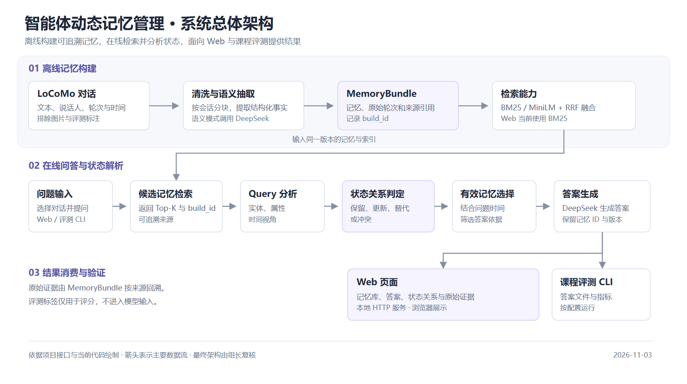
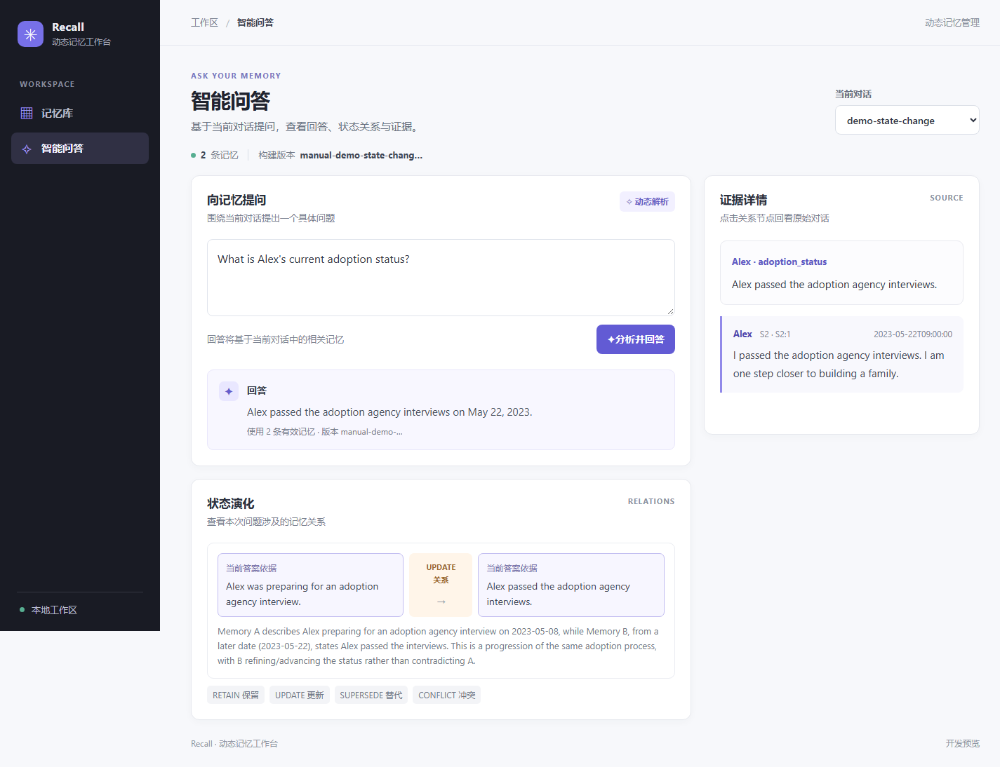

# 智能体动态记忆管理：最终报告

> 课程：软件需求工程  
> 团队：6767 组（队伍 ID：2）  
> 版本：v1.0-final-draft  
> 日期：2026 年 11 月  

<!--
写作说明：
1. 本文件是最终报告框架，不是最终交付稿。定稿时删除全部写作提示。
2. 统一区分“已实现”“已测试”“已验收”“待完成”，不得用设计目标代替实测结果。
3. 所有指标必须写明数据划分、方法版本、配置和样本量；未经真实实验不得填写估计值。
4. 标准答案、gold evidence 和状态关系标签只用于离线评测，不得进入记忆构建、检索或模型输入。
-->

## 填报责任总表

下面指定的是每个部分的**实际填写负责人**。主笔负责把内容写成可提交的正文；供稿人负责提供事实、配置、数据、图表或实现依据；复核人负责检查技术口径、数据真实性和前后一致性。没有明确交给个人的内容不得默认由文档主笔代写。

| 章节 | 主笔 / 实际填写人 | 供稿或数据提供 | 复核 |
| --- | --- | --- | --- |
| 摘要 | 张崇洋 | 全员各提供 3～5 条“结果、限制、贡献” | 陈易 |
| 1 引言 | 陈易 | 于国庆提供问题动机与技术定位 | 张崇洋 |
| 2.1 LoCoMo 数据 | 鲁瑞特 | 张崇洋补充评测口径 | 陈易 |
| 2.2 相关工作、2.3 方法定位 | 于国庆 | 鲁瑞特、张崇洋核对方法差异 | 陈易 |
| 3 需求分析 | 张崇洋 | 各模块负责人确认功能状态；陈易提供约束与变更 | 陈易 |
| 4 系统设计 | 陈易 | 鲁瑞特、于国庆、许子萌提供模块设计；许子萌负责架构图 | 张崇洋 |
| 5.1 记忆构建、5.2 混合检索 | 鲁瑞特 | 张崇洋提供对应测试与指标证据 | 于国庆 |
| 5.3 状态解析、5.4 答案生成 | 于国庆 | 张崇洋提供状态标签与测试结果 | 鲁瑞特 |
| 5.5 Web 应用 | 许子萌 | 陈易提供部署和接口信息 | 张崇洋 |
| 5.6 课程评测接口 | 张崇洋 | 陈易确认最终课程接口 | 于国庆 |
| 6.1 测试策略 | 张崇洋 | 各模块负责人提交测试记录 | 陈易 |
| 6.2 实验问题与假设、6.4 对照方法 | 于国庆 | 张崇洋确认指标可计算性 | 陈易 |
| 6.3 数据划分、6.5 指标定义 | 张崇洋 | 陈易确认课程要求 | 于国庆 |
| 7.1 开发集主结果、7.2 分对话结果 | 张崇洋 | 实际跑批数据，不允许他人估算或代填 | 于国庆 |
| 7.3 状态关系错误分析 | 于国庆 | 张崇洋提供混淆矩阵与错误记录 | 鲁瑞特 |
| 7.4 独立测试集结果 | 张崇洋 | 陈易负责确认冻结记录和数据隔离过程 | 于国庆 |
| 8.1 主要发现 | 张崇洋 | 于国庆、鲁瑞特核对技术结论 | 陈易 |
| 8.2 局限与未来工作 | 陈易 | 全员补充各自模块限制 | 张崇洋 |
| 9 项目管理与团队协作 | 陈易 | 全员确认个人贡献与行动计划偏差 | 张崇洋 |
| 10 结论 | 陈易 | 张崇洋提供最终实验结果 | 全员确认 |
| 附录 A 需求追踪与验收 | 陈易 | FR/NFR 对应负责人填写状态和证据 | 张崇洋 |
| 附录 B 运行与复现 | 陈易 | 鲁瑞特、于国庆、许子萌、张崇洋分别复核本模块命令 | 张崇洋 |
| 附录 C 接口与输出示例 | 陈易 | 于国庆、张崇洋核对推理和评测字段 | 鲁瑞特 |
| 附录 D 团队贡献 | 陈易汇总 | 每名成员先填写自己的贡献，不得由他人代写 | 张崇洋 |

### 图表占位清单

图表不是越多越好。正文保留下面这些必要图表；实际数据产生前只保留占位符，禁止使用示意数字代替实验结果。

| 编号 | 类型 | 内容 | 正文位置 | 生成与填写负责人 | 当前状态 |
| --- | --- | --- | --- | --- | --- |
| 图 1 | 架构图 | 系统总体架构与端到端数据流 | 4.1 | 陈易设计，许子萌绘制 | 已绘制，待架构复核 |
| 图 2 | 流程图 | 一个真实状态变化案例的 Memory 关系演化 | 5.3 | 于国庆 | 【待真实案例确认】 |
| 图 3 | 截图 | Web 问答、有效 Memory、证据与关系视图 | 5.5 | 许子萌 | 已截图（合成样例），待最终界面验收 |
| 图 4 | 分组柱状图 | 三种方法在开发集上的 QA F1 与 Recall 对比 | 7.1 | 张崇洋 | 【待真实实验结果】 |
| 图 5 | 混淆矩阵热力图 | 四类状态关系的判定结果 | 7.3 | 张崇洋生成，于国庆解释 | 【待人工关系标签】 |
| 表 1 | 数据表 | 功能需求与最终实现状态 | 3.2 | 张崇洋 | 【占位表已建立】 |
| 表 2 | 数据表 | 测试层次、工具与结果 | 6.1 | 张崇洋 | 【占位表已建立】 |
| 表 3 | 数据表 | 开发集主结果 | 7.1 | 张崇洋 | 【待真实实验结果】 |
| 表 4 | 数据表 | 开发集分对话结果 | 7.2 | 张崇洋 | 【待真实实验结果】 |
| 表 5 | 数据表 | 状态关系混淆矩阵 | 7.3 | 张崇洋 | 【待人工关系标签】 |
| 表 6 | 数据表 | 独立测试集主结果 | 7.4 | 张崇洋 | 【冻结后运行】 |
| 表 7 | 数据表 | 需求追踪与验收 | 附录 A | 陈易 | 【待最终验收填写】 |

图表文件约定：最终图片放入 `docs/figures/`，文件名使用 `fig-01-architecture.png`、`fig-04-dev-comparison.png` 这类小写短横线格式；原始数据或绘图脚本放入 `experiments/`，确保负责人能够从真实结果重新生成图表。每张图下方必须写明数据来源、样本量、实验配置编号和生成日期。

协作方式：各负责人通过独立分支提交自己负责的章节或 Markdown 片段，并附数据、截图或测试证据；张崇洋负责统一措辞与排版，陈易负责技术口径和最终交付完整性。不要多人同时直接修改同一份 `final-report.md`。

## 摘要

**填报责任：** 张崇洋主笔；全员提供结果、限制和贡献；陈易复核。

<!--
最后撰写，建议控制在 300～500 字。按以下顺序概括：
1. 长程多会话问答中，过期记忆与当前记忆混淆的问题；
2. 本组提出的“结构化记忆—混合检索—状态关系解析—有效记忆选择—答案生成”方法；
3. 系统实现范围与课程接口；
4. 开发集上的主要实验结果及与 Full Text、Vector RAG 的对比；
5. 结论、局限和主要贡献。
-->

【待最终实验完成后撰写】

**Web 模块供稿（待主笔整合）：**

- 已实现本地 Web 页面及 HTTP 接口，支持浏览预构建记忆、回看原始来源和查看问答与状态关系。
- 新版页面按“记忆库”和“智能问答”分为两个视图；当前 Web 问答使用 BM25 检索。
- 使用两条合成记忆完成一次浏览器真实问答演示，显示答案、UPDATE 关系及来源；这只是功能演示，不代表模型性能或正式验收。
- 当前页面依赖预先生成的 MemoryBundle；在线问答依赖模型服务，尚需结合最终版本开展完整验收。

**关键词：** 长期对话记忆；LoCoMo；动态状态解析；混合检索；有效记忆；软件需求工程

## 1 引言

**填报责任：** 陈易主笔；于国庆提供问题动机与技术定位；张崇洋复核。

### 1.1 问题背景

说明长程、多会话对话中的状态变化，以及普通向量 RAG 同时召回旧状态和新状态所造成的错误回答。应给出一个具体、脱敏的 LoCoMo 状态变化示例，但不得把示例结果冒充实验结论。

【待补：问题背景与一个真实状态变化示例】

### 1.2 项目目标

明确系统目标：

- 从 LoCoMo 对话中构建可追溯、带来源的结构化 Memory；
- 根据问题检索相关候选记忆；
- 判定 RETAIN、UPDATE、SUPERSEDE、CONFLICT 关系；
- 只使用当前仍然有效的记忆生成答案；
- 通过 Web 展示记忆、证据、答案与状态关系；
- 通过课程命令行接口输出答案并计算三项指标。

### 1.3 项目范围与边界

**范围内：** 单段 LoCoMo 对话内的文本记忆；记忆构建、混合检索、状态解析、答案生成、Web 展示和离线评测。

**范围外：** 多模态输入、跨对话记忆共享、模型训练或微调、面向公网的部署、物理设备控制，以及针对具体测试题写死规则。

### 1.4 主要贡献

从以下四个方面提炼，避免把普通工程实现包装成研究贡献：

1. 面向长对话状态变化的可追溯结构化 Memory；
2. 在检索与生成之间加入显式状态关系解析层；
3. 同时评价问答质量、证据召回和状态判断的课程评测链路；
4. 可复现的 Web 演示、实验记录与需求追踪材料。

【待根据最终实验结论调整措辞】

## 2 背景、数据与相关工作

**填报责任：** 各小节负责人不同，见下。

### 2.1 LoCoMo 数据

**填报责任：** 鲁瑞特主笔；张崇洋补充评测口径；陈易复核。

说明 LoCoMo 的多会话结构、QA、证据轮次与事件标注，并交代本项目的字段使用边界。

| 项目 | 内容 |
| --- | --- |
| 开发集 | `conv-26`、`conv-30`、`conv-41`、`conv-42` |
| 独立测试集 | 课程从其余对话中选取 2 段；具体编号与使用时间按课程通知记录 |
| 构建输入 | 原始对话文本、说话人、会话时间、轮次 ID |
| 禁止输入 | QA、标准答案、gold evidence、事件摘要及其他评测标签 |
| 文本范围 | 单段对话、文本轮次；过滤图片链接与空文本 |

### 2.2 相关工作

**填报责任：** 于国庆主笔；鲁瑞特、张崇洋核对方法差异；陈易复核。

简述三条相关工作线索，说明本项目借鉴了什么、没有复刻什么：

- LoCoMo 与长程对话记忆评测；
- DimMem 的结构化记忆与多维度检索；
- MRAgent 的 Cue–Tag–Content 图与主动检索。

【待补：每条工作的核心思想及与本项目的关系】

### 2.3 本文方法定位

**填报责任：** 于国庆主笔；陈易复核。

用一段话说明本组重点：采用轻量级结构化 Memory 和混合检索，不构建完整图记忆；核心差异是在答案生成前显式执行状态关系判定与有效记忆选择。

## 3 需求分析

**填报责任：** 张崇洋主笔；各模块负责人确认功能状态，陈易提供约束与变更；陈易复核。

### 3.1 用户与使用场景

| 用户 | 核心场景 | 主要需求 |
| --- | --- | --- |
| 项目开发成员 | 构建并检查 Memory、调试问答 | 数据可追溯、结果可复现 |
| 课堂演示者与听众 | 展示状态变化与系统依据 | Web 可视化、错误提示清楚 |
| 课程评测人员 | 批量提交问题并读取答案 | 参数化 CLI、固定输出格式 |
| 后续维护者 | 修改模块或复现实验 | 接口稳定、测试与文档完整 |

### 3.2 功能需求概览

**表 1 占位：功能需求与最终实现状态。** 由张崇洋根据实际验收结果填写，不能沿用计划阶段的状态。

| 功能 | 需求编号 | 实现模块 | 最终状态 |
| --- | --- | --- | --- |
| 结构化记忆构建与存储 | FR-01–FR-03 | `src/memory/`、`src/common/` | 【已实现/已测试/已验收】 |
| 有效记忆候选检索 | FR-04–FR-07 | `src/index/` | 【已实现/已测试/已验收】 |
| 动态状态解析与答案生成 | FR-08–FR-11 | `src/reasoning/` | 【已实现/已测试/已验收】 |
| Web 记忆与状态可视化 | FR-12–FR-15 | `src/web/` | 已测试（仅覆盖部分场景；最终验收待完成） |
| 评测与课程接口 | FR-16–FR-18 | `src/eval/`、`experiments/` | 【已实现/已测试/已验收】 |

### 3.3 非功能需求

概括可复现性、跨平台性、可追溯性、性能、信息安全和软件质量要求，并链接到 SRS 的 NFR 编号。不要重复粘贴完整 SRS；只保留与最终验收有关的要求。

### 3.4 需求变更

记录需求冻结前后的重要变化，例如取消 Web 上传 LoCoMo JSON 的需求、保留课程评测入口，以及相应文档和实现调整。每个变更写明原因、影响范围、确认人和对应提交或 PR。

## 4 系统设计

**填报责任：** 陈易主笔；鲁瑞特、于国庆、许子萌提供模块设计，许子萌负责架构图；张崇洋复核。

### 4.1 总体架构



*图 1：系统总体架构。数据来源：现有代码、接口定义与项目设计；样本量和实验配置不适用；绘制日期：2026-11-03。图示区分索引模块支持的检索能力与 Web 当前使用的 BM25，最终架构口径待组长及相关模块负责人复核。可编辑源文件：[`fig-01-architecture.svg`](figures/fig-01-architecture.svg)。*

给出一张最终架构图，至少包含：

```text
locomo.json
  → Memory 构建与校验
  → MemoryBundle（版本、来源、记忆）
  → BM25 / MiniLM / RRF
  → Query 分析
  → 状态关系判定
  → 有效记忆选择
  → DeepSeek 答案生成
  → Web 展示 / 课程 answers.json / 指标计算
```

强调离线构建与在线问答分离、历史事实保留、构建版本一致性和证据回溯。

### 4.2 数据模型与模块边界

用表格说明 `MemoryBundle`、`SourceRef`、`RetrievalResult`、`MemoryRelation`、`AnswerRecord` 的职责，以及它们如何连接各模块。字段细节引用 `docs/interfaces.md`，正文只解释关键契约与版本约束。

### 4.3 关键设计决策

| 决策 | 选择 | 原因 | 代价或限制 |
| --- | --- | --- | --- |
| 存储方式 | UTF-8 JSON | 简单、透明、便于课程交付 | 大规模并发与查询能力有限 |
| 检索 | BM25 + 向量 + RRF | 兼顾字面与语义匹配 | 增加索引和模型依赖 |
| 状态解析 | LLM 分组成对判定 | 能利用时间与上下文 | 有延迟、费用和稳定性风险 |
| 历史处理 | 构建时保留，查询时筛选 | 支持当前与历史问题 | 状态判断负担转移至在线阶段 |
| Web | 原生 HTML/CSS/JavaScript + Python 标准库 | 无前端构建步骤，便于复现 | 组件化和交互能力受限 |

### 4.4 错误处理与数据隔离

说明非法模型输出、API 重试、版本不匹配、来源缺失、空检索和 Web 请求错误的处理方式；再次明确评测标签不得进入构建与推理。

## 5 详细实现

**填报责任：** 各小节负责人不同，见下。

### 5.1 结构化记忆构建

**填报责任：** 鲁瑞特主笔；张崇洋提供测试证据；于国庆复核接口衔接。

说明：

- LoCoMo 读取、清洗、会话切块和来源 ID 保留；
- DeepSeek 结构化抽取，以及 `turns` 联调基线；
- 人物、属性、值、会话时间、事件时间和相对时间表达；
- `build_id`、缓存身份、Memory ID 与 JSON 原子保存；
- 构建阶段只保留历史，不提前删除旧状态。

### 5.2 混合检索与证据回溯

**填报责任：** 鲁瑞特主笔；张崇洋提供检索测试与指标证据；于国庆复核检索到推理的交接。

说明：

- BM25 的索引字段与适用问题；
- MiniLM 模型版本、编码和余弦相似度；
- 多路候选、Memory ID 去重与 RRF；
- 实体/属性过滤与稳定排序；
- Top-K 返回、原文来源回看和关联历史隔离。

### 5.3 动态状态解析

**填报责任：** 于国庆主笔；张崇洋提供状态标签和测试结果；鲁瑞特复核数据输入。

说明 Query 分析字段、候选记忆分组、四类关系含义，以及“缺少时间不得推测先后”等规则。

> **【图 2 占位：一个真实状态变化案例的 Memory 关系演化】**  
> 填写：于国庆；复核：鲁瑞特。  
> 只使用已经核对原始来源的真实 Memory，展示旧状态、新状态、关系类型和当前有效状态；不得使用人工编造的评测结果。最终图放在 `docs/figures/fig-02-state-evolution.png`。

| 关系 | 判定 | 当前问题下的处理 | 历史问题下的处理 |
| --- | --- | --- | --- |
| RETAIN | 可同时成立 | 保留 | 保留 |
| UPDATE | 后续信息补充或局部修改 | 使用更新后的有效状态 | 按问题时间范围选择 |
| SUPERSEDE | 新状态明确替代旧状态 | 过滤旧状态 | 保留旧状态用于回溯 |
| CONFLICT | 互斥且无法消解 | 两条均保留并提示冲突 | 两条均保留并提示冲突 |

### 5.4 答案生成

**填报责任：** 于国庆主笔；张崇洋提供问答结果；陈易复核课程输出要求。

说明输入仅包含问题、有效 Memory 和必要冲突提示；输出 `AnswerRecord`，包含答案、有效 Memory ID、冲突标记和 `build_id`。写明模型、prompt 版本、重试和空答案处理。

### 5.5 Web 应用

**填报责任：** 许子萌主笔；陈易提供部署与接口信息；张崇洋复核截图和演示步骤。

Web 模块由 `src/web/server.py` 和 `src/web/static/` 组成。服务使用 Python 标准库 `ThreadingHTTPServer` 提供静态页面和 JSON 接口，默认监听 `127.0.0.1:8000`；页面使用原生 HTML、CSS 和 JavaScript，无需前端构建。服务从 `WEB_MEMORY_DIR` 指定的目录读取预构建的 `MemoryBundle`。页面分为“记忆库”和“智能问答”：前者选择对话、检索并浏览记忆，点击记忆可回看对应原始轮次；后者提交问题，展示回答、有效记忆数量、构建版本、状态关系、判定理由和证据入口。图中被选作答案依据的关系节点会被突出显示。

| 接口 | 作用 |
| --- | --- |
| `GET /api/conversations` | 列出可用对话与构建信息 |
| `GET /api/memories?conversation_id=…` | 读取所选对话的记忆列表 |
| `GET /api/memories/{memory_id}?conversation_id=…` | 读取记忆详情与来源轮次 |
| `POST /api/ask` | 对指定对话和问题执行检索、状态解析、有效记忆选择与答案生成，返回答案及关系等信息 |

当前 Web 问答使用 BM25 检索，并调用已有推理与答案生成模块；Web 不重新判定记忆关系。页面会在切换对话时清除旧回答，在请求失败或版本不一致时显示错误。浏览记忆和来源不需要模型 API；在线问答需要配置可用的 DeepSeek 服务。当前页面不提供原始 LoCoMo 上传或 Memory 构建功能，应先在页面外准备好 MemoryBundle。



*图 3：新版 Web 演示截图。数据来源：仓库中的合成样例 `examples/demo_dynamic_memory.json`；样本量：1 次提问、2 条记忆；配置：BM25、DeepSeek 在线问答，`build_id=manual-demo-state-change-v1`，基于提交 `83636d6` 和本地未提交的前端修改；生成日期：2026-11-03。相关运行记录见 [`fig-03-web-demo-evidence.json`](figures/fig-03-web-demo-evidence.json)。该演示不作为 LoCoMo 实验结果或模型效果指标。*

演示时先选择 `demo-state-change`，在记忆库中查看记忆和来源，再进入智能问答页询问 “What is Alex's current adoption status?”。本次实际返回 Alex 已通过收养机构面试，并展示一条 `UPDATE` 关系；点击关系节点后可回看相应来源轮次。此记录只证明该样例当次运行及界面展示，不证明其他问题、全部关系类型或课程数据均已通过验收。

### 5.6 课程评测接口

**填报责任：** 张崇洋主笔；陈易确认最终课程接口；于国庆复核完整调用链。

给出最终可用命令和输入输出位置：

```text
python -m src.eval --conversation <conv_id> --questions <questions.json> \
  --output answers.json --metrics-output metrics.json
```

说明 live 模式是否使用预构建 Memory、离线评分模式、`answers.json` 字段，以及最终格式与助教通知的对应关系。不要在未验证时声称接口已通过课程验收。

## 6 测试与实验方法

**填报责任：** 以张崇洋为主，于国庆负责实验设计与对照方法；各模块负责人提供测试证据。

### 6.1 测试策略

**填报责任：** 张崇洋主笔；各模块负责人提交测试记录；陈易复核。

**表 2 占位：测试层次、工具与最终结果。** 各模块负责人提供测试记录，张崇洋汇总；不能只写“测试通过”，必须写清命令、数量和日期。

| 层次 | 验证内容 | 工具或证据 | 最终结果 |
| --- | --- | --- | --- |
| 单元测试 | 数据契约、检索、关系选择、指标计算 | pytest | 【填写通过数/失败数】 |
| 静态检查 | 格式、未使用导入、行宽等 | Ruff | 【填写结果】 |
| 集成测试 | Memory→检索→推理→答案→指标 | pytest + CLI | 【填写结果】 |
| 真实数据测试 | DeepSeek 抽取、四段开发集 Memory | 实际命令与产物 | 【填写结果】 |
| Web 验收 | 浏览、证据、问答、关系图 | Chrome 浏览器自动操作与图 3；见 §5.5 和附录 A | 2026-11-02：四个对话选项、记忆与证据、视图切换、对话切换及窄屏布局检查；问答交互使用模拟响应。2026-11-03：1 次两条合成记忆的真实在线问答；仅为局部测试，最终验收待完成 |
| 跨平台验收 | Python 3.11、macOS、Windows | 两平台测试记录 | 【填写结果】 |

### 6.2 实验问题与假设

**填报责任：** 于国庆主笔；张崇洋确认每个研究问题都能由实际指标回答。

建议用研究问题组织实验，而不是只罗列指标：

| 编号 | 研究问题 | 可检验假设 |
| --- | --- | --- |
| RQ1 | 结构化 Memory 能否保留回答问题所需的证据？ | 本组方法的 Recall@K 不低于 Vector RAG，或能说明差异来源 |
| RQ2 | 状态关系解析能否减少过期记忆造成的错误？ | 本组方法的 QA F1 优于不做状态判断的 Vector RAG |
| RQ3 | 显式状态解析的收益是否值得额外 token 与延迟？ | 以 F1、平均 token 和耗时的联合结果判断 |
| RQ4 | 系统在未见测试对话上是否仍成立？ | 冻结配置后独立测试集结果与开发集结论方向一致 |

### 6.3 数据划分与防泄漏

**填报责任：** 张崇洋主笔；陈易确认课程要求；于国庆复核训练、调试和测试边界。

- 开发集用于 prompt、检索参数、K 值和错误修复；
- 独立测试集在方案冻结后运行，不根据测试结果调参；
- 标准答案、gold evidence 和状态标签只用于评分；
- 记录是否有预构建 Memory，并确保测试阶段不访问人工标签；
- 报告开发集结果和测试集结果，不能只报告较好的部分。

### 6.4 对照方法

**填报责任：** 于国庆主笔；张崇洋确认基线可运行和可比较；陈易复核。

| 方法 | 输入范围 | 是否检索 | 是否状态解析 | 用途 |
| --- | --- | --- | --- | --- |
| Full Text | 对话全文 | 否 | 否 | 检验直接长上下文回答 |
| Vector RAG | 向量 Top-K Memory | 是 | 否 | 隔离普通语义检索效果 |
| 本组方法 | BM25 + 向量 + RRF 候选 | 是 | 是 | 验证完整方案 |

三个方法必须使用相同数据、问题、生成模型和评分口径；不同的模型参数或数据处理必须单独记录。

### 6.5 指标定义

**填报责任：** 张崇洋主笔；陈易确认课程口径；于国庆复核状态指标定义。

| 指标 | 定义 | 汇总方式 | 备注 |
| --- | --- | --- | --- |
| QA F1 | 生成答案与标准答案的词级 F1 | 宏平均 | 按课程指定口径 |
| Recall@K | 前 K 条 Memory 的来源是否覆盖至少一条关键证据 | Recall@1、Recall@5 | gold evidence 只用于评分 |
| 状态更新准确率 | 四类关系判定正确比例 | 总体准确率 + 混淆矩阵 | 同时报告各类样本量 |
| 平均 token | 每方法每题输入与输出 token 总和 | 算术平均 | 记录模型与计费口径 |
| 平均耗时 | 每题问答耗时 | 算术平均；另报中位数 | 标明设备和网络条件 |

## 7 实验结果与分析

**填报责任：** 张崇洋负责真实跑批、数据和主结果；于国庆负责状态错误分析。

> 本节只能填写真实运行结果。未运行的实验保留“待完成”，不得生成示意分数。

### 7.1 开发集主结果

**填报责任：** 张崇洋根据实际运行结果填写；于国庆复核方法差异；陈易复核数据划分。

**表 3 占位：开发集主结果。** 四段开发对话全部运行后填写。

| 方法 | QA F1 | Recall@1 | Recall@5 | 状态更新准确率 | 平均 token | 平均耗时 |
| --- | ---: | ---: | ---: | ---: | ---: | ---: |
| Full Text | 【待填】 | 不适用 | 不适用 | 不适用 | 【待填】 | 【待填】 |
| Vector RAG | 【待填】 | 【待填】 | 【待填】 | 不适用 | 【待填】 | 【待填】 |
| 本组方法 | 【待填】 | 【待填】 | 【待填】 | 【待填】 | 【待填】 | 【待填】 |

> **【图 4 占位：三种方法的开发集主结果对比图】**  
> 生成：张崇洋；复核：于国庆。  
> 建议使用分组柱状图展示 QA F1、Recall@1、Recall@5；状态准确率只比较本组方法与可计算该指标的方法。图只能由表 3 的真实数据生成，最终图放在 `docs/figures/fig-04-dev-comparison.png`。

分析必须回答：

- 本组方法与两个基线相比，在哪项指标上提升或退化；
- 差异可能来自检索、状态过滤还是答案生成；
- 提升是否足以抵消 token、耗时和复杂度；
- 结果波动是否超过样本差异可解释的范围。

### 7.2 分对话结果

**填报责任：** 张崇洋根据实际运行结果填写；鲁瑞特复核检索相关失败；于国庆复核状态相关失败。

**表 4 占位：开发集分对话结果。** 每行是一段开发对话，不是独立测试集。

| 对话 | 问题数 | QA F1 | Recall@5 | 状态准确率 | 主要失败类型 |
| --- | ---: | ---: | ---: | ---: | --- |
| `conv-26` | 【待填】 | 【待填】 | 【待填】 | 【待填】 | 【待填】 |
| `conv-30` | 【待填】 | 【待填】 | 【待填】 | 【待填】 | 【待填】 |
| `conv-41` | 【待填】 | 【待填】 | 【待填】 | 【待填】 | 【待填】 |
| `conv-42` | 【待填】 | 【待填】 | 【待填】 | 【待填】 | 【待填】 |

### 7.3 状态关系错误分析

**填报责任：** 于国庆主笔；张崇洋提供混淆矩阵和逐题记录；鲁瑞特复核实体、属性和时间来源。

填写四类关系的混淆矩阵，并解释主要混淆方向，例如 UPDATE 与 SUPERSEDE 边界不清、时间缺失导致 CONFLICT、实体或属性抽取错误。

**表 5 占位：状态关系混淆矩阵。** 行是人工真实标签，列是系统预测标签；样本量必须单独报告。

| 真实类别 \ 预测类别 | RETAIN | UPDATE | SUPERSEDE | CONFLICT |
| --- | ---: | ---: | ---: | ---: |
| RETAIN | 【待填】 | 【待填】 | 【待填】 | 【待填】 |
| UPDATE | 【待填】 | 【待填】 | 【待填】 | 【待填】 |
| SUPERSEDE | 【待填】 | 【待填】 | 【待填】 | 【待填】 |
| CONFLICT | 【待填】 | 【待填】 | 【待填】 | 【待填】 |

> **【图 5 占位：状态关系混淆矩阵热力图】**  
> 生成：张崇洋；解释：于国庆；复核：鲁瑞特。  
> 热力图必须与表 5 的数值完全一致，并显示类别样本量。最终图放在 `docs/figures/fig-05-confusion-matrix.png`。

### 7.4 独立测试集结果

**填报责任：** 张崇洋在冻结后实际运行并填写；陈易记录冻结过程和数据隔离，于国庆复核结论。

在方案和代码冻结后填写。必须说明测试对话何时由课程公布、运行前是否修改代码、是否接触标签，以及最终提交对应的 commit/tag。

**表 6 占位：独立测试集主结果。** 这是两段测试对话的汇总结果，不是两套独立测试集。

| 方法 | QA F1 | Recall@1 | Recall@5 | 状态更新准确率 | 平均 token |
| --- | ---: | ---: | ---: | ---: | ---: |
| Full Text | 【待填】 | 不适用 | 不适用 | 不适用 | 【待填】 |
| Vector RAG | 【待填】 | 【待填】 | 【待填】 | 不适用 | 【待填】 |
| 本组方法 | 【待填】 | 【待填】 | 【待填】 | 【待填】 | 【待填】 |

## 8 讨论

**填报责任：** 各小节负责人不同，见下。

### 8.1 主要发现

**填报责任：** 张崇洋主笔；于国庆和鲁瑞特核对技术解释；陈易复核结论边界。

用 3～5 条结论回答研究问题。每条结论必须对应实验结果、测试证据或明确的定性观察。

### 8.2 局限与未来工作

**填报责任：** 陈易主笔；全员补充各自模块限制；张崇洋复核。

明确当前不包含大规模并发、图记忆、多跳主动检索、完整多模态和跨对话共享；若未来扩展，说明预计收益、额外成本和验证方式。

**Web 模块供稿：** 当前服务主要面向本机演示，未验证公网部署与大规模并发；页面依赖预构建 MemoryBundle，不能直接上传原始对话完成构建；问答依赖模型 API，输出与响应时间受服务状态影响。图 3 的单次合成样例不能替代四段开发数据的批量评测，也不能证明四类关系均已完成验收。

## 9 项目管理与团队协作

**填报责任：** 陈易主笔；全员确认个人贡献、实际进度和计划偏差；张崇洋复核。

### 9.1 里程碑完成情况

| 里程碑 | 计划交付 | 实际完成时间 | 证据 | 偏差与原因 |
| --- | --- | --- | --- | --- |
| 团队工作流 | 文档、process、slides | 【待填】 | tag / 邮件记录 | 【待填】 |
| Proposal | 范围和路线图 slides | 【待填】 | tag / PR | 【待填】 |
| SRS | IEEE 830 改编需求文档 | 【待填】 | tag / PR | 【待填】 |
| 中期设计与测试 | 文档、代码、slides | 【待填】 | tag / PR | 【待填】 |
| 最终交付 | 报告、代码、演示、process | 【待填】 | `v1.0-final` | 【待填】 |

### 9.2 团队分工

概述五名成员的主责和交叉备份，不重复完整分工表。注明各模块最终实际贡献，以及原计划与实际执行的差异。

### 9.3 过程管理

摘要说明：

- 固定周会、主持人和纪要轮值；
- 每周计划、行动项、负责人和完成状态；
- GitHub 分支、约定式提交、PR、Non-author approval 和 Squash merge；
- 里程碑 tag、版本控制和过程材料归档；
- 不配置 CI 时由本地 Ruff、pytest 和 PR 检查记录承担质量把关。

### 9.4 复盘

说明哪些计划有效、哪些风险实际发生、团队如何调整。避免只写“合作良好”；至少给出一个延期、冲突或需求变更的处理实例。

## 10 结论

**填报责任：** 陈易主笔；张崇洋提供最终实验结论；全员确认。

回答三个问题：

1. 系统是否完成了课程要求的端到端链路；
2. 状态关系解析是否在两个基线之外带来可验证的效果；
3. 当前结果在什么范围内成立，哪些问题仍待解决。

【待最终实验完成后定稿】

## 附录

### 附录 A 需求追踪与验收

**填报责任：** 陈易主笔；各需求与模块负责人确认状态和证据；张崇洋复核。

将 FR-01 至 FR-18、NFR、实现位置、测试用例、实验指标和最终状态汇总为一张表。状态只能使用“已实现”“已测试”“已验收”之一，并附证据链接。

**表 7 占位：需求追踪与验收。** 最终每一项都必须有实现位置、测试证据和验收状态。

**Web 模块供稿：** 以下“已测试”仅指所列范围，不表示对应需求的全部验收条件均已通过；代码位置为 `src/web/`，最终状态由验收负责人复核。

| 需求 | 状态 | 当前证据与未覆盖范围 |
| --- | --- | --- |
| FR-12 记忆浏览 | 已测试 | 2026-11-02 浏览器加载四个对话选项，查看记忆并切换对话；筛选、空数据和异常等完整验收条件待补测。 |
| FR-13 来源回看 | 已测试 | 浏览器点击记忆及关系节点后显示来源轮次；多来源、重复来源和错误引用等完整验收条件待补测。 |
| FR-14 Web 问答 | 已测试 | 2026-11-02 使用模拟响应检查问答展示和切换对话后的清理；2026-11-03 对两条合成记忆完成一次真实问答，见图 3 和运行记录。课程数据、错误及版本异常场景待补测。 |
| FR-15 状态关系视图 | 已测试 | 图 3 显示一次真实问答中的 UPDATE、关系理由和证据入口；其余关系类型、空关系和异常输入待补测。 |

### 附录 B 运行与复现

**填报责任：** 陈易主笔；鲁瑞特、于国庆、许子萌、张崇洋分别复核本模块命令；张崇洋复核最终文档。

列出环境准备、数据放置、Memory 构建、Web 启动、CLI 问答、指标计算和测试命令。确保命令来自最终冻结版本。

**Web 模块供稿：** Windows PowerShell 下，在项目根目录安装项目依赖、创建 `.env` 并配置本机模型密钥后，可用合成样例启动：

```powershell
$env:WEB_MEMORY_DIR = 'examples'
.\.venv\Scripts\python.exe -m src.web.server
```

在浏览器打开 `http://127.0.0.1:8000/`。以上假定已存在项目虚拟环境 `.venv`；默认端口可由 `WEB_PORT` 覆盖。使用四段开发对话时，将 `WEB_MEMORY_DIR` 改为实际 MemoryBundle 所在目录，如 `outputs/milestone5-b/memory`，并先确认目录中已有可用 JSON 文件。在线问答需要可用的 DeepSeek 配置；密钥仅保存在本机，不写入报告或仓库。该命令已用于当前本地工作树的演示，最终冻结版本仍需复核。

### 附录 C 接口与输出示例

**填报责任：** 陈易主笔；鲁瑞特确认数据契约，于国庆确认推理字段，张崇洋确认评测输出。

给出 `MemoryBundle`、`MemoryRelation`、`AnswerRecord`、`answers.json` 和 `metrics.json` 的精简示例；指出完整契约所在文件。

### 附录 D 团队贡献

**填报责任：** 每名成员先填写自己的模块、文档、实验和复核贡献；陈易汇总并核对 Git 记录；张崇洋复核。

按成员列出负责模块、文档章节、实验工作和交叉复核事项，并与 Git 提交记录和 PR 保持一致。

**许子萌（待本人核对并确认）：** Web 应用与可视化，包括页面和 HTTP 接口、记忆及来源展示、问答和状态关系视图；为最终报告提供 Web 章节、演示截图、总体架构图与本模块测试记录。新版前端目前包含本地未提交修改，最终交付版本和个人贡献应结合 Git / PR 记录确认。
